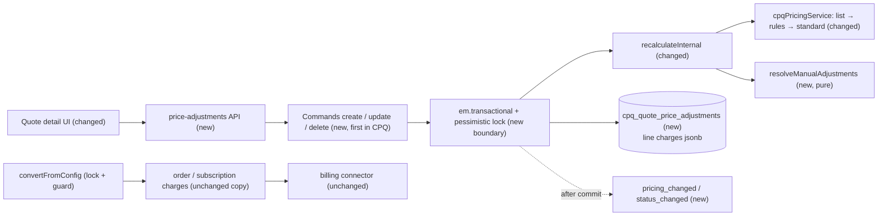
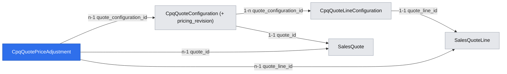

# CPQ manual price adjustments (permanent) with a price waterfall and pricing signals

Extends: specs/implementation/xd-188-price-rules.md
Extends: specs/implementation/xd-201-quoting.md
Extends: specs/implementation/xd-187-calculate-price-api.md

App Spec: `.ai/specs/2026-11-10-app-spec-cpq-quote-price-adjustments.md` (source of truth — §1.3 glossary, §1.4 domain model, §7 Phase 1). Brief: `.ai/specs/briefs/2026-11-10-cpq-price-adjustments-manual-adjustments.md`. Depends on: `.ai/specs/2026-11-10-cpq-quote-pricing-integrity.md` (recalculate hardening, frozen Amend lines, guard API verified). Stories: US-1.1, 1.2, 1.5–1.9, 2.1, 4.1–4.3, 0.1, 0.2.

## 📝 TLDR
Sales reps need to set negotiated prices on CPQ quotes; today the engine's price (list price after price rules) is final. **Proposed (future behavior):** reps add manual price adjustments — a new unit price, an amount off, or a percentage on a charge or a whole line — evaluated in the same waterfall as price rules, so every charge records list, standard (after rules) and offer price; offer prices flow unchanged to orders, subscriptions and billing for new sales, and CPQ emits pricing / status events that project approval workflows hook into.

## Resolved assumptions (autonomous defaults)

| # | Question | Default | Rationale |
|---|---|---|---|
| Q1 | Bundle pricing signals with adjustments? | Yes — events ship here; guards on existing routes ship in `quote-pricing-integrity` | `pricing_changed` / `status_changed` carry the waterfall snapshot defined here. |
| Q2 | Command pattern for adjustment writes? | Yes — `cpq.quote_price_adjustment.create / update / delete` with undo | Framework rule (AGENTS.md, CPQ SKILL "Commands for writes"). These are the **first commands in CPQ**. |
| Q3 | Preview location | `POST /api/cpq/quotes/{quoteId}/price-adjustments/preview` | Keeps `recalculate` unchanged; no persistence, no events. |
| Q4 | Adjustments on ARC mirror lines (Amend / Renew)? | Not allowed until `arc-continuity` (`LINE_NOT_ELIGIBLE`); new `add` lines on ARC quotes are adjustable | `modify` price changes reach CPQ inventory but not billing (amend / renew events carry only added and removed items, `cpqOrderService.ts:1220-1302`); `add` lines reach billing as added items. |
| Q5 | `discountTotal` | Unchanged (deprecated); new `ruleDiscountTotal` / `manualDiscountTotal` both include line quantity | Today's formula omits the line quantity (`cpqQuotingService.ts:1269-1283`); summing a corrected and an uncorrected figure would be wrong. |
| Q6 | Calculate-price waterfall fields | Opt-in `includeWaterfall: true` | The public Puffin calculator proxies charges to anonymous visitors (`demo_puffin/api/cloud-pricing-calculator/price/route.ts`); nothing new leaks by default. |
| Q7 | Rollback lever | Feature toggle `cpq.manual_price_adjustments` gates writes and UI; the resolver keeps applying stored adjustments | Turning writes off must not reset negotiated prices. Verified in installed Open Mercato 0.9.0: `featureTogglesService.getBoolConfig` resolves tenant overrides; writes fail closed when missing or disabled. |

## 📝 Problem Statement

- **No negotiated pricing.** `cpqQuotingService` writes engine output into each line and the sales line (`cpqQuotingService.ts:236-275, 847-875`); sales `discountAmount` / `discountPercent` are hard-coded `'0'`. Reps negotiate off-system.
- **Rules hide the starting point.** The pre-rule price is not stored (`cpqPricingService.ts:164-238`); a manager cannot tell an engine-granted discount from a negotiated one.
- **No pricing signal.** CPQ emits no quote events (`events.ts`), so approvals cannot be configured.
- **Evidence it matters:** the App Spec's primary goal (≥ 95% of non-standard-price deals priced in CPQ) is 0% by construction today.

## 📝 Prior spec drift

- `xd-188-price-rules.md` §Gaps (l.490) says `CpqPriceRule` / `applyPriceRules()` do not exist — they do (`entities.ts:567-624`, `cpqPricingService.ts:164-238`).
- `xd-188-price-rules.md` l.193 says no discount summary — `pricingSummary.discountTotal` exists.
- `xd-201-quoting.md` l.432 defines `discountTotal` with the line quantity and `discount_*` rules only — the code sums every negative rule delta × `charge.quantity` without the line quantity. Kept as is (Q5).
- `xd-187` / `manuals/xd-188-price-rules.md` examples call `/api/cpq/cpq-quotes/price` — the route is `api/quotes/price/route.ts` → `/api/cpq/quotes/price`.

## 📝 Proposed Solution

**One waterfall, two origins.** `resolveProductCharges` records `listUnitPrice/listTotalPrice` before the rule pass and `standardUnitPrice/standardTotalPrice` after it, tagging rule adjustments `origin: 'rule'`. A pure resolver applies **manual adjustments** (table `cpq_quote_price_adjustments`) to the standard price and appends `origin: 'manual'` entries. Every save path already ends in `recalculateInternal` (`cpqQuotingService.ts:320, 464, 521, 698`), so the waterfall is computed in one place.

Rules (App Spec R1–R8, permanent only):
- Levels `charge` (line + `chargeCode`) and `line` (all charges, optional `nrc` / `mrc` filter, cascading to bundle child lines). Most specific valid adjustment wins; never compounded.
- Types `discount_percent` (any level), `discount_absolute` (charge; off the per-instance charge total), `price_override` (charge; unit price; `flat` / `per_unit` only). Rule formulas; floor 0; never above standard.
- Eligible lines: engine-priced, not an ARC mirror line (Q4).
- Invalid adjustments (target missing / ambiguous, above standard, currency) are kept, skipped (fallback to the next valid one, else standard), flagged, and make the line `incomplete`; conversion is refused while the stored snapshot contains one.
- Adjustment lock: writes only in `new` / `incomplete` / `ready` and while no order exists; deleting an invalid adjustment is allowed in non-terminal statuses.

**Transaction and lock model (new to CPQ).** Every price-affecting write — adjustment command, line add / update / remove, saved recalculation, clone, status transition, conversion — runs inside one `em.transactional(...)`: (1) load `CpqQuoteConfiguration` with a pessimistic write lock (`LockMode.PESSIMISTIC_WRITE`), (2) check status / lock / `expectedRevision`, (3) mutate, (4) recalculate on the same EM (`withAtomicFlush` where queries follow mutations), (5) `pricing_revision += 1`, (6) commit; events are dispatched **after** commit. The existing flush → `recalculateInternal` → flush sequences (`cpqQuotingService.ts:317-320, 462-464, 519-521, 923`) are folded into this boundary; `recalculate(save)` stops forking the EM for writes (`:545`). Conversion (`convertFromConfig`) takes the same lock before reading status and adjustments, so "no order exists" cannot race.

**Signals.** `cpq.quote.pricing_changed` (stored `snapshotHash` changed) and `cpq.quote.status_changed` (manual and automatic transitions), after commit. Enforcement of approvals exists only when a project registers a mutation guard (status changes are operator-driven any → any, `services/types.ts:63-65`).

**Alternatives considered:** editing `charges` jsonb (overwritten on recalculation); sales `AdjustmentKind` (no charge / month dimension, two sources of truth); quote-scoped rows in `cpq_price_rules` (deal data in catalog configuration and permissions); compounding (unpredictable price and approval math).

**Research (market leaders):** Salesforce CPQ's waterfall List → Special → Regular → Customer (rep's additional discount) → Partner → Net with one additional discount per line and a quote-level default → adopted: three stored prices, one manual adjustment per charge, most-specific-wins (quote level in a later feature); a per-offering *non-discountable* flag is a follow-up suggestion. Odoo: line discount % with engine-side pricelists → confirms the minimal path; we add charge granularity because CPQ lines carry several charges. Stripe / Chargebee coupon durations → informs the later time-windows feature.

## 📝 Delta

### Capability: cpq-quote-pricing

#### ADDED Requirement: Manual price adjustment on a charge
The system SHALL let a user with `cpq.quotes.manage` and `cpq.quotes.adjust_price` set a new unit price, an amount off, or a percentage discount on one charge of an eligible quote line, and SHALL price that charge at the adjusted value while recording list, standard and offer price.

##### Scenario: Override a setup fee
- WHEN a rep sets `price_override` 80 with reason `competitive_match` on charge `setup_fee` whose standard price is 100
- THEN the charge's offer `unitPrice` is 80, `standardUnitPrice` 100, an `adjustments[]` entry with `origin: 'manual'` and `delta: -20` exists, and `pricingRevision` increases by 1

##### Scenario: Override above standard
- WHEN a rep sets `price_override` 120 on a charge whose standard price is 100
- THEN the API returns `422 ABOVE_STANDARD` and nothing is stored

##### Scenario: ARC mirror line
- WHEN a rep adjusts a mirror line of an Amend or Renew quote
- THEN the API returns `422 LINE_NOT_ELIGIBLE`

#### ADDED Requirement: Percentage discount on a line
The system SHALL apply a line-level `discount_percent` to every charge of the line (optionally only `nrc` or `mrc`) and of its bundle child lines that has no more specific valid manual adjustment.

##### Scenario: Line discount with a charge override
- WHEN a line has a 15% line discount and a charge-level override on `setup_fee`
- THEN `setup_fee` uses the override and every other charge is 15% below standard

#### ADDED Requirement: Price waterfall on every charge
The system SHALL expose on every resolved quote charge its list, standard and offer price and the ordered rule and manual adjustments between them; charges saved before this change SHALL derive list and standard prices when read.

##### Scenario: Quote without adjustments
- WHEN a quote has no manual adjustments
- THEN offer equals standard and `unitPrice`, `totalPrice`, line and quote totals equal the values produced before this change

#### ADDED Requirement: Invalid manual adjustments are surfaced, not applied
The system SHALL keep a manual adjustment whose target charge no longer resolves (or resolves ambiguously), whose override exceeds the current standard price, or whose currency differs from the quote, SHALL NOT apply it, SHALL fall back to the next valid adjustment or the standard price, and SHALL mark the line `incomplete` (and the quote `incomplete` when it is in an auto-managed status).

##### Scenario: Configuration removes the adjusted charge
- WHEN a line's configuration changes so `setup_fee` no longer applies
- THEN the adjustment remains with error `ADJUSTMENT_TARGET_MISSING`, the line is `incomplete`, and a `ready` quote becomes `incomplete`

#### ADDED Requirement: Adjustment lock
The system SHALL reject creating or changing manual adjustments unless the quote status is `new`, `incomplete` or `ready` and no order exists for the quote, and SHALL allow deleting an invalid adjustment in any non-terminal status.

##### Scenario: Edit after submission
- WHEN a rep changes an adjustment on a quote in `in_approval`
- THEN the API returns `409 ADJUSTMENT_LOCKED` and nothing changes

#### ADDED Requirement: Adjustment preview
The system SHALL price a draft adjustment against the current quote without persisting anything or emitting events.

##### Scenario: Preview
- WHEN a rep previews a 10% line discount
- THEN the response contains the re-priced quote and no adjustment row, revision change or event exists afterwards

#### ADDED Requirement: Adjustments follow quote copies and line removal
The system SHALL copy all manual adjustments when a quote is cloned (new ids, remapped lines, invalid ones stay invalid) and SHALL soft-delete a line's adjustments when the line is removed.

##### Scenario: Clone
- WHEN a quote with a charge override and a line discount is cloned
- THEN the clone shows the same offer prices and has its own two adjustment rows

##### Scenario: Line removal
- WHEN a line with an adjustment is removed
- THEN its adjustment is soft-deleted in the same transaction

#### ADDED Requirement: Rule and manual discount totals
The system SHALL report `ruleDiscountTotal` and `manualDiscountTotal` (both including the line quantity), list / standard totals, deal values, signed discount depth and a snapshot hash in `pricingSummary`, and SHALL leave `discountTotal` unchanged.

##### Scenario: Manual discount counted
- WHEN a line of quantity 2 has a charge with standard total 100 and offer total 80
- THEN `manualDiscountTotal` includes 40 and `discountTotal` equals its value before this change

### Capability: cpq-quote-lifecycle

#### MODIFIED Requirement: Quote to order conversion
The system SHALL refuse to convert a quote whose stored pricing contains an invalid manual adjustment, in addition to today's `cancelled` / `rejected` refusal, and SHALL take the quote's pricing lock while converting.

##### Scenario: Invalid adjustment blocks conversion
- WHEN an accepted quote's stored line carries `ADJUSTMENT_TARGET_MISSING`
- THEN conversion returns `422 ADJUSTMENT_INVALID` naming the line and no order is created

Frozen by: `packages/cpq/src/modules/cpq/services/__tests__/cpqOrderService.test.ts`

#### ADDED Requirement: Quote pricing and status events
The system SHALL emit `cpq.quote.pricing_changed` after a committed save that changes the quote's snapshot hash, and `cpq.quote.status_changed` after every committed status change (manual or automatic), each with the pricing snapshot.

##### Scenario: No-op recalculation
- WHEN a saved recalculation produces the same snapshot hash
- THEN no `cpq.quote.pricing_changed` is emitted

##### Scenario: Reason edit
- WHEN a rep only changes an adjustment's reason note
- THEN no `cpq.quote.pricing_changed` is emitted (reason fields are not hash inputs)

##### Scenario: Legacy quote baseline
- WHEN a quote created before this change is saved for the first time and its offers are unchanged
- THEN its snapshot hash is stored and no `cpq.quote.pricing_changed` is emitted

##### Scenario: Automatic status change
- WHEN deleting the last invalid adjustment moves the quote from `incomplete` to `ready`
- THEN `cpq.quote.status_changed` is emitted with `cause: 'auto'`

### Capability: cpq-calculate-price

#### ADDED Requirement: Optional waterfall fields in the calculate-price API
The calculate-price API SHALL return `listUnitPrice`, `listTotalPrice`, `standardUnitPrice` and `standardTotalPrice` only when the request sets `includeWaterfall: true`, SHALL tag rule adjustments `origin: 'rule'`, and SHALL never apply manual adjustments.

##### Scenario: Default request
- WHEN a caller posts to `/api/cpq/quotes/price` without `includeWaterfall`
- THEN the response has today's fields plus `origin` on adjustments

## 📝 Architecture

Primary module: `@dainamite/cpq`. No change to `@dainamite/billing` or the connector — new-sale offer totals already reach billing (`cpqOrderService.ts:1164-1198`); ARC price changes wait for `arc-continuity` (Q4).



Takeaway: everything new sits inside CPQ's quote path behind one transaction boundary; downstream modules consume the same offer totals as today.

## 📝 Data Model

### New entity `CpqQuotePriceAdjustment` → table `cpq_quote_price_adjustments`

| Column | Type | Null | Notes |
|---|---|---|---|
| `id` | uuid PK `gen_random_uuid()` | no | |
| `organization_id`, `tenant_id` | uuid | no | indexed with the FK columns below |
| `quote_configuration_id` | uuid | no | FK string → `cpq_quote_configurations.id` |
| `quote_id` | uuid | no | FK string → `sales_quotes.id` |
| `level` | text | no | `charge` \| `line` (this spec) |
| `quote_line_id` | uuid | no (this spec) | FK string → `sales_quote_lines.id` |
| `charge_code` | text | yes | required for `charge` |
| `charge_type_filter` | text | yes | `nrc` \| `mrc`; `line` only |
| `adjustment_type` | text | no | `discount_percent` \| `discount_absolute` \| `price_override` |
| `value` | numeric(18,4) | no | |
| `currency_code` | text | yes | required for absolute / override |
| `window_kind` | text | no | default `relative` |
| `from_month` | integer | no | default 1 (only `1` accepted here) |
| `to_month` | integer | yes | only `null` accepted here |
| `reason_code` | text | no | entry of dictionary `cpq.price_adjustment_reason` |
| `reason_note` | text | yes | ≤ 500; required for `other` |
| `created_by_user_id` | uuid | no | |
| `updated_by_user_id` | uuid | yes | |
| `created_at`, `updated_at`, `deleted_at` | timestamptz | `deleted_at` yes | soft delete |

Indexes `cpq_qpa_quote_config_idx (organization_id, tenant_id, quote_configuration_id)`, `cpq_qpa_quote_line_idx (organization_id, tenant_id, quote_line_id)`. Window columns exist now with their final meaning so `time-windows` adds behaviour, not schema; carry-over columns arrive with `arc-continuity`.

### Changed
- `CpqQuoteConfiguration.pricing_revision integer not null default 0`.
- `ResolvedCharge` jsonb (quote line charges, copied to order lines / subscription items): `listUnitPrice`, `listTotalPrice`, `standardUnitPrice`, `standardTotalPrice`, `adjustmentErrors[]`; `adjustments[].origin` (+ `adjustmentId`, `class`, `level`, `windowKind`, `fromMonth`, `toMonth`, `reasonCode` on manual entries).
- `pricingSummary` jsonb: `listNrcTotal`, `listMrcTotal`, `standardNrcTotal`, `standardMrcTotal`, `ruleDiscountTotal`, `manualDiscountTotal`, `dealValue {list, standard, offer}`, `discountDepth {rule, manual, total, maxLineManual}`, `hasTimeBasedAdjustments` (always `false` here), `snapshotHash`; `discountTotal` unchanged.

Migration via `yarn mercato db generate`; additive. Reason notes are business free text, tenant-scoped like other quote data; no PII expected (UI hint: "no customer personal data").



## 📝 API Contracts

Routes under `packages/cpq/src/modules/cpq/api/`, Next.js style, `export const openApi`, Zod, `QuotingError` → status, mutation guards before / after every write (API verified in `quote-pricing-integrity`). `{quoteId}` is the CPQ quote id.

| Method | Path | Features | Request | Response |
|---|---|---|---|---|
| GET | `/api/cpq/quotes/{quoteId}/price-adjustments` | `cpq.quotes.view` | `?page&pageSize≤100` | `{ items, total, pricingRevision }` |
| POST | `/api/cpq/quotes/{quoteId}/price-adjustments` | `cpq.quotes.manage`, `cpq.quotes.adjust_price` | `PriceAdjustmentInput` | `201 { adjustment, quote: QuoteResult }` |
| PATCH | `/api/cpq/quotes/{quoteId}/price-adjustments/{adjustmentId}` | same | `{ adjustmentType?, value?, currencyCode?, chargeTypeFilter?, reasonCode?, reasonNote?, expectedRevision? }` (level / target immutable) | `{ adjustment, quote }` |
| DELETE | `/api/cpq/quotes/{quoteId}/price-adjustments/{adjustmentId}` | same | `?expectedRevision` | `{ quote }` |
| POST | `/api/cpq/quotes/{quoteId}/price-adjustments/preview` | same | `{ draft: PriceAdjustmentInput, replaceAdjustmentId? }` | `{ quote, errors }` — nothing persisted |

```ts
PriceAdjustmentInput = {
  level: 'charge' | 'line'
  quoteLineId: string                         // uuid of a line of this quote
  chargeCode?: string                         // required for level=charge
  chargeTypeFilter?: 'nrc' | 'mrc' | null     // level=line only
  adjustmentType: 'discount_percent' | 'discount_absolute' | 'price_override'
  value: number                               // % 0<v≤100; amount >0; override ≥0
  currencyCode?: string                       // required for absolute / override; = quote currency
  reasonCode: string                          // active entry of cpq.price_adjustment_reason
  reasonNote?: string                         // ≤500; required when reasonCode = 'other'
  expectedRevision?: number
}
```

Errors: `400` Zod; `403` feature / toggle off; `404` quote / line / adjustment not in scope; `409` `ADJUSTMENT_LOCKED`, `STALE_REVISION`; `422` `ADJUSTMENT_OVERLAP`, `ABOVE_STANDARD`, `TYPE_NOT_ALLOWED` (level / charge model / usage), `CURRENCY_MISMATCH`, `TARGET_NOT_FOUND`, `TARGET_AMBIGUOUS`, `LINE_NOT_ELIGIBLE` (ARC mirror or free-form line), `REASON_NOTE_REQUIRED`.

**Changed contracts (additive):** `QuoteResult.pricingRevision`; `lines[].charges[]` and `pricingSummary` fields above; `POST /api/cpq/orders` (convert) → `422 ADJUSTMENT_INVALID { lineId, code }`; `POST /api/cpq/quotes/price` accepts `includeWaterfall`.

**Commands:** `cpq.quote_price_adjustment.create` (undo: soft-delete + recalc), `.update` (undo: restore previous values + recalc), `.delete` (undo: clear `deleted_at` + recalc). Undo runs in the same transaction boundary, is refused with `409` when the quote is locked, bumps `pricing_revision` and may emit `pricing_changed`.

**Events** (`events.ts`, `clientBroadcast: true` so open quote pages refresh; persistence is the consumer's choice — workflow triggers and persistent subscribers):

```ts
type PricingSnapshot = {
  quoteId: string; quoteType: 'new' | 'amend' | 'renew' | 'cancel'; cpqStatus: string
  currencyCode: string; pricingRevision: number; snapshotHash: string
  dealValue: { list: number; standard: number; offer: number }
  discountDepth: { rule: number | null; manual: number | null; total: number | null; maxLineManual: number | null }
  hasTimeBasedAdjustments: boolean
}
// cpq.quote.pricing_changed
{ tenantId, organizationId, ...PricingSnapshot, cause: 'adjustment' | 'line' | 'recalculate' | 'clone', occurredAt }
// cpq.quote.status_changed
{ tenantId, organizationId, ...PricingSnapshot, fromStatus, toStatus, cause: 'manual' | 'auto', actorUserId: string | null, occurredAt }
```

`snapshotHash` = SHA-256 of canonical JSON (sorted keys) of: per line (sorted by `lineId`) `quantity`, normalized `termMonths` horizon and normalized `includeInDeal` eligibility (omitted means true), and per charge (sorted by `chargeCode`) list / standard / offer unit and total prices; per adjustment (sorted by `id`) `level`, target, `adjustmentType`, `value`, `currencyCode`, window. Reason fields, authors and timestamps are excluded. Versioning: fields are only added; a breaking change gets a new event id.

**ACL:** `cpq.quotes.adjust_price` in `acl.ts`; `setup.ts defaultRoleFeatures` for `admin` and `employee`; enforced via route `requireFeatures`.

## 📝 UI/UX

On `backend/cpq/quotes/[id]/page.tsx`:
- Line row: List and Offer columns, signed depth badge; `ChargeBreakdown` waterfall rows (source: rule code / name, or reason + author; delta per row).
- **Adjust price** per charge and **Discount line** in the line menu → one dialog: type (filtered by level and charge model), value, reason, note; debounced live preview; `Cmd/Ctrl+Enter` saves, `Esc` cancels; `409 STALE_REVISION` → "Prices changed — reload".
- **Price adjustments** panel: level, target, type, value, reason, author, date; edit / delete; `Invalid: <reason>` badge (text, not color only); injection slot `data-table:cpq.quote_price_adjustments`.
- Locked: actions disabled with tooltip "Adjustments are locked in status {status} — move the quote back to Ready to change them"; invalid adjustments keep Delete. Without `cpq.quotes.adjust_price` or with the toggle off: read-only.
- ARC mirror lines: no adjustment actions; tooltip "Price changes on existing subscription items arrive with a later release".
- Summary card: list / standard / offer deal value; rule / manual / total depth.
- Order CPQ tab and subscription item pages: read-only waterfall.
- i18n under `cpq.priceAdjustments.*`; `lucide-react` icons.

## 📝 Edge Cases & Failure Scenarios

| Scenario | Behavior |
|---|---|
| Configuration change removes the adjusted charge | Line `incomplete`, `Invalid: target missing`; delete or re-create; conversion `422` |
| Price rule lowered the standard below an override | Next recalculation flags `ABOVE_STANDARD`; offer falls back to standard |
| Two reps save at once | Second write waits on the row lock, then re-checks; with `expectedRevision` the stale one gets `409` |
| Save while a colleague converts the quote | Lock serialises; after conversion the save gets `409 ADJUSTMENT_LOCKED` |
| Duplicate product-level charge codes on a line | `TARGET_AMBIGUOUS` |
| Tiered / volume charge | Only % / amount off offered; override `422 TYPE_NOT_ALLOWED` |
| Quantity change after amount off | Amount stays per instance; UI shows "× line qty" |
| Accepted quote with a stored invalid adjustment | Conversion `422`; move back to `ready`, fix, re-accept |
| Event dispatch fails after commit | Write stands; error logged; stored `snapshotHash` stays authoritative for guards |
| Quote currency changes | Absolute / override adjustments `CURRENCY_MISMATCH`, not applied |
| Legacy quotes | List / standard derived on read; first save stores them; hash baseline without event |
| Toggle switched off | No new writes, UI read-only; stored adjustments keep applying |

## 📝 Risks & Impact Review

| Risk | Severity | Mitigation |
|---|---|---|
| Pricing regression on quotes without manual adjustments | High | Characterization tests over all 5 rule types × 4 charge models before touching the engine; byte-equal assertions |
| Transaction refactor of the quote write paths (first `em.transactional` + locks in CPQ) | High | Dedicated step; DB-backed concurrency test (two parallel writes, write vs conversion); existing service tests must stay green |
| Public contracts: two events, additive API fields | Medium | Typed payloads above; additive-only rule; `MIGRATION.md` + `CHANGELOG.md` |
| First commands in CPQ | Medium | Follow `.ai/guides/core.md` → Command Pattern; undo tested per command |
| Rollback | Medium | First lever: toggle off (writes stop, prices kept). Code rollback: open quotes with adjustments revert to standard on their next save — list them first (query by `cpq_quote_price_adjustments`) and notify owners; orders / subscriptions already carry the offer and are unaffected; down migration drops the table / column (adjustments lost) |
| Dictionary editing unverified | Low | Seed-only fallback |

Product-direction calls (not defects): no compounding, no markups, usage excluded, approvals out of scope (App Spec §10).

## 📋 Phasing

Part of App Spec Phase 1, after `quote-pricing-integrity`. Five PR-sized phases, each leaving the app working:

1. **A — Waterfall foundation** (engine capture, entity, resolver, summary, transaction boundary, integration).
2. **B — Adjustments API** (commands, routes, preview, ACL, reasons, clone / removal, conversion guard).
3. **C — Pricing signals** (events).
4. **D — UI.**
5. **E — Docs, demo data, archive.**

## 📋 Implementation Plan

### Phase A — Waterfall foundation
1. **Characterize pricing** — tests pinning `resolveProductCharges` output for 5 rule types × flat / per_unit / volume / tiered (incl. zero floor) in `services/__tests__/cpqPricingService.test.ts`; green on unchanged code; commit alone.
2. **Capture list / standard + `origin`** — types and `cpqPricingService`; legacy read helper; step-1 suite unchanged + new assertions.
3. **Entity + migration** — `CpqQuotePriceAdjustment`, `pricing_revision`; Zod schemas; `yarn mercato db generate`; `yarn generate`; validator matrix tests.
4. **Resolver** — `services/priceAdjustments/resolveManualAdjustments.ts` (pure): precedence, bundle cascade, eligibility (ARC mirror / free-form), formulas, floor, invalid codes with fallback; tests per rule and code.
5. **Summary math** — `ruleDiscountTotal`, `manualDiscountTotal` (line quantity), deal value, signed depth, canonical `snapshotHash`; `discountTotal` untouched (assert unchanged).
6. **Transaction boundary** — `em.transactional` + `LockMode.PESSIMISTIC_WRITE` on `CpqQuoteConfiguration` for add / update / remove / recalculate(save) / status transition / clone / conversion; post-commit dispatch hook; `pricing_revision` bump. Tests: existing service suites green; new DB-backed integration test (`__integration__/`) for two concurrent writes and write vs conversion.
7. **Integration** — load adjustments once per recalculation; apply after the engine; write `adjustmentErrors`, `isConfigured` and auto status; legacy-hash baseline. Tests: idempotency (two recalculations byte-identical), invalid → `incomplete`.

### Phase B — Adjustments API
1. **Commands** with undo; tests for execute + undo, undo refused when locked.
2. **Routes** — list / create / patch / delete with `openApi`, features, toggle, guards, lock, `expectedRevision`, error codes; handler tests for 400 / 403 / 404 / 409 / 422 / 201.
3. **Preview** — route + service path; asserts no flush, no revision change, no emit.
4. **ACL + reasons** — `acl.ts`, `setup.ts` (`admin`, `employee`), visible per-tenant dictionary (`competitive_match`, `volume_commitment`, `loyalty`, `promotion`, `strategic_deal`, `price_correction`, `other`); seed idempotency test.
5. **Clone + removal** — extend clone and removal paths; tests.
6. **Characterize conversion** in `cpqOrderService.test.ts`, then add the lock + invalid-adjustment guard (MODIFIED requirement).
7. **Calculate-price** — `includeWaterfall` flag + `origin` on adjustments; route test.

### Phase C — Pricing signals
1. Declare and emit `cpq.quote.pricing_changed` / `cpq.quote.status_changed` (incl. auto transitions) after commit; tests: no event on no-op / reason edit / preview / legacy baseline; one per save; auto cause.

### Phase D — UI
1. Waterfall rows, List / Offer columns, depth / invalid badges.
2. Adjust price / Discount line dialog with preview and stale-revision handling.
3. Price adjustments panel, lock / read-only / toggle states, ARC mirror-line tooltip, injection slot.
4. Order CPQ tab and subscription item read-only waterfall.
   Playwright (`__integration__/`): override a charge, discount a line, submit (locked), back to ready, convert, check order and subscription prices.

### Phase E — Docs, demo data, archive
1. `manuals/cpq-price-adjustments.md` (operator flow; approval recipe: Workflows trigger on `cpq.quote.status_changed` with `filterConditions` on `discountDepth.manual`, a timer for quotes stuck in `in_approval`, and a mutation guard on status / conversion for enforcement); update `manuals/xd-188-price-rules.md` (correct API path); `packages/cpq/MIGRATION.md`, `CHANGELOG.md`.
2. Demo seed: GIX "Demo — Acme port upgrade" (`setup_fee` 290 → 250 `competitive_match`; line 10% on MRC `strategic_deal`); idempotent.
3. **Archive the Delta** into `.ai/specs/capabilities/cpq-quote-pricing.md`, `cpq-quote-lifecycle.md`, `cpq-calculate-price.md`.

## Acceptance

App Spec §7 Phase 1 business and domain criteria (the frozen-line and recalculation criteria are met by `quote-pricing-integrity`); every Delta scenario above has a test.
