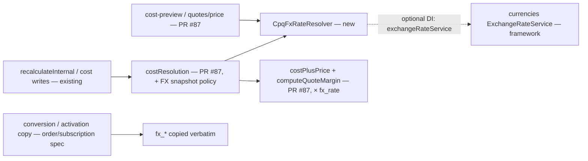
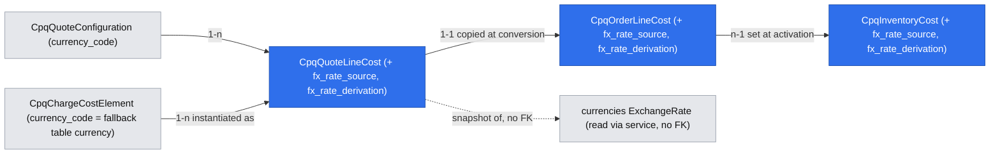

# CPQ cost-plus: foreign-currency supplier costs with dated exchange-rate snapshots

Extends: .ai/specs/2026-11-12-cpq-cost-plus-quote-pricing-margin.md
Extends: specs/implementation/xd-186-pricing-tables.md
Extends: specs/implementation/xd-187-calculate-price-api.md

App Spec: `.ai/specs/2026-11-11-app-spec-cpq-cost-plus-pricing.md` (source of truth: §1.4.6 `fx_rate` / `fx_rate_date`, R2, R3, R4, §5 US-2.4, §7 Phase 2 criterion R3 / R4, §10 Q-D4).
Brief: `.ai/specs/briefs/2026-11-11-cpq-cost-plus-foreign-currency-costs.md`.
Stories: US-2.4.
Commit plan: `.ai/specs/app-spec-notes/cost-plus-commits-WF.md` #26.
Depends on: `.ai/specs/2026-11-12-cpq-cost-plus-quote-pricing-margin.md` (PR #87: `cpq_quote_line_costs` with nullable `fx_rate` / `fx_rate_date`, `costService`, `costResolution`, `withQuotePricingWrite` + `marginTracker`, cost preview). Step 9 only also depends on **PR 1 of `.ai/specs/2026-11-12-cpq-cost-plus-order-subscription-costs.md`**, which creates `cpq_order_line_costs` / `cpq_inventory_costs` with `fx_rate` / `fx_rate_date`, the conversion copy and the activation copy.
Tracked upstream dependency: **UP-FX-1**, `@open-mercato/core` `currencies` date normalization. `ExchangeRateService.getRate` matches UTC midnight only, while the built-in NBP / Raiffeisen providers store Warsaw-midnight timestamps. This spec does not wait for it; rates from the built-in providers become usable once it is fixed (Q14, confirmed).

## 📝 TLDR

Supplier costs often arrive in the supplier's currency (USD / EUR carrier tails, Q-D4). Today, in the Phase 1 behavior specified by PR #87, any cost line that is not in the quote currency is `none` + `CURRENCY_NO_RATE`, so the line is not ready and procurement converts by hand.

**Proposed (future behavior):**
- CPQ converts a foreign-currency cost into the quote currency with a dated rate read from the framework `currencies` module (`exchangeRateService.getRate`, `autoFetch: false`, look-back 7 days, tenant-configurable).
- The rate, its actual date and its provider (`source`) are snapshotted on the cost line at each **saved** recalculation while the quote is unlocked. They freeze with the cost lock and are copied to order and subscription costs. Previews compute a rate and store nothing.
- No rate means `CURRENCY_NO_RATE` as today, never a 1:1 conversion.
- Cost tables prefer entries in the quote currency, else entries in the element's currency, converted.
- Without the `currencies` module installed, CPQ keeps the PR #87 behavior.
- **Scope in practice (Q14, confirmed):** FX works with rates entered manually in `currencies` (`POST /api/currencies/exchange-rates`) or with custom providers that store rates at UTC midnight.
  - The built-in NBP and Raiffeisen providers do not feed it today. They store PLN pairs at Warsaw-midnight timestamps, which `getRate` never matches, and they hold no direct pairs between non-PLN currencies such as USD→EUR.
  - The usage endpoint and the cost dialog tell operators which pairs are missing.
  - Rates from the built-in providers become usable once the upstream issue UP-FX-1 is fixed.

## Resolved assumptions (autonomous defaults)

| # | Question | Applied default | Rationale | Confirm? |
|---|---|---|---|---|
| Q1 | Where does the tenant-configurable look-back live? | Number feature toggle **`cpq.cost_plus.fx_max_days_back`** (default 7, clamped to 0–30), read with `featureTogglesService.getNumberConfig`. `ModuleConfigService` was considered and rejected. | CPQ already reads its tenant settings through `featureTogglesService` (`di.ts:27`, `services/priceAdjustments/adjustmentService.ts:56-59`). Feature toggles support `number` / `json` values (`feature_toggles/lib/feature-flag-check.ts:222-232`) and have a per-tenant override UI (App Spec U1). `ModuleConfigService` (`configs/lib/module-config-service.ts:106-116`) has a tenant scope but no tenant-facing UI, and CPQ does not use it anywhere. | reversible |
| Q2 | Provider rule: "tenant default provider, else highest priority". | The `currencies` module has **no** default-provider or priority concept (verified: `ExchangeRate` has a free-text `source`, `data/entities.ts:98-100`; `CurrencyFetchConfig` has only `provider` + `isEnabled`, `:143-148`; `getRate` returns every provider's row, `exchangeRateService.ts:26-33, 152-160`). CPQ therefore adds a JSON toggle **`cpq.cost_plus.fx_source_priority`** (ordered `source` names, default `[]`). It picks the first listed source that has a rate. Otherwise a single rate is used as-is, and several unlisted rates are tie-broken by `source` ascending. The chosen `source` is stored. | This is the closest deterministic and auditable reading of R3 that the platform supports. Choosing between providers changes customer prices, and the App Spec rule assumed a platform concept that does not exist. | Confirmed by the product owner in PR review (2026-11-13). Reversible. |
| Q3 | Inverse and cross rates | Direct pair (cost → quote currency) first, from any source. The inverse pair is tried **only when no source has a direct rate**; then `fx_rate = round(1 / rate, 8)` and `fx_rate_derivation = 'inverse'`. No triangulation through a pivot currency; pivot-currency triangulation is recorded as a follow-up option. | A manual rate is usually entered in one direction only. Bid / ask caveat: a provider's two directions can be different rate types (NBP stores PLN→X as 1/ask `sell` and X→PLN as `bid` `buy`, `providers/nbp.ts:89-106`), so 1/rate of one direction is not the other direction's quoted rate. CPQ never ignores an existing direct rate in favour of an inverted one, and the derivation is stored. Cross rates would add a second derived number per line and a choice of pivot. If neither pair exists, the line gets `CURRENCY_NO_RATE`, which is safe. | reversible |
| Q4 | Which date is the "saved recalculation date"? | The server's current UTC date at the write. The quote date and `valid_until` are not used. | R4 says the rate is taken as of the date of the saved recalculation. `getRate` refuses future dates (`exchangeRateService.ts:54-55, 230-240`), and "today" never trips that check. | reversible |
| Q5 | Store the rate's provider and derivation? | Yes. New nullable columns `fx_rate_source` (text, the `ExchangeRate.source` as stored) and `fx_rate_derivation` (text, `direct` \| `inverse`) on `cpq_quote_line_costs`, `cpq_order_line_costs` and `cpq_inventory_costs`. | Two providers can disagree, and an inverted rate is not a quoted one (Q3). Without these columns, a stored rate cannot be explained or audited. Keeping them separate avoids parsing a suffixed source. The change is additive and nullable. | reversible |
| Q6 | Does a saved recalculation refresh an unchanged foreign cost's rate? | Yes, on every saved recalculation while unlocked (US-2.4 alternate path). The price and `margin_hash` may move, and the existing `pricing_changed` / `margin_changed` events fire. **Exception:** lines carried from subscription items (`origin = carried`, or any line of an ARC mirror, i.e. `configuration._arcMirroredFromItemId` set) never refresh their snapshot. The ARC costs feature decides any renegotiation. | App Spec R4 and the US-2.4 alternate path. Mirror lines carry a contracted cost (R13, I-11), and a silent re-rate would move a frozen price or margin. | reversible |
| Q7 | Optional dependency | `cpqFxRateResolver` is registered in CPQ `di.ts`. It resolves `exchangeRateService` only when `container.hasRegistration('exchangeRateService')`. Otherwise it returns "unavailable", and every foreign cost is `CURRENCY_NO_RATE` (the PR #87 behavior). No static import from `currencies`. | Rule "CPQ installable alone". Precedent: `getBaseCurrencyCode` degrades when `currencies` is absent (`services/types.ts:18-36`). | reversible |
| Q8 | `getRate` throws (same currency, future date, DB error) | Same currency never calls the service: the rate is 1, and no FX columns are set. Any throw is caught, logged without amounts, and mapped to `CURRENCY_NO_RATE`. The write itself never fails because of FX. | Rate lookup is reference data. A missing rate is already a defined line state. | reversible |
| Q9 | A foreign-currency cost line created or valued while the quote is locked (lock-exempt margin-only cost; same-value confirmation) | A **new** line, or a margin-only line whose value is re-entered, takes the rate at the write date. A lock-exempt same-value confirmation keeps the stored snapshot, and a currency change counts as a value change (it is not a same-value confirmation). Price-basis lines keep their snapshot (R4). | It has no snapshot to freeze, so it needs one to compute margin. Price never moves while locked (I-5). | reversible |
| Q10 | What is the "element currency" for a `table` cost element? | The element's optional `currency_code`, read as the **fallback table currency**. If it is null and no entry exists in the quote currency, the outcome is unchanged (`CURRENCY_NO_RATE`). No schema change. | App Spec R3 wording, and §1.4.4 already has `currency_code` on the element. | reversible |
| Q11 | Separate toggle for FX? | No. FX runs whenever `cpq.cost_plus` is on and `currencies` is installed. | Least new surface. The only alternative to FX is a not-ready line. | reversible |
| Q12 | Calculate-price (no quote) | It converts at today's rate in memory and never returns a rate or a cost. With no rate, it returns `priceOnRequest: true` (PR #87 contract). Public calculator prices of foreign-cost charges therefore move with each new daily rate (accepted). | I-4. The public calculator must not reveal supplier currency or rates. Calculator prices are indicative and are not stored. | reversible |
| Q13 | A manual or supplier value entered while no rate existed: what status does it get once a rate appears? | It becomes `estimated` (catalog `fixed` / `table` lines become `confirmed`). A pricing manager confirms it, which blocks conversion until then (R7). | PR #87 stores "no rate" as `value_status = none`, so the status that was entered is not kept. Nobody has seen the converted price yet, and confirming it is the cheap and safe choice. | reversible |
| Q14 | Ship FX while the built-in providers cannot feed it (NBP / Raiffeisen store Warsaw-midnight timestamps that `getRate` never matches, `exchangeRateService.ts:207-224, 246-250` vs `providers/nbp.ts:76-80`, and hold no USD→EUR pair)? | Yes. Scope v1 to manually entered rates and custom providers that store rates at UTC midnight. File the upstream issue **UP-FX-1** (date normalization in `currencies`) as a named, tracked dependency; rates from the built-in providers become usable once it is fixed, with no CPQ change. Add operator signals: `missingFxPairs` in `GET /api/cpq/cost-plus/usage`, and "No USD→EUR rate maintained" in the cost dialog. CPQ does not work around the framework, for example with a date-range query or its own provider. | Failure is safe (`CURRENCY_NO_RATE`, never a wrong rate). A CPQ workaround would duplicate `currencies` lookup semantics and break when the framework is fixed. Tenants whose only rate source is NBP get no automatic FX until UP-FX-1 lands, so this is a scope limit on a confirmed product decision (Q-D4). | Confirmed by the product owner in PR review (2026-11-13). Reversible. |
| Q15 | `margin_hash` stability | FX fields enter the hash **only when set** (null-stable). A quote with no FX snapshot keeps a byte-identical `margin_hash`. | No spurious `margin_changed` / `approvalInvalidated` on deploy for existing quotes. | reversible |

## 📝 Problem Statement

- **Hand conversion today.** Under PR #87, a cost whose `currency_code` differs from the quote currency resolves to `value_status = none` + `CURRENCY_NO_RATE` (PR #87 Delta, "Cost-plus list price" → "Foreign-currency cost before FX ships"). Procurement must convert USD tails by hand and enter them as EUR manual costs, which loses the supplier's original amount and the rate that was used.
- **Table lookups are quote-currency-only.** The engine filters pricing-table entries by the quote currency with no fallback (`services/cpqPricingService.ts:301`). A cost table kept in USD therefore never matches a EUR quote.
- **No FX code exists in CPQ** (App Spec C12). The only coupling to `currencies` is the base-currency lookup, which degrades to `'USD'` when the module is missing (`services/types.ts:18-36`).
- **Evidence:** App Spec Q-D4 (confirmed 2026-11-12) says carrier tails are often USD / EUR. The App Spec production reality check states "Our USD carrier costs need converting by hand until Phase 2".
- **Platform limit (Q14, confirmed).** The built-in rate providers do not produce rates that `getRate` can return:
  - Timestamps: NBP stores Warsaw midnight (`providers/nbp.ts:76-80`), while `getRate` matches UTC midnight exactly (`exchangeRateService.ts:207-224, 246-250`).
  - Pairs: they store only PLN pairs.
  - In practice, this feature therefore converts with manually maintained rates or rates from custom UTC-midnight providers until UP-FX-1 is fixed.

## 📝 Prior spec drift

- **App Spec R3 vs platform.** R3 relies on "the tenant's default provider" and a provider "priority". Neither exists in `currencies` 0.9.0 (see Q2). The code is the truth: this spec adds a CPQ-side `source` priority setting (Q2, confirmed).
- **App Spec architect checkpoint #1 vs `getRate` storage semantics.** Checkpoint #1 grounded `getRate` as returning "rates for the date". In fact `findExactRates` matches `date` **exactly at UTC midnight** (`exchangeRateService.ts:207-224, 246-250`). The NBP provider, however, stores Warsaw midnight converted to UTC (`providers/nbp.ts:76-80`), i.e. 22:00 / 23:00 UTC of the previous day. As read, `getRate` would therefore not find NBP-fetched rows. The same applies to Raiffeisen, which also uses PLN pairs. This is a framework issue outside CPQ, tracked as UP-FX-1 (Q14, confirmed). The impact is a safe failure (`CURRENCY_NO_RATE`, never a wrong rate). The demo seeds manual rates at UTC midnight.

## 📝 Proposed Solution

Add one resolver, `cpqFxRateResolver`, used by PR #87's cost resolution, cost preview and calculate-price paths. Cost lines keep their **original** currency and amount. The rate is a snapshot beside them (`fx_rate`, `fx_rate_date`, `fx_rate_source`, `fx_rate_derivation`). Conversion happens wherever costs are summed: R2 (`C = Σ instance amount × fx_rate`, full precision, rounded once at the list total) and `computeQuoteMargin()`.

```
cost line (300 USD) ──▶ fxRateResolver.resolve(USD→EUR, today, maxDaysBack=7, autoFetch=false)
                          ├─ rate found  → fx_rate 0.92, fx_rate_date 2026-11-11, fx_rate_source 'ECB' → C += 276.00…
                          └─ no rate     → value_status none + CURRENCY_NO_RATE (value kept) → line not ready
saved recalc, unlocked ─▶ snapshot stored │ locked ─▶ stored snapshot reused │ preview / calculate-price ─▶ computed, never stored
```

**Snapshot policy (R4), keyed on the existing lock:**

| Context | FX behavior |
|---|---|
| Saved recalculation, quote mutable (`new` / `incomplete` / `ready`, no order) | resolve the rate for today and overwrite the snapshot |
| Saved recalculation, quote locked or converted | reuse the stored snapshot; never call the service |
| Line carried from a subscription item (`origin = carried`, or an ARC mirror line with `_arcMirroredFromItemId`) | reuse the carried snapshot in every context; the ARC costs feature owns any re-rate |
| Unsaved recalculation (`recalculate({save:false})`, `cpqQuotingService.ts:670-679`), `POST /cost-preview`, `POST /quotes/price` | resolve in memory; store nothing |
| Cost write (manual create / value edit) | as a saved recalculation, plus the Q9 lock rules |
| Conversion / activation | copy the snapshot verbatim (no lookup) |

**Alternatives considered:**
- **Store the converted amount and discard the original:** this loses the supplier amount and makes a later re-rate impossible. Rejected.
- **Read `ExchangeRate` rows directly with an ORM query:** this couples to an internal entity and bypasses the service's look-back. Rejected. The service is the grounded contract.
- **`autoFetch: true`:** this would make an external HTTP call inside the quote's row lock (`services/priceAdjustments/quotePricingWrite.ts:29-47`). Rejected by architect checkpoint #2. It would also not help today, because fetched built-in rows are not matched (Q14).
- **Working around UP-FX-1 in CPQ** (a date-range query on `ExchangeRate`, or a CPQ-owned provider): rejected (Q14).
- **Pivot-currency triangulation** (e.g. USD→PLN→EUR from NBP rows): not in v1 (Q3). It is a follow-up option once UP-FX-1 is fixed.

**Research (market leaders):**
- **Salesforce Revenue Cloud / CPQ (multi-currency + Advanced Currency Management)** keeps dated exchange rates and converts quote-line amounts at the dated rate. Cost fields are stored in the record currency.
  - **Adopted:** dated rates, and the original currency kept.
  - **Not adopted:** org-wide corporate-currency roll-ups.
- **Odoo** (`res.currency.rate`, `_convert(..., date)`) converts purchase cost into the sale-order currency at the order date for `sale_margin`.
  - **Adopted:** convert-on-read for margin.
  - **Added on top:** a frozen snapshot, so a sent quote never moves.
- **Zuora / Chargebee** fix the exchange rate on the subscription at creation and re-rate only on a contract change.
  - **Adopted:** the rate freezes at lock / activation and moves only with ARC (Phase 3).
- **Oracle CPQ** stores a per-quote exchange-rate snapshot.
  - **Adopted:** the snapshot.
  - **Rejected:** a quote-level single rate. Ours is per cost line, because one quote can mix USD and GBP tails.

## 📝 Delta

### Capability: cpq-quote-pricing

#### MODIFIED Requirement: Cost-plus list price
This requirement was added by PR #87 (`.ai/specs/2026-11-12-cpq-cost-plus-quote-pricing-margin.md`) and is not yet archived. This change replaces its scenario "Foreign-currency cost before FX ships".

The system SHALL price a cost-plus charge at list total = markup(Σ known price-basis costs per instance, each converted to the quote currency at its stored or freshly resolved `fx_rate`), rounded once to the currency precision. Price rules and manual adjustments SHALL then apply unchanged. A charge with an unknown price-basis cost, or with no applicable one, SHALL have no price, and its line SHALL NOT be ready. A cost in a currency other than the quote currency SHALL be converted only with a rate from the `currencies` module. When no rate is available, the cost SHALL be `none` + `CURRENCY_NO_RATE` and SHALL never be converted 1:1.

##### Scenario: Markup percent
- WHEN price-basis costs are 300 and 100 per instance and the markup is `markup_percent` 25
- THEN `listTotalPrice` is 500.00, and with a 10% manual line discount the offer is 450.00

##### Scenario: Unknown cost
- WHEN one price-basis cost line has `value_status = none`
- THEN the charge has no price, the line error is `COST_PENDING`, and a `ready` quote becomes `incomplete`

##### Scenario: Foreign-currency cost converts at a dated rate
- WHEN a price-basis cost is 300 USD on a EUR quote, the markup is `markup_percent` 25, and `currencies` holds a USD→EUR rate of 0.92 dated 2026-11-11 (the saved recalculation runs on 2026-11-12)
- THEN the cost line keeps `unit_amount` 300 / `currency_code` USD, stores `fx_rate` 0.92000000, `fx_rate_date` 2026-11-11, its `fx_rate_source` and `fx_rate_derivation = direct`, and `listTotalPrice` is 345.00

##### Scenario: No rate in the look-back window
- WHEN a price-basis cost is in USD on a EUR quote and no USD→EUR or EUR→USD rate exists within `cpq.cost_plus.fx_max_days_back` days
- THEN the cost line is `none` with `CURRENCY_NO_RATE`, its entered amount and currency are kept, and the line is not ready

##### Scenario: Quote without costs
- WHEN a quote has no cost-plus charges and no cost lines
- THEN `charges`, `pricingSummary` and `snapshotHash` are byte-identical to the values produced before this change

Frozen by: `packages/cpq/src/modules/cpq/services/costs/__tests__/costPlusPrice.test.ts` (created by PR #87), together with `costResolution.test.ts` for the `CURRENCY_NO_RATE` line state

#### ADDED Requirement: Exchange-rate snapshot follows the cost lock
The system SHALL take a foreign-currency cost line's rate as of the date of a saved recalculation or cost write while the quote is mutable, and store it with its actual date and source. While the cost lock applies, or once an order exists, the system SHALL reuse the stored snapshot. Unsaved recalculations and previews SHALL NOT store a rate.

##### Scenario: Refresh while unlocked
- WHEN a `ready` quote with a 300 USD tail at 0.92 (2026-11-11) is recalculated and saved on 2026-11-13, and the newest rate is 0.93 (2026-11-13)
- THEN `fx_rate` becomes 0.93, the price moves, `pricing_changed` and `margin_changed` are emitted

##### Scenario: Frozen while locked
- WHEN the same quote is `with_customer` and a newer rate exists
- THEN a saved recalculation leaves `fx_rate`, `fx_rate_date`, `charges` and `margin_hash` unchanged

##### Scenario: Preview stores nothing
- WHEN a user runs an unsaved recalculation or the cost preview
- THEN the response uses today's rate and no cost line row changes

##### Scenario: Carried mirror line keeps its rate
- WHEN an unlocked Amend or Renew quote has a mirror line whose carried USD cost holds `fx_rate` 0.90, and today's rate is 0.93
- THEN a saved recalculation leaves the line's `fx_rate`, `fx_rate_date`, `fx_rate_source` and `fx_rate_derivation` unchanged

##### Scenario: Null-stable margin hash
- WHEN a quote whose cost lines are all in the quote currency is recalculated after this change ships
- THEN its `margin_hash` is byte-identical to the value before this change, and no `margin_changed` is emitted

#### ADDED Requirement: Cost table currency precedence
The system SHALL look up a `table` cost element in entries of the quote currency first. Only when no matching entry exists there SHALL it use entries in the element's `currency_code` and convert them.

##### Scenario: USD-only cost table on a EUR quote
- WHEN the cross-connect cost table holds only USD entries, the element's `currency_code` is USD, and a USD→EUR rate exists
- THEN the cost line holds the USD entry value with `currency_code` USD and the stored rate

##### Scenario: Quote-currency entry wins
- WHEN the table holds both a EUR and a USD entry for the same dimensions
- THEN the EUR entry is used and no FX columns are set

#### ADDED Requirement: Foreign-currency costs without the currencies module
The system SHALL treat every non-quote-currency cost as `none` + `CURRENCY_NO_RATE` when the `currencies` module is not installed, and SHALL start without errors.

##### Scenario: Standalone CPQ
- WHEN CPQ runs in an app without `@open-mercato/core` `currencies` registered and a USD cost is added to a EUR quote
- THEN the cost line is `none` + `CURRENCY_NO_RATE` and no error is logged at startup

#### ADDED Requirement: Missing exchange-rate pairs are reported
The system SHALL report in `GET /api/cpq/cost-plus/usage`, as `missingFxPairs`, every (cost currency, quote currency) pair on which a cost line of an open, unconverted quote is `CURRENCY_NO_RATE`, together with the number of affected quotes.

##### Scenario: Operator checks missing rates
- WHEN two open EUR quotes have USD cost lines without a rate
- THEN the usage response contains `missingFxPairs: [{ from: 'USD', to: 'EUR', openQuotes: 2 }]`

### Capability: cpq-cost-catalog

#### ADDED Requirement: Cost preview shows conversion
The system SHALL return, for each previewed foreign-currency cost, the original amount and currency, the rate, its date and source, and the converted amount, for holders of `cpq.costs.view`. It SHALL store nothing.

##### Scenario: Preview a USD element
- WHEN a pricing admin previews a charge whose fixed element is 300 USD for a EUR configuration, and a rate of 0.92 exists
- THEN the preview shows `unitAmount` 300 USD, `fxRate` 0.92, `fxRateDate`, `fxRateSource`, `convertedInstanceAmount` 276.00 EUR

### Capability: cpq-calculate-price

#### MODIFIED Requirement: Cost-plus charges in the calculate-price API
This requirement was added by PR #87 and is not yet archived.

The system SHALL return a cost-plus charge's list price when all its applicable price-basis costs resolve without a quote, converting foreign-currency costs at today's rate in memory. It SHALL mark the price `indicative: true` when any of them is an on-request estimate. It SHALL return `priceOnRequest: true` with no price otherwise, including when a needed rate is missing or the tenant toggle is off. It SHALL never return a cost, markup or exchange rate.

##### Scenario: On-request without estimate
- WHEN the Puffin calculator prices an offering whose cost-plus charge has an `on_request` element without an estimate
- THEN the charge has `priceOnRequest: true` and `unitPrice: null`, and the totals exclude it

##### Scenario: Foreign-currency cost
- WHEN the offering's price-basis cost is a fixed 300 USD, the request currency is EUR, and a rate exists
- THEN the charge has a list price computed from the converted cost, and the response contains no rate, currency of cost or cost amount

Frozen by: `packages/cpq/src/modules/cpq/api/quotes/price/__tests__/route.test.ts`

### Capability: cpq-quote-lifecycle

#### ADDED Requirement: Exchange-rate snapshots carry to orders and subscriptions
The order / subscription costs spec already copies `fx_rate` and `fx_rate_date` as part of its "shared cost value columns". This requirement adds `fx_rate_source` and `fx_rate_derivation` to that copy.

The system SHALL copy `fx_rate`, `fx_rate_date`, `fx_rate_source` and `fx_rate_derivation` unchanged:
- from quote cost lines to `CpqOrderLineCost` at conversion;
- from order line costs to `CpqInventoryCost` at activation.

It SHALL include them in the `items[].costs[]` change-log snapshot. It SHALL NOT look up a rate on these paths.

##### Scenario: Activation keeps the quote rate
- WHEN a quote with a 300 USD tail at 0.92 is converted and activated after the rate moved to 0.95
- THEN the order line cost and the subscription item cost hold `fx_rate` 0.92 with the quote's date, source and derivation

## 📝 Architecture

- **Module:** `@dainamite/cpq` only. There is no static import from `@open-mercato/core/modules/currencies`. The service is resolved by its DI name `exchangeRateService` (`currencies/di.ts:25-31`) and typed through a local structural interface (`{ getRate(params): Promise<{ rates: Array<{ rate: string; source: string }>; actualDate: Date | null }> }`, which mirrors `exchangeRateService.ts:5-33`). This keeps the package compilable without `currencies`.
- **Reused:**
  - `ExchangeRateService.getRate({ fromCurrencyCode, toCurrencyCode, date, scope: { tenantId, organizationId }, options: { autoFetch: false, maxDaysBack } })` (`exchangeRateService.ts:49-77`). It returns the rows of **all** providers for the first date found and `actualDate`. It throws on a future date or the same currency.
  - Rate semantics: `rate` = `toCurrency` units per 1 `fromCurrency` unit (`providers/nbp.ts:99-106`). So `getRate(from = cost currency, to = quote currency).rate` is exactly `fx_rate`, with no inversion on the direct path.
  - `featureTogglesService.getNumberConfig` / `getJsonConfig` (`feature-flag-check.ts:222-232`), with the seeding pattern of `lib/priceAdjustmentDefaults.ts:16-17` (`onConflictAction: 'ignore'`).
  - From PR #87: `costResolution`, `costPlusPrice`, `computeQuoteMargin()`, cost preview, `withQuotePricingWrite` + `marginTracker` (`services/priceAdjustments/quotePricingWrite.ts`), the usage endpoint and the redaction helper.
  - `margin_hash` includes the FX rate per App Spec §1.4.6, but **null-stably** (Q15): FX fields are appended to a cost's hash input only when `fx_rate` is set.
- **New service:** `services/costs/fxRateResolver.ts` → `CpqFxRateResolver`.
  - `available(): boolean`.
  - `resolve({ from, to, date, scope }): Promise<{ ok: true, rate: string /*8 dp*/, rateDate: string, source: string, derivation: 'direct'|'inverse' } | { ok: false, code: 'CURRENCY_NO_RATE', reason: 'unavailable'|'not_found'|'error' }>`.
  - It reads the two settings and tries the direct pair. Only when no source returns a direct rate does it try the inverse pair (Q3). It applies the source rule (Q2) within the chosen direction, and memoizes per `(from, to, date)` for the lifetime of one resolver instance. It is DI-scoped, so the memo lives for one request / write.
  - It reads through the `currencies` service's own request EM, not the pricing transaction. That is acceptable for reference data, needs no row locks, and does no network I/O (`autoFetch: false`).
- **Current consumers affected:**
  - `costResolution` (sets or keeps the snapshot, skips carried / mirror lines, applies table precedence).
  - `costPlusPrice` and `computeQuoteMargin()` (multiply by `fx_rate`; null-stable hash).
  - The cost preview, calculate-price and `cost-plus/usage` routes.
  - Conversion copy and activation copy (order / subscription costs spec, PR 1).
  - The `snapshotSubscription` builder (`services/cpqInventoryService.ts:1506`), cost entries.
  - The Costs panel and the cost dialogs.
- **Not affected:** `charges` / `pricingSummary` shape, broadcast events and billing (I-9). The rate is never written into any of them.



Takeaway: one new resolver at the edge of the cost engine. FX is snapshotted where PR #87 already persists cost values, and it is copied, never re-read, downstream.

## 📝 Data Model

The migrations are generated with `yarn mercato db generate` in `packages/cpq/src/modules/cpq/migrations/` and are additive only.

| Table | Column | Type | Null | Rules |
|---|---|---|---|---|
| `cpq_quote_line_costs` (PR #87) | `fx_rate` | numeric(18,8) | yes (exists) | set iff `currency_code` ≠ quote currency and a rate was resolved; > 0 |
| | `fx_rate_date` | date (exists) | yes | `getRate` `actualDate` (UTC date); ≤ the write date |
| | **`fx_rate_source`** (new) | text | yes | the `ExchangeRate.source` used, verbatim; set together with `fx_rate` |
| | **`fx_rate_derivation`** (new) | text | yes | `direct` \| `inverse` (Q3); set together with `fx_rate` |
| `cpq_order_line_costs` (order / subscription spec PR 1; `fx_rate`, `fx_rate_date` are part of its shared cost value columns) | **`fx_rate_source`**, **`fx_rate_derivation`** (new) | as above | yes | copied verbatim at conversion |
| `cpq_inventory_costs` (same spec, PR 1) | same | as above | yes | copied at activation; changed only by ARC activation (Phase 3) |

Invariants:
- The four `fx_*` columns are all null or all set.
- A line in the quote currency never has them set.
- A `CURRENCY_NO_RATE` line has them null, keeps `unit_amount` / `currency_code`, and has `value_status = none` (US-2.4 "the value is still stored").
- When a later saved recalculation finds a rate (Q13), catalog `fixed` / `table` lines become `confirmed`. A manual or supplier value becomes `estimated`, with `note` "rate applied after entry", and needs Edit / Confirm before conversion (R7).

**No change to `cpq_charge_cost_elements`:** `currency_code` on a `table` element is read as the fallback table currency (Q10). If PR #87's validator rejects `currency_code` on table elements, step 6 relaxes it (an additive validation change).

**Settings (feature toggles, seeded global, tenant-overridable):**
- `cpq.cost_plus.fx_max_days_back` (`number`, default 7);
- `cpq.cost_plus.fx_source_priority` (`json`, `string[]`, default `[]`).

**Sensitive data:** rates are public reference data. However, a cost line's `currency_code` + `fx_rate` reveal supplier currency and, together with a price, help infer cost. All `fx_*` fields are therefore returned only with `cpq.costs.view`, through the PR #87 redaction helper. The new columns are not registered in `ce.ts` or search.



## 📝 API Contracts

There are no new routes. All changed routes keep `requireAuth`, `requireFeatures` (never `requireRoles`), `runCpqMutationGuards` on writes and the PR #87 toggle-off behavior (`404`). Each one updates its `openApi` export. All changes are additive response fields.

| Method + path | Features | Change |
|---|---|---|
| `GET /api/cpq/quotes/{quoteId}/costs` | `cpq.quotes.view` (+ `cpq.costs.view` for values) | With `cpq.costs.view`, each cost gains `fxRate`, `fxRateDate`, `fxRateSource`, `fxRateDerivation`, `convertedInstanceAmount` (quote currency, 4 dp) and `quoteCurrencyCode`, and `error: {code:'CURRENCY_NO_RATE', from, to, date}`. Without it: only `error.code`, with no currency or date. |
| `POST /api/cpq/quotes/{quoteId}/costs`, `PATCH …/costs/{costId}` | `cpq.quotes.manage` + `cpq.costs.manage` | No request change: a rate is **never accepted** in the body (anti-corruption, App Spec §1.4.9). The response carries the snapshot per Q9. `currencyCode` must be 3 uppercase letters (existing). A currency change on a locked price-basis line → `409 COST_LOCKED`. |
| `POST /api/cpq/cost-preview` | `cpq.pricing.view` + `cpq.costs.view` | Each cost gains `fxRate`, `fxRateDate`, `fxRateSource`, `fxRateDerivation`, `convertedInstanceAmount` or `error: CURRENCY_NO_RATE`. Nothing is stored. |
| `GET /api/cpq/cost-plus/usage` (PR #87; extended by the order / subscription spec) | `cpq.costs.view` (available when the toggle is off) | Gains `missingFxPairs: [{ from, to, openQuotes }]`, over open, unconverted quotes' cost lines with `error_code = CURRENCY_NO_RATE`. One grouped query on the `(organization_id, tenant_id, …)` indexes. Additive. |
| `POST /api/cpq/quotes/price` | unchanged | No new fields. Foreign-cost charges price, or return `priceOnRequest`. |
| Order cost / subscription item cost read routes (order / subscription spec) | as defined there (`cpq.costs.view`) | + `fxRateSource`, `fxRateDerivation` (`fxRate` / `fxRateDate` are already exposed there). |
| Subscription change-log API | unchanged | `items[].costs[]` gains the `fx*` fields. It is already stripped without `cpq.costs.view` (order / subscription spec). |

**Events:** none new. A rate refresh that changes a price emits the existing `cpq.quote.pricing_changed` (cause `recalculate`). A refresh that changes `margin_hash` emits `cpq.quote.margin_changed` (non-broadcast). Neither payload gains FX fields.

**Notifications:** none.

## 📝 UI/UX

- **Quote detail → Costs sub-panel (`CostsPanel.tsx`, `cpq.costs.view`, read-only for reps):**
  - The value cell shows the original amount and currency. When converted, it adds a second line, "≈ 276.00 EUR · 0.92 · ECB · 2026-11-11", with a tooltip "Rate frozen while the quote is locked" when locked.
  - The `CURRENCY_NO_RATE` badge reads "No USD→EUR rate for 2026-11-12 (looked back 7 days)".
  - Without `cpq.costs.view`, the user sees only the badge "Cost pending — currency rate missing", with no currencies.
- **Add / Edit / Confirm cost dialog:**
  - The currency selector defaults to the quote currency.
  - When another currency is picked, a read-only hint appears: "Converted at the latest rate on save (currently 0.92 from ECB, 2026-11-11)". The hint comes from `cost-preview`.
  - With no rate, the hint reads "No USD→EUR rate maintained — the line will stay not ready until a rate is entered in Currencies".
  - The hint needs `cpq.pricing.view`. A user without it (e.g. procurement with `cpq.costs.manage` only) gets no hint and no error toast: the client skips the call and treats a `403` silently. The saved line still shows the rate or the badge.
  - Inverse-derived rates are labelled "(inverse)".
  - There is no rate input.
  - `Cmd/Ctrl+Enter` submits, `Esc` cancels (unchanged).
- **Charge editor → Preview cost:** the same converted second line per cost row. A `table` element form exposes `currency_code` labelled "Fallback table currency".
- **Order / subscription cost panels** (order / subscription spec): the same display, never "frozen" wording, because they are always snapshots.
- **Settings:** no new page. The two toggles appear in the existing feature-toggle overrides UI (App Spec U1).
- **Operator signal:** the PR #87 toggle-off / usage confirmation shows "Missing exchange rates: USD→EUR (2 open quotes)" from `missingFxPairs`.

Mockups: skipped — no browser provider configured (text-only spec).

## 📝 Edge Cases & Failure Scenarios

| Case | Behavior |
|---|---|
| `currencies` not installed | every foreign cost: `CURRENCY_NO_RATE`; resolver `available() = false`; the UI hint reads "Currency conversion unavailable" |
| Rate exists only for the inverse pair | `fx_rate = round(1/rate, 8)`, `fx_rate_derivation = inverse` |
| Direct rate from one source, inverse from another | the direct rate is used; the inverse is never consulted (Q3) |
| Carried / ARC mirror line on an unlocked quote | the snapshot is kept; no lookup (Q6) |
| Several providers, none in `fx_source_priority` | lowest `source` ascending (deterministic); stored source visible (Q2, confirmed) |
| Rate older than the look-back | `CURRENCY_NO_RATE`; the message names the pair, the date and the window |
| Toggle `fx_max_days_back` missing / wrong type / outside 0–30 | the default 7 is used, clamped; logged once per request |
| `getRate` throws (DB error) | `CURRENCY_NO_RATE` for that line; the write commits; warning logged without amounts |
| Rate entered later (manual rate in Currencies) | the line becomes ready on the next saved recalculation while unlocked; locked quotes keep `none` until they are reopened (I-5: no price change while locked) |
| Locked quote, lock-exempt margin-only cost in GBP | rate taken at write (Q9); the price is unchanged; `margin_changed` fires |
| Supplier answer (sourcing feature) in a different currency than the line | a currency change counts as a different value: unlocked → applied with a fresh rate; locked → the `proposedAmount` path (sourcing spec) |
| Post-conversion re-confirmation (Q-D13, Phase 3) | keeps the stored rate (margin only) |
| Clone (PR #87 R16) | FX columns are copied with manual / supplier values; catalog lines re-resolve, and so do their rates, on the clone's first saved recalculation (the clone is `new`) |
| Server timezone not UTC | the date passed is today's UTC date; `getRate`'s look-back uses local `setDate` (`exchangeRateService.ts:255-259`), so production runs UTC (documented in the manual) |
| Tenant relies on the built-in NBP / Raiffeisen fetch | rows are stored at Warsaw midnight and hold PLN pairs only → `CURRENCY_NO_RATE`, never a wrong rate; listed in `missingFxPairs` until UP-FX-1 is fixed or rates are maintained manually (Q14, confirmed) |
| Quote currency changed (if supported) | the next saved recalculation re-resolves every line against the new currency |

## 📝 Risks & Impact Review

- **Contracts:** additive only. Two new nullable columns in three tables. New response fields are behind `cpq.costs.view`, plus `missingFxPairs` on the usage endpoint. Two new feature-toggle identifiers. One behavior change in a public contract: calculate-price now prices foreign-cost charges that returned `priceOnRequest` before. That is the intended effect of the MODIFIED requirement; it is not breaking. Public calculator prices of foreign-cost charges move with each new daily rate (accepted, Q12). Logged in `packages/cpq/MIGRATION.md` and the changeset.
- **Framework dependency (High for value, safe for correctness; Q14, confirmed).**
  - The built-in providers never feed the resolver: Warsaw-midnight timestamps vs `getRate`'s exact UTC-midnight match, and PLN pairs only.
  - In practice, v1 FX works only with manually entered rates or custom UTC-midnight providers. Tenants relying on NBP / Raiffeisen get `CURRENCY_NO_RATE` (safe, visible in `missingFxPairs` and in the cost dialog).
  - **UP-FX-1** (date normalization in `@open-mercato/core` `currencies`) is a named, tracked dependency. The issue is filed by the implementation PR (outside this spec's write scope). Once it is fixed, built-in direct / inverse PLN pairs work with no CPQ change. Cross pairs still need pivot-currency triangulation (follow-up option).
  - The `getRate` signature is pinned by a structural type and a resolver test, so a framework change fails the test, not production typing.
- **ARC interplay:** carried / mirror lines never re-rate here (Q6). The ARC costs feature owns renegotiation.
- **Price moves between saves (accepted, App Spec Cross-Story Impact US-2.4).** Unlocked quotes re-rate on each saved recalculation. Approvals keyed on `snapshotHash` / `margin_hash` see the change through the existing events.
- **Rollback limits:**
  - The down-migration drops `fx_rate_source` / `fx_rate_derivation` only. `fx_rate` / `fx_rate_date` belong to PR #87 and the order / subscription spec.
  - Reverting the code returns foreign costs to `CURRENCY_NO_RATE` on the next unlocked saved recalculation. Locked and converted quotes keep their stored prices and snapshots (the data stays readable).
- **Toggle-off (`cpq.cost_plus` off):** the PR #87 behavior applies. Cost endpoints return `404`, and re-pricing returns `COST_PLUS_DISABLED`. Stored FX snapshots stay in place and are never re-read.
- **Confidentiality sweep extension (I-4):**
  - PR #87's `costConfidentiality.test.ts` (sentinel 7777.77) gains a USD cost with a sentinel rate of `0.77777777` and source `SENTINEL_FX`.
  - Neither may appear for a user without `cpq.costs.view` in any quote / line / order / calculate-price / change-log response, any broadcast event, or any command log.
  - The `CURRENCY_NO_RATE` projection without `cpq.costs.view` carries no currency codes.
- **Product direction calls (owner: product), confirmed in PR review on 2026-11-13:**
  - the provider selection rule (Q2);
  - shipping with manual / custom-provider rates only until UP-FX-1 is fixed (Q14).

## 📋 Phasing

A single PR (12 steps). Steps 1–8 and 10–11 depend only on PR #87.
- Step 9: `Depends on:` PR 1 of `.ai/specs/2026-11-12-cpq-cost-plus-order-subscription-costs.md`. If that PR has not merged, step 9 moves to a follow-up PR. Until then, `fx_rate` / `fx_rate_date` are still copied by that spec, but the source and derivation are not.
- Step 12 (archive): runs only after PR #87's archive has created `.ai/specs/capabilities/cpq-cost-catalog.md`.

## 📋 Implementation Plan

Tests run with `yarn test` (`jest.config.cjs`), using the mock-EM pattern of `.ai/skills/unit-tests/SKILL.md`, which accounts for the hidden `findOne` of `getBaseCurrencyCode`. Run `yarn mercato db generate` after entity steps and `yarn generate` after DI / structural steps.

1. **Characterize (commit alone, green on unchanged code).**
   - In `services/costs/__tests__/costPlusPrice.test.ts` and `costResolution.test.ts`: a USD fixed cost on a EUR quote → `none` + `CURRENCY_NO_RATE`, charge unpriced; a USD-only cost table on a EUR quote → the current outcome.
   - In `services/costs/__tests__/quoteMargin.test.ts`: record `margin_hash` for a quote whose costs are all in the quote currency. It must stay byte-identical (Q15).
   - In `api/quotes/price/__tests__/route.test.ts`: a USD price-basis cost → `priceOnRequest: true`.
2. **Settings.**
   - `lib/costPlusDefaults.ts` (PR #87) also upserts `cpq.cost_plus.fx_max_days_back` (number 7) and `cpq.cost_plus.fx_source_priority` (json `[]`), with `onConflictAction: 'ignore'`.
   - `services/costs/fxSettings.ts` reads them with defaults and clamping.
   - Tests: `lib/__tests__/costPlusDefaults.test.ts` (idempotent, never overwrites); `fxSettings.test.ts` (missing / mismatched / out of range).
3. **Resolver.** `services/costs/fxRateResolver.ts`: the structural type, direct first and inverse only when no source has a direct rate, source rule, derivation, memo, error mapping, `autoFetch: false`, UTC-today date. Tests: `fxRateResolver.test.ts` with a mocked service:
   - call arguments (`autoFetch: false`, `maxDaysBack`);
   - priority list / single / tie-break;
   - a direct rate from source A beats an inverse rate from source B;
   - inverse rounding to 8 dp, `derivation: 'inverse'`;
   - a throw → `CURRENCY_NO_RATE`;
   - unavailable;
   - same currency never calls.
4. **DI.** Register `cpqFxRateResolver` (scoped) in `di.ts`, resolving `exchangeRateService` only if `container.hasRegistration('exchangeRateService')`, with `featureTogglesService` as for the adjustment service. Inject it into `costService` / `costResolution` / the cost preview / calculate-price. Run `yarn generate`. Tests: `__tests__/di.test.ts` (resolves with and without the `currencies` registration).
5. **Entity.** Add `fxRateSource` and `fxRateDerivation` to `CpqQuoteLineCost`, then `yarn mercato db generate`. Tests: none beyond the migration review (additive nullable column).
6. **Engine** (updates the step-1 tests to the new scenarios).
   - `costResolution`: the snapshot policy table (save + mutable → resolve and store; locked / ordered → reuse; save=false → in memory; carried / ARC mirror lines → always reuse), table currency precedence (Q10) and status on rate arrival (Q13).
   - `costPlusPrice` and `computeQuoteMargin()`: multiply by `fx_rate`, at full precision before the single rounding. FX fields enter `margin_hash` only when set (Q15).
   - Tests:
     - `costResolution.test.ts` (each Delta scenario, including the carried mirror line);
     - `costPlusPrice.test.ts` (300 USD × 0.92 × 1.25 = 345.00);
     - `quoteMargin.test.ts` (the hash changes with the rate; unchanged when the rate is reused; byte-identical for a quote without FX, per step 1);
     - the PR #87 golden test stays byte-identical (I-8).
7. **Writes.** In `costService`: manual create / value edit in a foreign currency per Q9, and a currency change on a locked price-basis line → `COST_LOCKED`. Tests: `costService.test.ts`, `commands/__tests__/quote-line-costs.test.ts`.
8. **Read APIs.** The cost projection fields in `GET /quotes/{id}/costs`, `cost-preview` and calculate-price (no FX fields), plus `missingFxPairs` in `GET /cost-plus/usage`, with the `openApi` updates. Usage route test: grouped pairs; converted / terminal quotes excluded. Extend the confidentiality sweep (sentinel rate and source). Tests: route tests for both projections; `services/__tests__/costConfidentiality.test.ts`.
9. **Carry-through.** `Depends on:` PR 1 of `.ai/specs/2026-11-12-cpq-cost-plus-order-subscription-costs.md` (`cpq_order_line_costs` / `cpq_inventory_costs` with `fx_rate` / `fx_rate_date` in their shared cost value columns, plus the conversion copy and activation copy).
   - Add `fxRateSource` / `fxRateDerivation` to `CpqOrderLineCost` / `CpqInventoryCost`, then `yarn mercato db generate`.
   - Extend that spec's copy so that all four `fx_*` fields are copied verbatim, with no lookup.
   - The `snapshotSubscription` builder (`services/cpqInventoryService.ts:1506`) `items[].costs[]` includes them.
   - Tests: `cpqOrderService.test.ts` (copy; the resolver is not called), `cpqInventoryService` activation / snapshot tests.
10. **UI.**
    - The Costs panel's converted line and badge text; the cost dialog's currency hint (calls `cost-preview`); the charge editor preview line; the "Fallback table currency" field; the order / subscription cost panels.
    - i18n keys. `Cmd/Ctrl+Enter` / `Esc` stay intact.
    - Tests: component tests where present.
11. **Seed + docs.**
    - `demo_gix`: a USD partner-tail element and USD→EUR rates with source `Manual`, stored at UTC midnight for the last 3 days. This is a demo module (L3), so it may write through the `currencies` API or entity.
    - One demo quote with a converted tail.
    - A `manuals/cpq-cost-plus-pricing.md` section "Foreign-currency costs". It covers:
      - maintaining rates manually and the built-in-provider limit (UP-FX-1);
      - `missingFxPairs`;
      - the provider rule and the inverse / bid-ask caveat;
      - the look-back setting, the freeze, ARC mirror lines, UTC;
      - calculator prices moving daily.
    - File the upstream UP-FX-1 issue and link it from the manual and `MIGRATION.md`.
    - `packages/cpq/MIGRATION.md` + changeset.
    - Playwright smoke: enter a 300 USD tail on a EUR quote → the line is ready with "≈ 276.00 EUR"; send it → the rate stays frozen after a rate change.
12. **Archive the Delta** into `.ai/specs/capabilities/`. This runs only after PR #87's archive step has created `cpq-cost-catalog.md` and recorded "Cost-plus list price" and "Cost-plus charges in the calculate-price API"; otherwise it waits for that.
    - `cpq-quote-pricing.md` (MODIFIED "Cost-plus list price" + 4 ADDED);
    - `cpq-cost-catalog.md` (ADDED);
    - `cpq-calculate-price.md` (MODIFIED);
    - `cpq-quote-lifecycle.md` (ADDED).

### Acceptance (from App Spec §7 Phase 2)

| Kind | Criterion | Steps |
|---|---|---|
| Domain | **R3 / R4:** `fx_rate` + date are snapshotted from `currencies` | 3, 6 |
| Domain | A missing rate gives `CURRENCY_NO_RATE`, never 1:1 | 1, 6 |
| Domain | Previews store nothing | 6, 8 |
| Domain | A locked quote's price never moves with the rate | 6, 7 |
| Domain | I-4 sweep extended | 8 |
| Domain | I-8 golden test unchanged; null-stable `margin_hash` | 1, 6 |
| Domain | I-7 carry-through of the FX snapshot (only once order / subscription spec PR 1 is in) | 9 |
| Business | "A USD cost on a EUR quote converts at the stored dated rate" (US-2.4 happy path, 300 USD × 0.92 = 276 EUR) | 6, 11 (smoke) |
