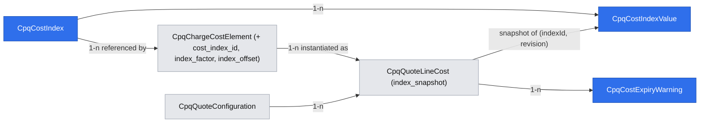

# CPQ index-linked costs (e.g. oil) and supplier-cost expiry warnings

Extends: .ai/specs/2026-11-12-cpq-cost-plus-quote-pricing-margin.md
Extends: specs/implementation/xd-250-arc-spec.md
Extends: specs/implementation/xd-187-calculate-price-api.md
Extends: specs/implementation/xd-201-quoting.md

App Spec: `.ai/specs/2026-11-11-app-spec-cpq-cost-plus-pricing.md` is the source of truth (§1.3 cost index / index value in force, §1.4.4–§1.4.6, §1.4.5, R4, R12 / Q-D9, R13, R15, §1.4.9 `cost_expiring`, §7 Phase 4, Q-D15).
Brief: `.ai/specs/briefs/2026-11-11-cpq-cost-plus-index-costs-expiry.md`.
Stories: US-1.4, US-3.6 (+ the Phase 4 part of US-0.2: demo index).
Commit plan: `app-spec-notes/cost-plus-commits-WF.md` #35–#38 (Phase 4; the demo index rides on #37).
Depends on: the quote pricing and margin feature (PR #87 spec above — `cpq_charge_cost_elements`, `cpq_quote_line_costs` incl. the nullable `index_snapshot`, `costService`, `withQuotePricingWrite` + `marginTracker`, `cpq.quote.margin_changed`, toggle `cpq.cost_plus`). The expiry warning needs the sourcing feature's `valid_until` flows to be useful but not to work (PR #87 already stores `valid_until`). Renew re-evaluation (Phase B step 12) needs the ARC costs feature (brief `briefs/2026-11-11-cpq-cost-plus-arc-costs.md`, commits #29–#30) to have landed. Foreign-currency index costs need the FX feature; before it, they resolve as `CURRENCY_NO_RATE` (PR #87 Q6).

## 📝 TLDR

Fuel- and energy-linked supplier costs move with published indices. Today CPQ has no index concept: such a cost is a `fixed` cost element that the pricing admin re-types after every market move, and nobody is warned when a confirmed supplier cost on an open quote is about to expire.

**Proposed (future behavior):**
- A pricing admin maintains **cost indices** (e.g. "Brent, USD/bbl") with dated, **append-only** values, by hand or through a bulk **import API**. A correction is a new value for the same date with a server-assigned higher revision.
- A cost element can use source **`index`**: unit cost = value in force × factor + offset, in the index currency. The quote cost line stores an `index_snapshot` (value, date, revision, factor, offset). It refreshes only on a **saved recalculation while the quote is unlocked**, and is frozen once the cost lock applies (R4). No value on or before the date → `INDEX_NO_VALUE`, line not ready.
- **Renew** quotes re-evaluate carried index costs (`value_origin = carried`, not renegotiation-due) as of the recalculation date. Only the value and snapshot change; Renew activation then updates the item cost in place. Between ARC changes, live subscription item costs are never revalued (Q-D9).
- A daily **scheduled job** emits the non-broadcast `cpq.quote.cost_expiring` once per `(cost line, valid_until)` for confirmed price-basis costs on open, unconverted quotes, and notifies cost managers (`cpq.cost.expiring`). No amounts are carried. Missed days are caught up without duplicates.
- Everything stays behind the `cpq.cost_plus` toggle.

## Resolved assumptions (autonomous defaults)

| # | Question | Applied default | Rationale | Confirm? |
|---|---|---|---|---|
| Q1 | The App Spec / brief say "scheduled **command**". Which scheduler target type? | A **queue** target: a module-registered schedule (`sourceType: 'module'`, `sourceModule: 'cpq'`) targeting a new CPQ worker queue `cpq-cost-expiry`. No scheduler command target. | In the installed scheduler 0.9.0 a command target runs only if the command is on the scheduler-safe allowlist **and** an actor user (trigger or creator) holds its features (`scheduler/lib/scheduler-safe-commands.ts:75-105`, `workers/execute-schedule.worker.ts:284-331`). A module registration has no creator, so it would be refused every day. A module-authored queue row is dispatched when `cpq` owns the queue's worker and no user stamp exists (`lib/safeQueueTargets.ts:297-314`). Precedent: `core/integrations/setup.ts:41-67`. The `CommandHandler` / `registerCommand` API the App Spec cites (`scheduler/src/index.ts:7-15`) does not exist there. | reversible |
| Q2 | Where is the `(cost line, valid_until)` dedupe recorded? | New append-only ledger `cpq_cost_expiry_warnings` with a unique `(quote_line_cost_id, valid_until)`. The cost line is not touched. | Writing a marker on the cost line would have to go through `withQuotePricingWrite` (I-5), bump `pricingRevision` daily and cause `409 STALE_REVISION` for reps. The ledger sits outside the quote aggregate, like index values. | reversible |
| Q3 | Which cost lines and quotes are in scope for expiry warnings? | `role = price_basis`, `value_status = confirmed`, `valid_until` not null, not deleted. Quote: `cpqStatus ∉ {rejected, cancelled}` and no order. **`accepted` quotes are included.** | Expired price-basis costs block conversion (R7); an accepted, unconverted quote is the case the ROI metric targets ("conversions refused for an expired cost with no prior `cost_expiring` = 0"). The code's `TERMINAL_STATUSES` includes `accepted` (`services/types.ts:55`); the App Spec's "terminal" for request cancellation is rejected / cancelled (US-3.7). Margin-only costs never block, so they get no warning. | reversible |
| Q4 | What is "N days" and where is it configured? | Number feature toggle `cpq.cost_expiry_lead_days`, default **14**, per-tenant override, seeded by the PR #87 `costPlusDefaults` seeder. | CPQ has no settings entity; feature toggles already carry the `cpq.cost_plus` switch, and `featureTogglesService.getNumberConfig` exists (`core/feature_toggles/lib/feature-flag-check.ts:222`). | reversible |
| Q5 | Schedule cadence and catch-up window | One schedule per organization, cron `0 6 * * *` UTC. Each run takes every in-scope line with `valid_until ≤ today + N` that has no ledger row, **including already-expired ones** (flagged `expired: true`). | "The next run catches every line with `valid_until − N ≤ today`" (US-3.6). Already-expired unwarned lines are still actionable while the quote is open. The flood on first rollout is bounded by open quotes. | reversible |
| Q6 | What is the "recalculation date" (as-of date for index values)? | The UTC calendar date of the server clock at the saved recalculation, injected as `asOfDate` (tests pass a fixed date). The same applies to calculate-price and cost preview. | Quotes carry no quoting date. R4 says "as of the date of a saved recalculation". UTC matches the scheduler default and `cpqOrderService.ts:1187`. | reversible |
| Q7 | How is the revision assigned under concurrency? | Inside one transaction: lock the parent `cpq_cost_indices` row (`PESSIMISTIC_WRITE`), read `max(revision)` for `(cost_index_id, effective_date)`, insert `max + 1` (1 if none). The unique key `(cost_index_id, effective_date, revision)` is the backstop: a violation returns `409 CONCURRENT_INDEX_WRITE` (retryable). Bulk imports lock all touched indices in ascending id order. | The index row is a natural, low-contention serialization point. Quote recalculations only read values and never take that lock. | reversible |
| Q8 | Import API semantics | `POST /api/cpq/cost-indices/import`, up to 1000 rows addressed by `indexCode`, **all-or-nothing** (any invalid row → `422` with per-row errors, nothing written), `dryRun` supported. A row whose value equals the current highest revision for that date is reported `unchanged` and not appended. | Re-running the same feed must not inflate revisions. Atomic import keeps "what is in force" explainable. | reversible |
| Q9 | Sign rules for factor and offset | `index_factor > 0` (default 1), `index_offset ≥ 0` (default 0) in v1. | Q-D15 defers negative values. Relaxing a validator later is additive; allowing negative unit costs now would need the deferred floor rule. | reversible |
| Q10 | Can an index's currency change? | Only while it has no values and no referencing element (`422 INDEX_CURRENCY_LOCKED`). `code` is immutable. | Changing the currency would silently reinterpret every stored value and snapshot. | reversible |
| Q11 | A pricing manager has overwritten an index cost line's value (PR #87 manual overwrite, `value_origin = manual`). Does the next recalculation refresh it? | No. Only lines with `value_origin = catalog` are re-resolved. The manual value stays until the manager clears it back to the catalog value. | Same intent as PR #87's note-required overwrite of catalog values; refreshing would silently drop a deliberate override. | reversible |
| Q12 | Renew re-evaluation of a carried index cost: which lines, which formula, which fields? | **Lines:** only Renew carried lines with `source = index`, `value_origin = carried` and **not** flagged `renegotiation_due`. Lines whose value came from a supplier answer or a manual entry are kept (consistent with Q11). **Formula:** the line's own `index_snapshot` `{indexId, factor, offset}` (the contracted formula); only the value moves to the one in force on the recalculation date. **Fields:** `unit_amount` and `index_snapshot` only; `value_status` and `renegotiation_due` are never changed. Amend mirrors are **not** re-evaluated (price lock, R13). | Coordinator decision (recommended option). The supplier contract fixes the formula; today's catalog factor belongs to new sales. Renegotiation due and R1c reconciliation belong to the ARC spec, so this branch must not undo them. | reversible |
| Q13 | Who may read indices and values? | Read: `cpq.pricing.view` **+** `cpq.costs.view`. Write: `cpq.pricing.manage` **+** `cpq.costs.view` (App Spec §1.4.10). Reps (default `cpq.costs.view`, Q-D1) can read indices; custom roles without `cpq.costs.view` cannot. | Index values are cost data (I-4). The App Spec names only the manage pair. | ⚠ NEEDS HUMAN CONFIRMATION |
| Q14 | Recipients of `cpq.cost.expiring` in multi-organization tenants | Users holding **both** `cpq.costs.manage` and `cpq.costs.view` **whose organization scope includes the quote's organization**. Built by one shared helper, `notifyCostManagers(scope, organizationId, notification)` (`lib/notifyCostManagers.ts`). It uses the notifications module's feature lookup, filters by the second feature and by organization, and sends a batch. The helper is shared with the sourcing spec and owned by whichever ships first (sourcing, Phase 2). | `createForFeature` resolves recipients per tenant only (`core/notifications/lib/notificationService.ts:423-440`, `notificationRecipients.ts:81-118`). Without the filter, managers of other organizations would see quote numbers and cost names they cannot open. | ⚠ NEEDS HUMAN CONFIRMATION |
| Q15 | Delivery guarantee of `cost_expiring` | The ledger row is committed first, then the event is emitted and the notification sent, and `emitted_at` is stamped. A row left un-stamped for more than 10 minutes is re-emitted by the next run. Duplicates are possible only after a crash between emit and stamp. | A ledger insert gives "once per `(line, valid_until)`" under concurrency and retries. A strict exactly-once across commit and event bus is not available. Consumers can dedupe on `warningId`. | reversible |
| Q16 | Split into separate specs (index costs vs expiry warnings)? | **One spec, two independent PRs** (Phasing). | The commit plan and brief bundle them. Each PR is independently deployable, which is the split test. | reversible |

## 📝 Problem Statement

- **No index concept.** Cost elements (PR #87) know sources `fixed` / `table` / `on_request` only. `index` is explicitly deferred to this feature (PR #87 spec §Data Model, `cpq_charge_cost_elements`: "The index columns (`cost_index_id`, `index_factor`, `index_offset`) are added by the index feature"). CPQ has no dated reference-data entity at all (`packages/cpq/src/modules/cpq/data/entities.ts`). The currencies module holds exchange rates only.
- **Workaround cost.** An oil-linked cost is a `fixed` element the admin edits by hand. Every edit re-prices every unlocked quote on its next save with no record of which market value was used, so the margin cannot be explained afterwards (App Spec §7 Phase 4 ROI: 0 manual cost edits on index-linked elements).
- **Silent expiry.** PR #87 stores `valid_until` on cost lines and refuses conversion once a price-basis cost has expired (`422 COSTS_NOT_CONFIRMED`). Nothing warns procurement beforehand. CPQ has no scheduled job or worker today (no `workers/` directory under `packages/cpq/src/modules/cpq/`) and no `notifications.ts`.
- **Engine shape.** List prices come from `calculateCharge` (`services/cpqPricingService.ts:248-322`), called by `recalculateInternal` (`services/cpqQuotingService.ts:937-1025`) on every recalculation, saved or not. No date is passed through the engine today. R4 needs an explicit as-of date and a save / lock distinction for index values.

## 📝 Prior spec drift

- **App Spec §4 WF3 / §4.5** cite `@open-mercato/scheduler/src/index.ts:7-15` for a `CommandHandler` / `registerCommand` API. The installed 0.9.0 `src/index.ts:7-15` exports only `ScheduledJob`, `SchedulerService`, `ScheduleRegistration` and the cron / interval helpers. Command targets need an allow-listed command and a user actor (`workers/execute-schedule.worker.ts:284-331`). → Resolved by Q1 (queue target).
- **App Spec §1.4.9 / US-3.6** "terminal quotes excluded" vs code: `TERMINAL_STATUSES = ['accepted', 'rejected', 'cancelled']` (`services/types.ts:55`). → Q3: this spec excludes rejected / cancelled and converted quotes only. The code constant is not changed.
- **CPQ module `requires`** lists neither `scheduler` nor `notifications` (`packages/cpq/src/modules/cpq/index.ts:11`), although the app enables both (`src/modules.ts:31, 44`; `package.json:65`). → Both are resolved optionally (`container.hasRegistration`), as `core/integrations/setup.ts:43-46` does. CPQ stays installable without them (SPEC-001).

## 📝 Proposed Solution

1. **Reference data outside the quote aggregate.** `CpqCostIndex` (master) and `CpqCostIndexValue` (append-only, revisioned). A dedicated `costIndexService` owns:
   - revision assignment (Q7);
   - "value in force" — `effective_date ≤ asOf ORDER BY effective_date DESC, revision DESC LIMIT 1`;
   - referential safety.
2. **A fourth cost source.** `costResolution.ts` (PR #87) gains an `index` branch. `unit_amount = value × factor + offset` in full precision, then rounded to 4 dp (the column scale). `currency_code` = the index currency, then R3 currency handling as for any cost. The snapshot is written only when the resolution is persisted, i.e. on a saved recalculation while the cost lock does not apply.
3. **Renew hook.** A shared function, `reevaluateCarriedIndexCosts(lines, { asOfDate, quoteType })` in `services/costs/indexCostResolution.ts`, re-resolves Renew carried index lines per Q12.
   - **Call order (coordinated with the ARC costs spec, `.ai/specs/2026-11-12-cpq-cost-plus-arc-costs.md`, under revision):** inside the saved recalculation, ARC's `reconcileRenewCosts` runs first (carry, R1c, renegotiation due); `reevaluateCarriedIndexCosts` runs immediately after, on the reconciled lines.
   - The ARC spec adds `source` and `index_snapshot` to its carry field list, so carried lines have the formula to re-evaluate.
   - Amend mirrors are untouched (R13).
   - After **Renew activation**, the ARC activation path updates the subscription item cost in place from the order line cost (e.g. 70.00 → 82.40, `item_cost_changed` with cause `renew`). Q-D9 means only "no revaluation between ARC changes".
4. **Expiry scan.** `costExpiryService.run(scope, today)` selects candidates in one indexed query, inserts ledger rows `ON CONFLICT DO NOTHING`, commits, then emits `cpq.quote.cost_expiring` and the notification for the inserted rows. It is driven by a module-registered daily schedule → `cpq-cost-expiry` queue worker, and by a CLI for manual runs.

**Alternatives considered:**
- **Indices in `currencies` exchange-rate providers:** rates are pairs of currencies, not unit series, and cannot hold "USD/bbl" (brief: rejected; architect #1).
- **A `data_sync` adapter for market feeds:** project-level. The import API is the integration point (non-goal: automatic feeds).
- **Mutable values with an audit log:** breaks "the value in force is deterministic" for already-snapshotted quotes. Append-only + revision keeps every snapshot traceable to one row.
- **A `last_warned_valid_until` column on the cost line:** rejected in Q2.
- **A scheduler command target:** rejected in Q1.
- **Revaluing item costs monthly:** rejected by Q-D9.

**Research (market leaders):**
- **SAP (condition records + index-based price escalation) and Oracle Procurement (price index / escalation clauses)** compute a cost or price as base × index factor from a dated index series with validity periods.
  - **Adopted:** dated series, "valid at date" lookup, a factor-and-offset formula.
  - **Not adopted:** escalation clauses on customer prices (non-goal, App Spec §1.2).
- **Salesforce CPQ** has no native index source. Customers model it with a custom "Cost" field fed by a scheduled integration. The import API is the equivalent hook.
- **Zuora / Chargebee** apply price uplifts on renewal only (Zuora "price increase on renewal"). The Renew-only re-evaluation matches that market expectation on the cost side.
- **Odoo** (`purchase` vendor pricelists) uses `date_start` / `date_end` vendor prices and a scheduled "expiring" check; it warns only through activities.
  - **Adopted:** a scheduled, deduped warning to a role.
  - **Not adopted:** automatic re-pricing on expiry.

## 📝 Delta

### Capability: cpq-cost-catalog

#### ADDED Requirement: Cost indices with append-only values
The system SHALL let a user with `cpq.pricing.manage` and `cpq.costs.view` maintain cost indices (code unique per tenant and immutable, name, unit, currency, active flag) and append dated values (> 0). The server SHALL assign each value a revision equal to one more than the highest revision for the same index and effective date. Values SHALL never be updated or deleted.

##### Scenario: Correction for an existing date
- WHEN Brent has value 80.00 for 2026-11-10 (revision 1) and the admin adds 82.40 for 2026-11-10
- THEN a second row with revision 2 is stored, and the value in force on 2026-11-10 is 82.40

##### Scenario: Concurrent appends
- WHEN two requests append a value for the same index and date at the same time
- THEN both succeed with revisions n+1 and n+2, or one returns `409 CONCURRENT_INDEX_WRITE` and stores nothing; no two rows share a revision

##### Scenario: Non-positive value
- WHEN a value of 0 or -5 is submitted
- THEN the API returns `422` and nothing is stored

#### ADDED Requirement: Value in force
The system SHALL resolve an index's value for an as-of date as the highest-revision value at the latest effective date on or before that date. Values dated after the as-of date SHALL be ignored.

##### Scenario: Future-dated value
- WHEN Brent has 82.40 on 2026-11-10 and 90.00 on 2026-12-01, and a quote is recalculated on 2026-11-12
- THEN the value in force is 82.40

#### ADDED Requirement: Bulk import of index values
The system SHALL accept up to 1000 index values per request, addressed by index code, and apply them atomically. Rows equal to the current highest revision for their date SHALL be reported `unchanged` and not appended. `dryRun` SHALL validate and report without writing.

##### Scenario: Re-run of the same feed
- WHEN the same 30-row import is posted twice
- THEN the first call reports 30 `created` and the second 30 `unchanged`, and no revision is added

##### Scenario: One invalid row
- WHEN one of 30 rows names an unknown index code
- THEN the API returns `422` with that row's error, and no row is stored

#### ADDED Requirement: Referenced indices cannot be removed
The system SHALL refuse to delete an index referenced by any non-deleted cost element, and to deactivate an index referenced by any active cost element (`422 INDEX_IN_USE`, listing the elements). It SHALL refuse to change an index's currency once it has values or references (`422 INDEX_CURRENCY_LOCKED`).

##### Scenario: Deactivate an index in use
- WHEN the admin deactivates Brent while the active element `fuel_surcharge` uses it
- THEN the API returns `422 INDEX_IN_USE` naming `fuel_surcharge`, and Brent stays active

#### MODIFIED Requirement: Charge cost elements
The system SHALL store a charge's default costs as cost elements, each with a code that is unique per charge and immutable, and a role, source (`fixed`, `table`, `index`, `on_request`), cost type and cost model, and SHALL reject combinations that App Spec §1.4.4 forbids. An `index` element SHALL reference an active index of the same tenant and organization, with `index_factor > 0` (default 1) and `index_offset ≥ 0` (default 0, in the index currency), no own amount or currency, and cost model `flat` or `per_unit`.

##### Scenario: Price-basis on a fixed charge
- WHEN a `price_basis` element is added to a `fixed` charge
- THEN the API returns `422 PRICE_BASIS_REQUIRES_COST_PLUS`

##### Scenario: Wrong table purpose
- WHEN a `table` element references a pricing table with `purpose = price`
- THEN the API returns `422 WRONG_TABLE_PURPOSE`

##### Scenario: Last price-basis element
- WHEN the only active price-basis element of a cost-plus charge is deactivated or deleted
- THEN the API returns `422 NO_PRICE_BASIS_ELEMENT`

##### Scenario: Index element
- WHEN an element with `source = index`, Brent, factor 0.5 and offset 2 is saved
- THEN it is stored, and the cost preview at Brent 82.40 shows unit cost 43.20 USD

##### Scenario: Index element without an index, or with a tiered model
- WHEN an `index` element omits `costIndexId`, references an inactive index, or uses `cost_model = tiered`
- THEN the API returns `422 INDEX_REQUIRED`, `INDEX_INACTIVE` or `MODEL_REQUIRES_TABLE`

##### Scenario: Index fields on another source
- WHEN a `fixed` or `table` element is saved with `costIndexId`, `indexFactor` or `indexOffset`
- THEN the API returns `422 INDEX_FIELDS_NOT_ALLOWED`

Frozen by: `packages/cpq/src/modules/cpq/api/charge-cost-elements/__tests__/route.test.ts` (created by the PR #87 plan, step 4)

### Capability: cpq-quote-pricing

#### ADDED Requirement: Index cost resolution and snapshot
The system SHALL resolve an `index` cost line, on a saved recalculation while the quote's cost lock does not apply and its `value_origin` is `catalog`, to `unit_amount = value in force on the recalculation date × factor + offset` in the index currency. It SHALL store `index_snapshot {indexId, currencyCode, effectiveDate, revision, value, factor, offset, asOfDate}`. It SHALL leave the stored value and snapshot unchanged on unsaved recalculations, on locked quotes and once an order exists. When no value is in force it SHALL set `value_status = none` with `INDEX_NO_VALUE`, and a price-basis line SHALL then not be ready.

##### Scenario: New value on an unlocked quote
- WHEN Brent 82.40 (2026-11-10) is added and a `ready` quote using Brent is saved on 2026-11-12
- THEN its index cost line snapshots 82.40 / 2026-11-10 / its revision, the cost-plus list price is recomputed, and `pricing_changed` and `margin_changed` are emitted

##### Scenario: Sent quote is frozen
- WHEN the same value is added while another quote is `with_customer`
- THEN that quote's `index_snapshot`, cost values and `charges` stay byte-identical on any recalculation

##### Scenario: No value on or before the date
- WHEN a quote line uses an index whose first value is dated after today
- THEN the cost line is `none` with `INDEX_NO_VALUE`, the cost-plus charge has error `COST_PENDING`, and the line is not ready

##### Scenario: Preview does not store
- WHEN the quote is recalculated with `save: false`
- THEN the response prices from the value in force, and the stored snapshot is unchanged

### Capability: cpq-calculate-price

#### ADDED Requirement: Index-costed charges in the calculate-price API
The system SHALL price a cost-plus charge whose price-basis costs include `index` elements from the value in force today, return its list price without `indicative`, and return `priceOnRequest: true` when no value is in force or its currency cannot be converted. It SHALL never return the index value, factor, offset or cost.

##### Scenario: Puffin calculator with an index cost
- WHEN an offering's cost-plus charge has one `index` price-basis element with a value in force
- THEN the charge returns `unitPrice` and no cost, index or markup field

### Capability: cpq-arc

#### ADDED Requirement: Index carried costs re-evaluated on Renew
The system SHALL, on a saved recalculation of an unlocked Renew quote, after the Renew carried-cost reconciliation, re-resolve every `carried` cost line with `source = index`, `value_origin = carried` and no renegotiation-due flag, at the value in force on the recalculation date. It SHALL use the carried snapshot's index, factor and offset. It SHALL change only that line's `unit_amount` and `index_snapshot`, never its `value_status` or renegotiation-due flag, and SHALL keep every other carried value unchanged. Amend mirror lines SHALL NOT be re-evaluated. Subscription item costs SHALL change only when the Renew activates, in place from the order line cost.

##### Scenario: Renew after the market moved
- WHEN an item was activated with Brent 70.00 and a Renew quote is saved when Brent is 82.40
- THEN the carried index cost line snapshots 82.40 with the item's factor and offset, and the item cost still holds 70.00 until the Renew activates

##### Scenario: Renew activation
- WHEN that Renew is converted and activated
- THEN the same item cost row (same id) holds 82.40 with the new snapshot, and `item_cost_changed` is emitted with cause `renew`

##### Scenario: Renegotiation-due line is not touched
- WHEN the carried index line is flagged renegotiation due (`estimated`)
- THEN its value, snapshot and `value_status` are unchanged, and it still blocks conversion (`422 COSTS_NOT_CONFIRMED`)

##### Scenario: Supplier or manual value kept
- WHEN the carried index line's value was replaced by a supplier answer or a manual entry (`value_origin` `supplier` / `manual`)
- THEN it is not re-evaluated

##### Scenario: Amend keeps the contracted value
- WHEN an Amend quote mirrors the same item
- THEN the carried index cost line keeps 70.00

This requirement is the declared exception to the ARC costs spec's "carried costs keep their values" Renew rule (App Spec R13). It is coordinated with the ARC costs spec (`.ai/specs/2026-11-12-cpq-cost-plus-arc-costs.md`, under revision), which calls `reevaluateCarriedIndexCosts` right after `reconcileRenewCosts` and carries `source` and `index_snapshot`.

### Capability: cpq-quote-lifecycle

#### ADDED Requirement: Supplier cost expiry warnings
The system SHALL, once a day per organization with the `cpq.cost_plus` toggle on, emit the non-broadcast event `cpq.quote.cost_expiring` and notify users holding `cpq.costs.manage` and `cpq.costs.view` in the quote's organization (notification `cpq.cost.expiring`). This SHALL happen exactly once per `(cost line, valid_until)`, for every confirmed price-basis cost line with `valid_until ≤ today + N` (`cpq.cost_expiry_lead_days`, default 14) on a quote that is not rejected or cancelled and has no order. Missed days SHALL be caught up. Neither the event nor the notification SHALL carry an amount or supplier.

##### Scenario: Warned once
- WHEN a tail cost has `valid_until` 2026-11-20, N = 14, and the job runs on 2026-11-06 and 2026-11-07
- THEN exactly one event and one notification exist for that line and date

##### Scenario: Validity extended
- WHEN procurement extends the cost to 2026-12-31 after the warning
- THEN no further warning is sent until 2026-12-17, when one is sent for 2026-12-31

##### Scenario: Missed days
- WHEN the job did not run for three days
- THEN the next run warns every in-scope line that became due in those days (including already expired ones, flagged `expired: true`), with no duplicates

##### Scenario: Excluded quotes
- WHEN the quote is cancelled, or has been converted to an order
- THEN no warning is emitted for its cost lines

## 📝 Architecture

- **Module:** `@dainamite/cpq` only (`packages/cpq/src/modules/cpq/`). There are no imports from other `src/modules`. `scheduler` and `notifications` are reached through the DI container with structural types (no package import, no new `peerDependency`), and are skipped when not registered.
- **Reused:**
  - PR #87 `costResolution.ts` / `costLookup.ts` / `costService` (toggle, redaction helpers);
  - `withQuotePricingWrite` + `marginTracker` (`services/priceAdjustments/quotePricingWrite.ts:10-50`) — index refresh is part of the existing saved recalculation, so no new lock path;
  - the lock predicate `ADJUSTMENT_MUTABLE_STATUSES` + order-exists (`services/priceAdjustments/adjustmentService.ts:18, 233-238`), shared by PR #87's cost lock;
  - `runCpqMutationGuards` (`api/_helpers/quoteMutationGuard.ts:23-37`) and `cpqErrorDoc` (`api/_helpers/quoteRouteOpenApi.ts:7`);
  - the PR #87 confidential-command pattern (non-undoable, redacted logs);
  - the pricing-table import preview pattern (`backend/cpq/pricing/[id]/ImportPreview.tsx`, `xlsxImport.ts`);
  - the CLI shape (`cli.ts:99-113`);
  - `SchedulerService.register` (`scheduler/services/schedulerService.ts:40-135`) with the `core/integrations/setup.ts:41-67` precedent;
  - notifications `NotificationTypeDefinition` (`core/sales/notifications.ts`) and batch / feature recipients.
- **New services:**
  - `services/costs/costIndexService.ts`: CRUD rules, `appendValues` (Q7), `importValues` (Q8), `valueInForce(indexId, asOfDate)`, `valuesInForce(indexIds, asOfDate)` (one query per recalculation, not per line), `referencingElements`.
  - `services/costs/costExpiryService.ts`: `run({ scope, today, leadDays })` → `{ inserted, reEmitted }`; candidate query, ledger insert, emit, notify, stamp.
  - `workers/cost-expiry.worker.ts`: `metadata = { queue: 'cpq-cost-expiry', id: 'cpq:cost-expiry', concurrency: 1 }`. It reads the trusted `tenantId` / `organizationId` of the scheduler envelope, and is not `schedulerSafe` (only the module row may target it). It is idempotent by the ledger.
  - `services/costs/indexCostResolution.ts`: `resolveIndexCost(line, valuesInForce, asOfDate)` (catalog lines) and `reevaluateCarriedIndexCosts(lines, { asOfDate, quoteType })` (Renew carried lines, Q12). Both are pure functions over loaded rows. The second is called by the ARC spec's Renew path.
  - `lib/costExpirySchedule.ts`: `registerCostExpirySchedule(container, scope)`, with id `stableUuid('cpq:cost-expiry:{tenantId}:{organizationId}')`. It is called from `setup.ts` `seedDefaults` (`setup.ts:21-23`) and from the PR #87 CLI `seed-cost-plus`. The registration **omits `isEnabled`**: `SchedulerService.register` then keeps the stored value on update and defaults to enabled on create (`schedulerService.ts:67, 90, 112`), so an admin's disable survives re-seeding.
  - `lib/notifyCostManagers.ts`: `notifyCostManagers(scope, organizationId, notification)` (Q14). It is shared with the sourcing spec and owned by whichever ships first (sourcing, Phase 2); this spec creates it only if sourcing has not shipped.
- **Engine change (date plumbing):** `recalculateInternal` gains an internal `asOfDate` (default: today UTC). PR #87's cost resolution receives `{ asOfDate, persist: save && !costLocked }`. `calculateCharge` itself is unchanged. Index values for all lines are loaded in one `valuesInForce` call.
- **Current consumers affected:**
  - The quote Costs panel shows the snapshot.
  - The charge editor's cost element dialog gains the `index` source.
  - Calculate-price and the Puffin proxy can now price index-costed charges (no new fields).
  - Workflows can subscribe to `cpq.quote.cost_expiring`.
  - Order / subscription copies carry `index_snapshot` unchanged (columns per the order / subscription costs spec). Item costs are not revalued between ARC changes (Q-D9). A Renew activation updates them in place from the order line cost (ARC spec, R13).
- **Coordination:**
  - **ARC costs spec** (`.ai/specs/2026-11-12-cpq-cost-plus-arc-costs.md`, under revision): it owns carried lines, R1c and renegotiation due. In the saved recalculation of a Renew it calls `reconcileRenewCosts` and then `reevaluateCarriedIndexCosts` (this spec), in that order. It adds `source` and `index_snapshot` to its carry field list. This spec's requirement *Index carried costs re-evaluated on Renew* is coordinated with it, not yet referenced by it.
  - **Sourcing spec:** it also introduces `notifications.ts` and the `notifyCostManagers` helper. Whichever lands first creates them; the other appends or reuses.

```mermaid
flowchart LR
  admin["Cost indices pages / import API — new"] --> idx["costIndexService (append, revision lock) — new"]
  idx --> vals[("cpq_cost_index_values — new")]
  save["saved recalculation in withQuotePricingWrite — existing"] --> res["costResolution + index branch — PR #87, extended"]
  res -->|valuesInForce(asOf)| vals
  res --> snap[("cpq_quote_line_costs.index_snapshot — PR #87 column")]
  sched["SchedulerService daily row — platform"] --> wk["cpq-cost-expiry worker — new"]
  wk --> exp["costExpiryService — new"] --> ledger[("cpq_cost_expiry_warnings — new")]
  exp --> ev["cpq.quote.cost_expiring (non-broadcast) + cpq.cost.expiring notification — new"]
```

Takeaway: index values are reference data read only inside the existing saved-recalculation write. The expiry scan never touches the quote aggregate; it writes only its own ledger.

## 📝 Data Model

All tables have the standard columns (`id` uuid, `organization_id`, `tenant_id`, `created_at`, `updated_at`, `deleted_at` where noted). Migrations are generated with `yarn mercato db generate` into `packages/cpq/src/modules/cpq/migrations/`, and are additive only.

**`cpq_cost_indices` (new)**

| Column | Type | Rules |
|---|---|---|
| `code` | text not null | `^[A-Z0-9_-]{2,40}$`; partial unique `(tenant_id, code) WHERE deleted_at IS NULL` (App Spec: unique per tenant); immutable |
| `name` | text not null | ≤ 200 |
| `unit` | text not null | ≤ 40, display only (e.g. "USD/bbl") |
| `currency_code` | text not null | ISO 4217; immutable once values or references exist (Q10) |
| `description` | text null | ≤ 1000 |
| `is_active` | boolean not null default true | deactivation refused while active elements reference it |
| `deleted_at` | timestamptz null | soft delete; refused while any non-deleted element references it |

Index: `(organization_id, tenant_id, is_active)`.

**`cpq_cost_index_values` (new, append-only — no `updated_at` writes, no `deleted_at`)**

| Column | Type | Rules |
|---|---|---|
| `cost_index_id` | uuid not null (FK string, same module) | same tenant / org as the index |
| `effective_date` | date not null | any date; future dates allowed |
| `value` | numeric(18,6) not null | `> 0` (DB check constraint + Zod) |
| `revision` | integer not null | server-assigned, ≥ 1 (Q7) |
| `source_note` | text null | ≤ 500 (e.g. "ICE Brent settlement") |
| `import_batch_id` | uuid null | set on import rows; groups one import call |
| `created_by_user_id` | uuid null | null for system imports without a user |

Unique `(cost_index_id, effective_date, revision)`. Index `(organization_id, tenant_id, cost_index_id, effective_date DESC, revision DESC)` serves value in force.

**`cpq_charge_cost_elements` (PR #87) — new columns** (MODIFIED requirement above)

| Column | Type | Rules |
|---|---|---|
| `source` | text, existing | gains `index` |
| `cost_index_id` | uuid null | required iff `source = index` |
| `index_factor` | numeric(18,6) null | `> 0`, default 1 when `source = index` |
| `index_offset` | numeric(18,4) null | `≥ 0`, default 0, in the index currency |

Index `(organization_id, tenant_id, cost_index_id) WHERE deleted_at IS NULL` serves referential checks.

**`cpq_quote_line_costs` (PR #87):** no new column.
- `index_snapshot` (already nullable jsonb) is filled for `source = index`: `{ indexId, currencyCode, effectiveDate, revision, value, factor, offset, asOfDate }`. This is the App Spec shape + `asOfDate`.
- `error_code` gains the value `INDEX_NO_VALUE`.
- Order and subscription item cost copies carry the same snapshot verbatim.

**`cpq_cost_expiry_warnings` (new, append-only ledger)**

| Column | Type | Rules |
|---|---|---|
| `quote_line_cost_id` | uuid not null | FK string |
| `quote_id`, `quote_line_id` | uuid not null | for the event / notification, no join at emit time |
| `valid_until` | date not null | the value warned for |
| `lead_days` | integer not null | N at warning time |
| `expired` | boolean not null | `valid_until < today` at warning time |
| `emitted_at` | timestamptz null | stamped after event + notification (Q15) |

Unique `(quote_line_cost_id, valid_until)`. Index `(organization_id, tenant_id, emitted_at)`. Candidate scan: PR #87's `(organization_id, tenant_id, …)` indexes plus a new partial index on `cpq_quote_line_costs (organization_id, tenant_id, valid_until) WHERE deleted_at IS NULL AND role = 'price_basis' AND value_status = 'confirmed'`.

**Toggle:** number feature toggle `cpq.cost_expiry_lead_days` (default 14), seeded with `onConflictAction: 'ignore'` by `lib/costPlusDefaults.ts` (PR #87).

**Sensitive data:**
- Index values, factors, offsets and snapshots are commercially confidential cost data (I-4), not personal data. They are readable only with `cpq.costs.view` (Q13).
- The new entities are not registered in `ce.ts` or search.
- Command logs for value appends carry index id, date and revision only, never the value.
- The ledger holds ids and dates only.



## 📝 API Contracts

Every route has:
- `requireAuth` and `requireFeatures` (never `requireRoles`);
- an `openApi` export (`tag: 'CPQ cost indices'`, path params, request / response schemas, errors via `cpqErrorDoc`);
- Zod validation and errors as `{ error, ...details }`;
- `runCpqMutationGuards` on writes (resource kinds `cpq.cost_index`, `cpq.cost_index_value`).

Writes run as commands `cpq.cost_index.create / update / delete` and `cpq.cost_index_value.append` (one command per import call). They are not undoable (append-only by design, PR #87 Q2), and their logs are redacted.

**Toggle off:** every route returns `404` (PR #87 Q8).

Feature sets: **R** = `cpq.pricing.view` + `cpq.costs.view`; **W** = `cpq.pricing.manage` + `cpq.costs.view` (Q13).

| Method + path | Features | Request | Response / errors |
|---|---|---|---|
| `GET /api/cpq/cost-indices?page&pageSize≤100&search&isActive&sortField&sortDir` | R | — | `{items:[{id, code, name, unit, currencyCode, isActive, current:{effectiveDate, value, revision}\|null, elementCount}], total, page, pageSize, totalPages}`; `current` = value in force today |
| `POST /api/cpq/cost-indices` | W | `{code, name, unit, currencyCode, description?, isActive?}` | `201 {item}`; `422 DUPLICATE_CODE`, `UNKNOWN_CURRENCY` |
| `GET /api/cpq/cost-indices/{indexId}` | R | — | `{item, current, futureValueCount, elements:[{id, code, name, role, productChargeId, chargeCode, isActive}]}`; `404` |
| `PATCH /api/cpq/cost-indices/{indexId}` | W | `{name?, unit?, description?, currencyCode?, isActive?}` (`code` immutable) | `200 {item}`; `422 INDEX_IN_USE {elements}`, `INDEX_CURRENCY_LOCKED`, `CODE_IMMUTABLE` |
| `DELETE /api/cpq/cost-indices/{indexId}` | W | — | `200`; `422 INDEX_IN_USE {elements}` (soft delete; values kept for snapshots) |
| `GET /api/cpq/cost-indices/{indexId}/values?page&pageSize≤100&from&to&includeSuperseded` | R | — | `{items:[{id, effectiveDate, value, revision, sourceNote, createdByUserId, createdAt, inForceToday, superseded, future}], total, …}`; sorted `effectiveDate desc, revision desc` |
| `POST /api/cpq/cost-indices/{indexId}/values` | W | `{effectiveDate, value, sourceNote?}` | `201 {value:{…, revision}}`; `422` (value ≤ 0), `409 CONCURRENT_INDEX_WRITE`, `422 INDEX_INACTIVE` (reactivate the index first) |
| `POST /api/cpq/cost-indices/import` | W | `{items:[{indexCode, effectiveDate, value, sourceNote?}] (1..1000), dryRun?: boolean}` | `200 {batchId, results:[{row, indexCode, effectiveDate, status:'created'\|'unchanged', revision?}]}`; `422 {errors:[{row, code: UNKNOWN_INDEX \| INDEX_INACTIVE \| INVALID_VALUE \| DUPLICATE_ROW}]}` (nothing written); `409 CONCURRENT_INDEX_WRITE` |
| `POST/PUT /api/cpq/charge-cost-elements` (PR #87) | unchanged | + `source: 'index'`, `costIndexId`, `indexFactor`, `indexOffset` | + `422 INDEX_REQUIRED`, `INDEX_INACTIVE`, `INDEX_FIELDS_NOT_ALLOWED` (index fields on another source) |
| `POST /api/cpq/cost-preview` (PR #87) | unchanged | — | index costs include `indexSnapshot` (cost-guarded route) and error `INDEX_NO_VALUE` |
| `GET /api/cpq/quotes/{quoteId}/costs` (PR #87) | unchanged | — | with `cpq.costs.view`: + `indexSnapshot`; without it: `error: 'INDEX_NO_VALUE'` status only |
| `POST /api/cpq/quotes/price` (existing) | unchanged | — | no new fields; index-costed charges priced or `priceOnRequest` (R15) |

Contract notes: all additions are additive. `source: 'index'` is a new enum value on a PR #87 route that has not shipped yet. No existing response field changes.

**Events** (`events.ts`):
- `cpq.quote.cost_expiring` — category `custom`, `clientBroadcast: false`, emitted with `persistent: true`.
  - Payload: `tenantId`, `organizationId`, `warningId`, `quoteId`, `quoteLineId`, `costLineId`, `costKey`, `chargeCode`, `validUntil`, `daysLeft`, `expired`, `leadDays`, `occurredAt`.
  - No amount and no supplier.
  - When: after the ledger row commits (Q15).
- No new event for index values. A value append is reference data. Quotes react on their next saved recalculation through the existing `pricing_changed` / `margin_changed`.

**Notification** (new `notifications.ts`; `notifications.client.ts` renderer optional):
- `cpq.cost.expiring`: channels `['in_app', 'email']`, severity `warning`, icon `clock-alert`.
- Title "Supplier cost expiring on quote {quoteNumber}"; body "{costName} — valid until {validUntil}" (or "expired on").
- `linkHref: '/backend/cpq/quotes/{sourceEntityId}#costs'`, `expiresAfterHours: 336`.
- Recipients per Q14 (`cpq.costs.manage` + `cpq.costs.view`, quote organization), sent through `notifyCostManagers`. No amount.

**Schedule** (registered, not an API): id `stableUuid('cpq:cost-expiry:{tenantId}:{organizationId}')`, name "CPQ supplier cost expiry warnings", `scopeType: 'organization'`, cron `0 6 * * *` UTC, `targetType: 'queue'`, `targetQueue: 'cpq-cost-expiry'`, `sourceType: 'module'`, `sourceModule: 'cpq'`. Tenant admins can disable it on the scheduler page. `seed-cost-plus` re-registers it as an upsert **without `isEnabled`**, so the admin's choice is kept.

**CLI** (`cli.ts`):
- `cpq seed-cost-plus` (PR #87) also registers the schedule;
- `cpq run-cost-expiry [--org] [--tenant] [--dry-run] [--today YYYY-MM-DD]` runs the scan manually (operations, tests). `--today` is accepted only with `--dry-run` or when `NODE_ENV !== 'production'`. Otherwise the CLI refuses it, so a back- or forward-dated run can never write ledger rows or send warnings in production.

## 📝 UI/UX

- **Cost indices list** `/backend/cpq/cost-indices` (`page.meta.ts`):
  - `requireFeatures: ['cpq.pricing.view', 'cpq.costs.view']`, `pageGroup: 'CPQ'`, `pageGroupKey: 'customers~sales~cpq.nav.group'` (same as `backend/cpq/pricing/page.meta.ts:12`), `pageOrder: 22`, icon `TrendingUp` (lucide), title key `cpq.costIndices.list.title`.
  - `DataTable` with pagination wired: code, name, unit, currency, **current value** ("82.40 · 10 Nov 2026 · r2" or "No value yet"), elements, active. Search and an Active filter.
  - **Create index** dialog (W only).
  - Empty state (App Spec §3.5): "No cost indices. Create one for costs that follow a market price."
  - Toggle off: the API `404` renders "Cost-plus pricing is off for this tenant."
- **Cost index detail** `/backend/cpq/cost-indices/[id]` (`page.meta.ts` with the same `pageGroupKey`, breadcrumb back to the list):
  - `FormHeader` in `detail` mode, with distinct loading / 404 / error states.
  - Master fields: editable for W. `code` is read-only; currency is read-only once locked, with a tooltip giving the reason.
  - **Values** table: newest first, badges *In force today* / *Future* / *Superseded*. Superseded revisions are hidden by default ("Show corrections" toggle).
  - **Add value** dialog (date default today, value, note). A same-date entry shows "This creates revision n+1 and replaces 80.00 for that date on the next save of unlocked quotes."
  - **Import values** dialog: paste or upload CSV `indexCode,effectiveDate,value,note`, then a `dryRun` preview reusing the `ImportPreview` pattern, then Import.
  - **Used by** list of referencing elements, linking to the offering / specification charge editor.
  - Deactivate / Delete show the `INDEX_IN_USE` list inline.
  - Injection spots: `detail:cpq.cost_index`, `data-table:cpq.cost_index_values`.
- **Read-only view:** reps (default `cpq.pricing.view` + `cpq.costs.view`, no `cpq.pricing.manage`) see both pages with no Create / Add value / Import / edit actions rendered. Users without `cpq.costs.view` get the platform forbidden page (page `requireFeatures`) and `403` from the API.
- **Charge editor cost element dialog** (PR #87): source **Index** shows the index picker (active only), factor and offset. Read-only help: "Today: 82.40 USD/bbl (10 Nov, r2) → unit cost 43.20 USD". The currency field is hidden.
- **Quote Costs sub-panel** (PR #87, `cpq.costs.view`): an index line shows "Brent 82.40 USD/bbl · 10 Nov 2026 · r2 · ×0.5 + 2.00". On locked quotes a lock icon shows "Frozen when the quote left Ready". `INDEX_NO_VALUE` shows the badge "No index value" to everyone (status only without `cpq.costs.view`).
- **Notification** click opens the quote at the Costs sub-panel.
- **Dialogs:** every dialog submits with `Cmd/Ctrl+Enter` and cancels with `Esc`. `409 CONCURRENT_INDEX_WRITE` → "Someone else just added a value — retry".
- **i18n:** keys under `cpq.costIndices.*`, `cpq.notifications.costExpiring.*`.

Mockups: skipped — no browser provider configured (text-only spec).

## 📝 Edge Cases & Failure Scenarios

| Case | Behavior |
|---|---|
| Value dated in the future | Stored; ignored until its date; marked *Future* |
| Correction (same date) after quotes snapshotted revision 1 | Unlocked quotes take revision 2 on their next save; locked quotes keep revision 1 (snapshot names it) |
| Index in USD, quote in EUR | R3: FX snapshot (FX feature); before FX ships → `CURRENCY_NO_RATE`, line not ready |
| Index deactivated / deleted while referenced | Refused (`INDEX_IN_USE`). Element create racing a deactivate: the element write reads the index `FOR SHARE`, the deactivate `FOR UPDATE` → serialized |
| Element switched from `index` to another source | Index fields are cleared. Unlocked quotes re-resolve on their next save; the old snapshot is dropped with the value |
| Recalculation while locked / after conversion | No index read is persisted; snapshot byte-identical (R4) |
| Manual overwrite of an index line | Kept; not refreshed (Q11) |
| Import of 1000 rows across 50 indices | One transaction, indices locked in id order; one batch id; `422` on any bad row |
| Two imports touching the same index | Serialized by the index lock; the second sees the first's revisions |
| Scheduler module absent | No schedule is registered; `run-cost-expiry` CLI still works; no warnings otherwise (documented) |
| Notifications module absent | The event is still emitted; the notification is skipped with a warning log |
| Worker crashes after commit, before emit | Row has `emitted_at` null → re-emitted after 10 minutes by the next run (Q15) |
| Validity extended after a warning | New `valid_until` → a new ledger key → a new warning when it becomes due |
| Validity shortened below today with no warning yet | Warned on the next run as `expired: true` |
| Quote cancelled between selection and emit | The candidate query and ledger insert are one transaction; a later cancel only stops future warnings. At most one stale warning |
| Toggle off for a tenant | The worker returns immediately (no ledger rows), routes `404`, engine leaves stored snapshots as they are (PR #87 R14) |
| Schedule disabled by a tenant admin | No runs; re-enabling catches up (Q5) |
| Clone of a quote with an index line | PR #87 R16: catalog lines re-resolve on the clone's first saved recalculation, so the snapshot is refreshed as of that date |

## 📝 Risks & Impact Review

- **Contracts and compatibility:**
  - New routes and a new event / notification type: additive.
  - `source: 'index'` and three element fields extend an unreleased PR #87 contract.
  - Calculate-price adds no fields (R15).
  - `cpq.quote.cost_expiring` is a new public event id. Its payload is part of the event contract from first release and is logged in `packages/cpq/MIGRATION.md`.
  - Nothing is breaking.
- **Pricing drift (Medium):** unlocked quotes now move with market data between saves. This is by design (R4, cross-story matrix US-1.4). Mitigation: snapshot traceability (revision), `pricing_changed` / `margin_changed` on the save that moves them, and locked quotes frozen.
- **Rollback limits:**
  - Down-migrations drop the new tables and columns. Once `index` elements exist, rolling back the engine step leaves elements with an unknown source. The rollback procedure is: switch those elements to `fixed` first (the usage endpoint lists cost-plus charges).
  - Snapshots on cost lines survive a rollback, because the PR #87 column remains.
- **Toggle off:** index APIs `404`, no expiry runs, stored data kept. Re-pricing behavior is PR #87 R14 (`COST_PLUS_DISABLED`).
- **Operational:** the schedule's existence depends on `seedDefaults` (new tenants) or `seed-cost-plus` (existing tenants). The manual says to run the CLI after upgrade.
- **Confidentiality sweep extension (I-4):** the PR #87 sentinel test (`services/__tests__/costConfidentiality.test.ts`) is extended **in the PR that ships each surface**, with an index value 7777.77, factor and offset:
  - **PR 1:** cost-index routes called without `cpq.costs.view` (`403`); command logs of `cpq.cost_index.*` / `cpq.cost_index_value.append`.
  - **PR 2:** quote / line / order / calculate-price responses, the Puffin proxy and broadcast events, for quotes with index cost lines and snapshots.
  - **PR 3:** the `cost_expiring` payload and the notification title / body / data (no amount, no supplier).
- **Product direction calls (owner: product):** Q13 (reps read index values) and Q14 (organization filtering of recipients) are flagged ⚠.

## 📋 Phasing

Delivered as **three PRs** (plus an optional fourth). Each leaves the app working; the toggle and absent `index` elements keep them independent. **Each PR runs its own confidentiality-sweep extension, Playwright smoke and Delta archive** for the requirements it ships, so no PR archives an unshipped requirement.

- **PR 1 — Index catalog (#35, #36):** Phase A. No pricing change. Archives the four ADDED index requirements of `cpq-cost-catalog`.
- **PR 2 — Engine (#37 + demo index):** Phase B. Archives the MODIFIED *Charge cost elements* requirement and the ADDED requirements of `cpq-quote-pricing` and `cpq-calculate-price`. Step 12 (Renew) and its `cpq-arc` archive ship here only if the ARC costs feature has landed; otherwise they ship as **PR 2b** after it.
- **PR 3 — Expiry warnings (#38):** Phase C. Independent of PR 1–2. Archives `cpq-quote-lifecycle`.

## 📋 Implementation Plan

Each step leaves the app working and is verified by the named tests (`yarn test`, `jest --config jest.config.cjs`, the mock-EM pattern of `.ai/skills/unit-tests/SKILL.md`). Run `yarn mercato db generate` after entity steps and `yarn generate` after structural ones (routes, pages, workers, notifications).

### Phase A — Index catalog (PR 1)
1. **Entities** `CpqCostIndex`, `CpqCostIndexValue` (+ `value > 0` check, unique / lookup indexes) → `yarn mercato db generate`. Not registered in `ce.ts`. Tests: `data/__tests__/costIndexValidators.test.ts` (code format, currency, value > 0, date format).
2. **`costIndexService`:**
   - `create / update / softDelete / setActive` with `INDEX_IN_USE` and `INDEX_CURRENCY_LOCKED`;
   - `appendValues`: index row `PESSIMISTIC_WRITE`, `max + 1`, unique-violation → `409 CONCURRENT_INDEX_WRITE`, `unchanged` detection;
   - `importValues`: lock in id order, atomic, dry run;
   - `valueInForce` / `valuesInForce`.

   Tests: `services/costs/__tests__/costIndexService.test.ts` — revision 1 then 2 on the same date; tie-break by revision; future value ignored; deterministic value in force; unchanged skip; lock order; invalid row → nothing persisted; in-use refusals.
3. **Commands + routes:** `commands/cost-indices.ts` (non-undoable, redacted logs); `api/cost-indices/route.ts`, `[indexId]/route.ts`, `[indexId]/values/route.ts`, `import/route.ts`, all with `openApi`, `requireFeatures`, `runCpqMutationGuards` and the toggle `404` → `yarn generate`. Tests: `api/cost-indices/__tests__/route.test.ts` (feature matrix R / W / none, toggle off, `422` / `409` codes, import dry run and idempotent re-run); `commands/__tests__/cost-indices.test.ts` (no value in log payloads).
4. **Pages:** list + detail (`page.meta.ts` per the navigation-patterns reference), Add value / Import / Create dialogs, Used-by list, read-only rendering, i18n → `yarn generate`. Tests: component tests for the dialogs' keyboard handling where the repo has them.
5. **PR 1 close-out:**
   - confidentiality sweep, PR 1 part (Risks section);
   - Playwright smoke: admin creates an index → adds a value → adds a correction (r2) → a rep sees the list read-only;
   - `packages/cpq/MIGRATION.md` + changeset (routes);
   - **archive** the four ADDED `cpq-cost-catalog` index requirements into `.ai/specs/capabilities/cpq-cost-catalog.md`.

### Phase B — Engine (PR 2; step 12 may move to PR 2b)
6. **Characterize, committed alone and green on unchanged code:**
   - in the PR #87 element route test (`api/charge-cost-elements/__tests__/route.test.ts`), today's refusal of `source: 'index'` (`422`);
   - in `services/costs/__tests__/costResolution.test.ts`, that a saved recalculation leaves a locked quote's cost lines byte-identical;
   - the PR #87 golden test (`services/__tests__/costPlusGolden.test.ts`) stays unchanged throughout this phase.
7. **Element index fields** (MODIFIED *Charge cost elements*): entity columns → `yarn mercato db generate`; validator branch; `FOR SHARE` read of the index on element writes. Update the step-6 route test to the new scenarios: index element accepted; `INDEX_REQUIRED` / `INDEX_INACTIVE` / `MODEL_REQUIRES_TABLE` / `INDEX_FIELDS_NOT_ALLOWED`.
8. **Date plumbing:** `recalculateInternal` gets an internal `asOfDate` and passes `{ asOfDate, persist }` to cost resolution; the public signatures are unchanged. Tests: `cpqQuotingService` mock-EM test showing `persist` is false for `save: false`, for locked statuses and when an order exists.
9. **Index branch** (`services/costs/indexCostResolution.ts` → `resolveIndexCost`, called by `costResolution.ts`): one `valuesInForce` per recalculation; unit amount and rounding; snapshot; `INDEX_NO_VALUE`; `value_origin = catalog` only (Q11); R3 currency path. Tests: `indexCostResolution.test.ts` + extend `costResolution.test.ts` (refresh on unlocked save, frozen when locked, preview not stored, no value → not ready, manual overwrite kept, `margin_hash` changes only when the value changes). Golden unchanged.
10. **Cost preview + calculate-price:** index resolution at today, `priceOnRequest` on no value / no rate, Puffin proxy unchanged. Tests: `api/quotes/price/__tests__/route.test.ts` (index-costed charge priced, no index fields in the response), cost-preview route test.
11. **UI:** cost element dialog index fields + "today" help; Costs sub-panel snapshot line + lock hint + `INDEX_NO_VALUE` badge.
12. **Renew re-evaluation** (needs the ARC costs feature with `reconcileRenewCosts` and the `source` / `index_snapshot` carry fields): `reevaluateCarriedIndexCosts(lines, { asOfDate, quoteType })` in `indexCostResolution.ts`, called by the ARC Renew path right after `reconcileRenewCosts`. Tests: `services/costs/__tests__/indexCostResolution.renew.test.ts`:
    - Renew carried index line (`value_origin = carried`) re-evaluated; only `unit_amount` and `index_snapshot` change;
    - a **renegotiation-due line stays `estimated`**, keeps its value and snapshot, and conversion still returns `422 COSTS_NOT_CONFIRMED`;
    - `supplier` / `manual` values are not re-evaluated;
    - Amend kept; other carried values unchanged;
    - the item cost is unchanged before activation, then updated in place (same id, 82.40, `item_cost_changed` cause `renew`) after activation, via a mock-EM activation test reusing the ARC spec's fixture.

    On merge: **archive** `cpq-arc` (*Index carried costs re-evaluated on Renew*).
13. **Demo seed (#37 rider):** `demo_gix`:
    - index `DEMO-DC-POWER` ("Demo data-centre power, EUR/MWh"), with values for the last 3 months, one same-date correction (r2) and one future value;
    - a `price_basis` `index` element (factor 0.5) on the PR #87 "IP Transit with partner tail" cost-plus charge;
    - two demo quotes: one `ready` (refreshes), one `with_customer` (frozen).

    Update the manual section in `manuals/cpq-cost-plus-pricing.md` (indices, import CSV format, R4 behavior). Tests: `src/modules/demo_gix/seeds/__tests__` seed idempotency extended.
14. **PR 2 close-out:**
    - confidentiality sweep, PR 2 part;
    - Playwright smoke: admin adds a value → a rep's unlocked quote re-prices on save → the sent quote does not;
    - `MIGRATION.md` + changeset (element fields, error code);
    - **archive** the MODIFIED *Charge cost elements* (`cpq-cost-catalog.md`), *Index cost resolution and snapshot* (`cpq-quote-pricing.md`) and *Index-costed charges in the calculate-price API* (`cpq-calculate-price.md`).

### Phase C — Expiry warnings (PR 3)
15. **Ledger + toggle:** `CpqCostExpiryWarning` entity and the partial candidate index → `yarn mercato db generate`; `cpq.cost_expiry_lead_days` (number, 14) added to `costPlusDefaults`. Tests: `lib/__tests__/costPlusDefaults.test.ts` extended (idempotent, never overwrites).
16. **`costExpiryService` + event + notification:**
    - candidate query (Q3 scope);
    - ledger `ON CONFLICT DO NOTHING`;
    - emit `cpq.quote.cost_expiring` (persistent, non-broadcast);
    - notification through `notifyCostManagers` (create it here only if the sourcing feature has not shipped it) to `cpq.costs.manage` + `cpq.costs.view` holders in the quote organization (Q14);
    - stamp `emitted_at`, re-emit stale rows (Q15);
    - `events.ts` entry; `notifications.ts` (new or appended) + i18n → `yarn generate`.

    Tests: `services/costs/__tests__/costExpiryService.test.ts`:
    - once per `(line, valid_until)` over two runs;
    - three missed days caught up;
    - extension → new warning at the new due date;
    - rejected / cancelled / converted excluded, accepted included;
    - margin-only and unconfirmed lines excluded;
    - toggle off → no-op;
    - payload has no amount or supplier;
    - a stale un-emitted row is re-emitted once.

    Plus `lib/__tests__/notifyCostManagers.test.ts`: users of another organization excluded; `cpq.costs.manage` without `cpq.costs.view` excluded.
17. **Worker + schedule + CLI:** `workers/cost-expiry.worker.ts`; `lib/costExpirySchedule.ts`, called from `setup.ts` `seedDefaults` and `seed-cost-plus`; CLI `run-cost-expiry` → `yarn generate`. Tests:
    - `workers/__tests__/cost-expiry.worker.test.ts`: uses the envelope scope, ignores payload scope, missing services degrade;
    - `lib/__tests__/costExpirySchedule.test.ts`: stable id, module source, queue target, skipped without `schedulerService`, and the registration object **has no `isEnabled` key**, so a schedule disabled by an admin stays disabled after re-seeding (mock `SchedulerService` upsert semantics);
    - `__tests__/cli.test.ts`: `--today` refused in production without `--dry-run`.
18. **PR 3 close-out:**
    - confidentiality sweep, PR 3 part;
    - Playwright smoke: `run-cost-expiry` in a non-production environment with `--today` puts one notification in the cost manager's inbox, and a second run adds none;
    - `MIGRATION.md` + changeset (event id, toggle, CLI);
    - manual section on expiry warnings and the schedule;
    - **archive** *Supplier cost expiry warnings* into `cpq-quote-lifecycle.md`.

### Acceptance (App Spec §7 Phase 4)

| Kind | Criterion | Steps |
|---|---|---|
| Domain | **Index values:** append-only, server-assigned revisions, deterministic value in force, future values ignored, ≤ 0 rejected | 1, 2, 3 |
| Domain | **R4:** a new value changes only unlocked quotes, only on a saved recalculation; locked quotes keep `index_snapshot` byte-identical; item costs not revalued between ARC changes (Q-D9) | 6, 8, 9, 12 |
| Domain | **Missing value:** `INDEX_NO_VALUE`, line not ready | 9 |
| Domain | **Renew:** index carried costs re-evaluated at the recalculation date; other carried values unchanged; renegotiation-due lines untouched | 12 |
| Domain | **`cost_expiring`:** once per `(cost line, valid_until)`; missed day caught up without duplicates; terminal and converted quotes excluded; not broadcast, no amount | 16, 17 |
| Domain | **Referential safety:** deleting or deactivating a referenced index is refused | 2, 3, 7 |
| Business | Adding a Brent value for today changes the price of an unlocked quote on its next saved recalculation and leaves a sent quote unchanged | 9, 13, 14 (smoke) |
| Business | A Renew re-evaluates index costs at today's value | 12 |
| Business | A cost expiring in N days produces exactly one warning | 16, 18 (smoke) |
