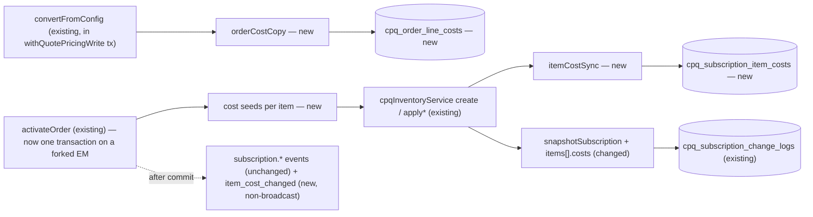
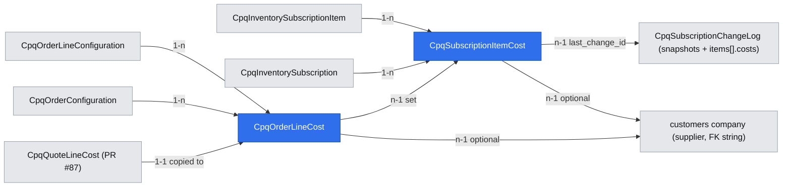

# CPQ cost-plus: carry quote costs to orders and subscriptions (no billing impact) with ARC safety

Extends: .ai/specs/2026-11-12-cpq-cost-plus-quote-pricing-margin.md
Extends: .ai/specs/2026-11-10-cpq-manual-price-adjustments.md
Extends: .ai/specs/2026-11-10-cpq-quote-pricing-integrity.md
Extends: specs/implementation/xd-250-arc-spec.md
Extends: specs/implementation/xd-215-customer-inventory.md
Extends: specs/implementation/xd-249-billing-spec.md

App Spec: `.ai/specs/2026-11-11-app-spec-cpq-cost-plus-pricing.md` is the source of truth (§1.3, §1.4.2, §1.4.6 last paragraphs, R12, R13 Phase 1 safety, I-4, I-7, I-9, I-10, §3 WF5 / WF6 reality check, §3.5, §7 Phase 1).
Brief: `.ai/specs/briefs/2026-11-11-cpq-cost-plus-order-subscription-costs.md`.
Stories: US-5.1, US-5.3, US-6.5.
Commit plan: `.ai/specs/app-spec-notes/cost-plus-commits-WF.md` #17b, #18, #19, #20, #20a. The conversion guard (#17, R7 / `COSTS_NOT_CONFIRMED`) and the post-conversion price freeze are specified in the PR #87 spec and are reused here, not redefined.
Depends on: `.ai/specs/2026-11-12-cpq-cost-plus-quote-pricing-margin.md` (PR #87) — specifically its `cpq_quote_line_costs` table, `costService` (toggle + `cpq.costs.view` redaction helper), `computeQuoteMargin()`, the conversion guard, the ACL features `cpq.costs.view` / `cpq.costs.manage` and the toggle `cpq.cost_plus`. This spec's PRs merge after that spec's PR 2 (Phases B–C).

`P/` = `packages/cpq/src/modules/cpq/`.

## 📝 TLDR

Today a quote's costs (added by the PR #87 feature) stop at the quote: conversion copies only `charges` / totals to the order (`P/services/cpqOrderService.ts:290-311`), activation copies them to subscription items (`:631-644`), and nothing records what a live item costs to deliver.

**Proposed (future behavior):**
- **Conversion** copies every quote cost line to a new `CpqOrderLineCost` in the same transaction as the order (same `cost_key`, `source_quote_line_cost_id`). Order costs never affect the order price.
- **Activation** creates one `CpqSubscriptionItemCost` per costed item and `cost_key`, whose **id never changes for the life of the purchase**. Activation becomes all-or-nothing (one DB transaction). The order line cost is linked to the item cost it set.
- **Cost history** is the existing `CpqSubscriptionChangeLog`: `snapshotSubscription` adds `items[].costs[]`, so every before → after is in the row of the order that caused it. The change-log API strips `costs` for users without `cpq.costs.view`. A non-broadcast `cpq.subscription.item_cost_changed` (no amounts) is emitted per created / changed / ended / re-pointed item cost.
- **UI:** order costs and margin (order page + `order-cpq-tab`), item costs and item margin, and cost diffs inside the existing Change History. Reps (who hold `cpq.costs.view` by default) see them read-only.
- **ARC safety until cost carry-over ships (Phase 3):** Renew mirror lines of cost-plus items are frozen at the contracted price with a banner. Reconfigured mirror lines get catalog cost lines (a widening of the PR #87 eligibility, App Spec R1a). At ARC activation a minimal write-back keeps item costs truthful: cancelled / removed items end their costs, reconfigured mirror lines update them in place (same ids; unchanged rows are not touched), added items create them, and a merge re-points them to the cloned items.
- **Billing payloads stay byte-identical** (I-9), with the toggle on or off.

## Resolved assumptions (autonomous defaults)

| # | Question | Applied default | Rationale | Confirm? |
|---|---|---|---|---|
| Q1 | Activation is not transactional today (`activateOrder` flushes several times on the request EM: `cpqOrderService.ts:339-401`, `cpqInventoryService.ts:448, 468, 1042, 1058`). How do item costs get written "in the same transaction as the items"? | `activateOrder` forks the request EM (`em.fork({ clear: true, useContext: false })`, the `withQuotePricingWrite` pattern, `quotePricingWrite.ts:27`) and runs the whole activation (new-sale and ARC branches, order status update) inside `fork.transactional(tx => …)` (equivalently `withAtomicFlush(tx, phases, { transaction: true })`). Every DB access uses `tx`: the order service passes it down explicitly, and the inventory work runs on `new DefaultCpqInventoryService(tx)` (via a `cpqInventoryService.withEntityManager(tx)` factory), never on the DI `this.em`. Post-commit events and the response DTO run after the commit. After a rollback nothing persists and the request EM is not dirtied. | The brief and App Spec WF5 edge case 3 require item costs to be written atomically with the items. A partial activation today can also leave a subscription behind a still-`draft` order, and a retry creates a second subscription. One boundary fixes both and removes the need for a cost-specific retry path. It is also what `xd-250-arc-spec.md` (lines 1058, 1182) already specifies. | ⚠ NEEDS HUMAN CONFIRMATION — changes the failure semantics of a hot path (a late failure now rolls back the whole activation). Reversible by removing the wrapper. |
| Q2 | Assetizable order lines become assets, not subscription items (`cpqOrderService.ts:613-620, 686-713`). Where do their costs go? | No item cost. Their `CpqOrderLineCost` rows stay on the order with `subscription_item_cost_id = null` and are shown there. | An asset is not a subscription item. Hanging the cost on the parent item would distort that item's margin. | reversible |
| Q3 | Item margin basis | `total_amount` (cost model applied, × line quantity, in the subscription currency) is stored on order line and item costs. Item MRC margin = `item.mrcAmount` − Σ open MRC `total_amount`; NRC margin = `item.nrcAmount` − Σ NRC `total_amount`, labelled "at activation". | `item.mrcAmount` is a line total with quantity applied (`cpqOrderService.ts:1165-1169`, `:638`), so costs must be on the same basis. It matches the PR #87 cost-total definition. | reversible |
| Q4 | When is a Renew mirror line "cost-plus" (and therefore frozen)? | When the source item's stored `charges` have a charge with `pricingMethod: 'cost_plus'`, **or** the item has an active `price_basis` item cost, **or** the item's offering has a cost-plus charge today. | Any of the three can produce a wrong price on re-pricing without carried costs. Freezing keeps the contracted price, which is the safe outcome (US-6.5). | reversible |
| Q5 | Which ARC mirror lines write back costs at activation? | Only a **reconfigured** mirror line — one carrying the new quote-only marker `_arcReconfigured`, set whenever a mirror line's pricing inputs change (Amend or Renew; un-freezing an Amend line sets it too) — replaces its item's costs from its order line costs, by `cost_key`. Every other mirror line (frozen, or a Renew line re-priced at standard without reconfiguration) leaves item costs untouched, because it has no catalog cost lines (R1c). `add` lines create item costs. `cancel` lines and Cancel quotes end them. A merge re-points them. An unchanged cost row is never written and emits no event. | This is App Spec §3 "Production reality check" WF6 ("a re-priced (reconfigured) mirror line updates the item's costs … untouched mirrors leave item costs as they are"), made precise against the code's line kinds (`cpqInventoryService.ts:1615-1775`). Keying on "not frozen" would end the costs of every unreconfigured Renew mirror. | reversible |
| Q6 | Do manual inventory operations outside ARC (status route terminate, item soft delete — `cpqInventoryService.ts:507-568, 664-678`) end item costs? | No. An item cost is **open** when `status = active` and its item is not `terminated` / `expired` / `superseded` / deleted. Margin, usage and UI use "open". | These operations write no change-log row, so ending costs there would create history-less changes (I-10). Filtering on item status keeps margins correct with no new write path. | reversible |
| Q7 | Change-log redaction scope | The change-log route returns `before_snapshot` / `after_snapshot` with every `items[].costs` key removed when the caller lacks `cpq.costs.view` **or** the toggle is off. The route itself is unchanged otherwise (no `403`). | App Spec US-5.3 failure path and R14 (cost columns hidden when off). It reuses the PR #87 redaction helper. | reversible |
| Q8 | `ended_at` for Cancel / removal | The change-log `effective_at` of the activating order (activation time — no operator cancel date exists in the Cancel path, `cpqInventoryService.ts:1822`). **This amends App Spec R13** ("`ended_at` = the cancel effective date") for Phase 1; the App Spec changelog records it. | App Spec R13 ("= the cancel effective date") and US-6.4 ("effective date − 1") disagree, and the code has no cancel effective date. The Phase 3 ARC feature owns that date; Phase 1 records the only date the code knows. | reversible |
| Q9 | A `cost_key` ended on an item comes back later (e.g. a re-priced Renew mirror re-instantiates an element) | The same row is reactivated (`status = active`, `ended_at = null`, values updated). No second row. | I-10: one id per (item, `cost_key`) for the life of the purchase. | reversible |
| Q10 | Snapshot shape for items without costs | The `costs` key is **omitted** for items with no item cost, so snapshots of uncosted subscriptions are byte-identical to today's. | Keeps existing change-log consumers and fixtures unchanged (I-8 spirit). | reversible |
| Q11 | Read endpoints and toggle | `GET /api/cpq/orders/{orderId}/costs` (`cpq.orders.view`) and `GET /api/cpq/inventory/subscriptions/{subscriptionId}/costs` (`cpq.inventory.view`) follow the PR #87 `GET /quotes/{id}/costs` model: without `cpq.costs.view` they return a **status-only projection** (ids, `cost_key`, name, role, value status, item-cost status — no amounts, suppliers, FX or margin); with it, the full projection. `404` when the toggle is off, as every PR #87 cost endpoint. Writes (conversion copy, activation, write-back) run regardless of the toggle. | PR #87 two-projection read contract, its Resolved assumption Q8, and App Spec R14 ("the toggle never weakens data paths"). | reversible |
| Q12 | `CpqSubscriptionItemCost.last_change_id` needs the change-log id | Order per activation step: write item costs → take the after-snapshot → `createChangeLog` (which now pre-generates its id with `crypto.randomUUID()`, like items do at `cpqInventoryService.ts:1250, 1607`) → set `last_change_id` on the rows written in that step → flush. `last_change_id` is not part of the snapshot. | Today the id is a DB default (`entities.ts:1405`) and `sub.lastChangeLogId = log.id` (`cpqInventoryService.ts:467, 1057`) is read before the insert. Pre-generating is additive and also makes that existing assignment reliable. | reversible |
| Q13 | Mirror lines and catalog cost lines | Widen the PR #87 eligibility: reconfigured (re-priced) Amend and Renew mirror lines instantiate catalog cost lines (App Spec R1a "and on a reconfigured mirror"); unreconfigured mirror lines never do (R1c), including frozen cost-plus Renew mirrors. | PR #87 limits instantiation to "configured, non-mirror" lines, so a re-priced cost-plus mirror would have no price basis and no costs to write back. The ARC (Phase 3) spec aligns to this. | reversible |

## 📝 Problem Statement

- **Costs vanish at conversion.** `convertFromConfig` builds order lines from `charges` / `nrcTotal` / `mrcTotal` only (`P/services/cpqOrderService.ts:237-312`). Nothing reads `cpq_quote_line_costs` after the PR #87 guard passes.
- **Live items have no cost.** Activation copies `charges` and totals to `CpqInventorySubscriptionItem` (`:631-644`; ARC `cpqInventoryService.ts:1634-1660, 1749-1764`). `CpqInventoryAsset.purchasePrice` is the sale NRC (`cpqOrderService.ts:703`). Renewals therefore start blind (App Spec WF5 ROI: 100% of activated costed items must record their contracted cost; today 0%).
- **History exists but has no costs.** `CpqSubscriptionChangeLog` already stores before / after snapshots per order (`P/data/entities.ts:1387-1482`, `snapshotSubscription` `cpqInventoryService.ts:1506-1561`), so it is the natural place for cost history — but the snapshot has no cost field.
- **ARC would mis-price or go stale.**
  - Renew mirrors are re-priced at today's standard (`P/services/arcPriceFreeze.ts:58-76` freezes Amend only; `cpqQuotingService.ts:1009-1020`).
  - PR #87 instantiates catalog cost lines only on "configured, non-mirror" lines (its requirement "Quote cost lines from catalog cost elements"). A re-priced cost-plus mirror line therefore has **no** price-basis cost line: the engine returns `NO_PRICE_BASIS_COST`, so the line has no price and is not ready. An unreconfigured cost-plus Renew mirror fails the same way, and a reconfigured Amend / Renew mirror cannot be priced from cost at all. App Spec R1a says a reconfigured mirror must instantiate catalog costs.
  - A Cancel terminates items (`cpqInventoryService.ts:1400-1446, 537-546`) and a merge clones them under new ids (`:1243-1281`), so any cost row keyed to the old item would stay live on a dead item.
- **Activation is not atomic.** `activateOrder` uses the request EM with several independent flushes (`cpqOrderService.ts:339-401`; `createSubscription` flushes at `cpqInventoryService.ts:448` and `:468`). A failure after the first flush leaves a subscription while the order stays `draft`; a retry creates a second subscription.

## 📝 Prior spec drift

- **App Spec WF5 edge case 2** says an activation retry is idempotent via `unique (subscription_item_id, cost_key, effective_from)`. The code has no new-sale activation idempotency (only ARC paths check `findIdempotentChangeLog`, `cpqInventoryService.ts:1020-1028, 1491-1504`), and `effective_from` was dropped by the stable-id decision (App Spec changelog 2026-11-12). This spec makes activation atomic instead (Q1); the unique key is `(subscription_item_id, cost_key)`.
- **App Spec US-5.2** (Phase 3) says activation takes the quote-configuration lock. `activateOrder` takes no lock (`cpqOrderService.ts:339-401`). Not needed in Phase 1 (no post-conversion cost writes exist yet); left to the Phase 3 feature.
- **App Spec R13 vs US-6.4** disagree on `ended_at` (effective date vs effective date − 1). See Q8.
- **`specs/implementation/xd-250-arc-spec.md`** §Activation (lines 1058, 1123, 1182) says `activateOrder` wraps the entire activation in `withAtomicFlush(em, phases, { transaction: true })` with full rollback. The code does not: it flushes per step (`cpqOrderService.ts:339-401`), with the optimistic-lock `409` as the only concurrency guard (`api/orders/[orderId]/activate/route.ts:26-38`). Q1 deliberately restores the prior spec's boundary, because this feature needs it.
- The subscription detail page loads the change log with a raw `fetch` (`backend/cpq/inventory/subscriptions/[id]/page.tsx:283`), which AGENTS.md forbids. New calls in this spec use `apiCall`; the existing call is migrated in step 19 because the page changes anyway.

## 📝 Proposed Solution

1. **Order copy (conversion).** Inside `convertFromConfig`, which already runs in `withQuotePricingWrite`'s transaction (`cpqOrderService.ts:136-140`, `quotePricingWrite.ts:29-46`), after the order lines are created, load the quote's non-deleted cost lines and persist one `CpqOrderLineCost` per cost line on the mapped order line (`quoteLineIdToOrderLineId`, `:235-246`). `total_amount` is taken from `computeQuoteMargin()` per cost line so the order shows exactly the margin the quote showed.
2. **Item costs (activation).** `activateOrder` runs in one transaction on a forked EM that it passes down explicitly (Q1). The order service loads the order line costs and passes them as **cost seeds** on each item input (`CreateSubscriptionItemInput.costs`, `ArcLineChange.costSeeds` + `costSync`). `cpqInventoryService` stays ignorant of orders: a new pure-ish helper `services/costs/itemCostSync.ts` creates, updates, ends and re-points `CpqSubscriptionItemCost` rows, **before** the after-snapshot is taken, and returns the change list. The order service then sets `CpqOrderLineCost.subscription_item_cost_id` and queues `item_cost_changed` events after commit.
3. **History.** `snapshotSubscription` loads the subscription's item costs in one query and adds `items[].costs[]` (omitted when empty, Q10). The change-log route strips it without `cpq.costs.view` (Q7).
4. **UI.** Order costs + margin; subscription item costs + item margin; cost diffs per change-log row.
5. **ARC safety.**
   - `buildArcMirrorConfiguration` freezes Renew mirror lines of cost-plus items (Q4) with a new marker `_arcCostPlusFrozen` beside `_arcPriceFrozen`; the frozen-line checks accept Renew lines carrying it.
   - The line-update path (`cpqQuotingService.ts:450-470`) sets the quote-only marker `_arcReconfigured` on any mirror line whose pricing inputs change (`arcPricingInputsChanged`), Amend or Renew.
   - The PR #87 cost resolution instantiates catalog cost lines on mirror lines carrying `_arcReconfigured` and on no other mirror line (Q13).
   - Activation write-back per Q5, with no-op suppression.

**Alternatives considered:**
- **Orders read quote cost lines** (architect checkpoint #1): overruled by the user (2026-11-12) — an order must keep its own costs for Phase 3 re-confirmation.
- **Close-and-reopen item cost rows per change:** ids would change per ARC; rejected by the user (I-10).
- **A separate cost-history entity:** duplicates the change log, which already has the per-order before / after and the quote / order links.
- **Writing item costs from a subscriber on `cpq.subscription.activated`:** events are best-effort after commit (`cpqOrderService.ts:389-398`); a lost event would lose costs (WF5 edge case 3).
- **Costs in billing payloads:** excluded (I-9, App Spec §1.2).

**Research (market leaders):**
- **Salesforce CPQ** copies quote-line cost fields to order products and, when contracting, to subscription records; amendments create additional delta subscription records instead of updating one. **Adopted:** the cost travels with the line through order and contract. **Not adopted:** delta records — we keep one row per item and cost key and put the before / after in the change log.
- **Zuora** versions rate plan charges per amendment (charge segments). **Not adopted:** segment versioning is billing-centric; our costs never bill.
- **Odoo** keeps the purchase price on the sale order line and computes order / subscription margin from it, behind a group permission. **Adopted:** order and item margin from stored costs, permission-gated server-side.
- **Chargebee** has no cost concept — confirming that cost belongs in CPQ, not in billing.

## 📝 Delta

### Capability: cpq-cost-carry-through

#### ADDED Requirement: Order line costs copied at conversion
The system SHALL copy every non-deleted quote cost line to exactly one `CpqOrderLineCost` on the corresponding order line when a quote is converted, in the same transaction as the order, keeping `cost_key`, values, currency, FX / index snapshots, supplier, validity and supplier term, and recording `source_quote_line_cost_id`. Order line costs SHALL NOT change any order price.

##### Scenario: Convert a costed quote
- WHEN an accepted quote whose tail line has a confirmed `price_basis` cost of 270 EUR and a `margin_only` installation cost of 1500 EUR is converted
- THEN the order line has two order line costs with the same `cost_key`s and values, and the order line's `charges`, `nrcTotal` and `mrcTotal` equal those of a conversion of the same quote without costs

##### Scenario: Conversion fails mid-way
- WHEN copying a cost line throws
- THEN no order, order line or order line cost exists afterwards

#### ADDED Requirement: Subscription item costs at activation
The system SHALL create, when an order activates a new subscription item, one `CpqSubscriptionItemCost` per order line cost of that item's order line (status `active`, `started_at` = activation date), in the same transaction as the item, and SHALL set the order line cost's `subscription_item_cost_id`. At most one item cost SHALL exist per (subscription item, `cost_key`), and its id SHALL never change.

##### Scenario: Activate a new sale
- WHEN the order from the previous scenario is activated
- THEN the tail item has two item costs (270 and 1500 EUR), each order line cost points at its item cost, and `cpq.subscription.item_cost_changed` is emitted twice with `cause: 'activation'` after commit

##### Scenario: Activation fails after the items are written
- WHEN activation throws after the subscription and its items were flushed
- THEN no subscription, item, item cost or change-log row remains, the order is still `draft`, and a retry activates it once

##### Scenario: Toggle off
- WHEN the tenant toggle `cpq.cost_plus` is off and a converted order with order line costs is activated
- THEN item costs are written exactly as with the toggle on

#### ADDED Requirement: Billing payloads are unaffected by costs
The system SHALL emit `cpq.subscription.activated`, `amended`, `renewed`, `cancelled`, `merged` and `superseded` payloads that are byte-identical (ignoring generated ids and timestamps) for the same quote with and without cost lines, and with the toggle on or off.

##### Scenario: Golden billing payload
- WHEN two identical quotes, one with cost lines and one without, are converted and activated
- THEN the two `cpq.subscription.activated` payloads are equal after normalizing ids and timestamps

#### ADDED Requirement: Order and item costs are confidential
The system SHALL return order line cost and item cost amounts, suppliers, FX data and margins only to users with `cpq.costs.view`, only while the toggle is on. Users with the read feature but without `cpq.costs.view` SHALL get a status-only projection. The system SHALL emit `cpq.subscription.item_cost_changed` with no amount and `clientBroadcast: false`.

##### Scenario: User without cost access
- WHEN a user with `cpq.orders.view`, `cpq.inventory.view` and `cpq.arc.changelog.view` but not `cpq.costs.view` reads the order, subscription, item, change-log and cost routes of an order whose tail cost is 7777.77
- THEN the cost routes return only ids, cost keys, names, roles and statuses, and no payload contains 7777.77, a supplier name, or a key named `unitAmount`, `instanceAmount`, `totalAmount`, `fxRate`, `supplier*` or `margin*`, and no change-log snapshot item has a `costs` key

#### ADDED Requirement: Order and item margin
The system SHALL compute, for holders of `cpq.costs.view`, the order margin from order line `charges` and order line costs (the PR #87 margin rules), and per subscription item the MRC margin (`mrcAmount` − Σ open MRC item cost totals) and the NRC margin at activation (`nrcAmount` − Σ NRC item cost totals), with cost coverage. Margin SHALL NOT be stored.

##### Scenario: Item margin
- WHEN an item has `mrcAmount` 400 and one open MRC item cost with `total_amount` 270
- THEN its MRC margin is 130 and its margin % is 32.5

#### ADDED Requirement: Usage reports live costed subscriptions
The system SHALL report in `GET /api/cpq/cost-plus/usage` the number of subscriptions with at least one open item cost as `liveSubscriptions`.

##### Scenario: Before switching the toggle off
- WHEN one active subscription has an open item cost
- THEN `liveSubscriptions` is 1

### Capability: cpq-subscription-history

#### ADDED Requirement: Item costs in change-log snapshots
The system SHALL include in every change-log `before_snapshot` / `after_snapshot` item, when the item has item costs, a `costs` array with each cost's id, `cost_key`, name, role, cost type, charge code, status, value status, amounts, currency, FX, supplier, supplier quote ref, validity, supplier term, `started_at` and `ended_at`. Items without item costs SHALL have no `costs` key.

##### Scenario: Created row
- WHEN a new sale with a 270 EUR tail cost is activated
- THEN the `created` change-log row's `after_snapshot` item carries `costs: [{ costKey: 'tail', unitAmount: '270.0000', status: 'active', … }]`

##### Scenario: Uncosted subscription
- WHEN a subscription without item costs is amended
- THEN its `before_snapshot` and `after_snapshot` are byte-identical to the snapshots produced before this change

#### ADDED Requirement: Change-log cost redaction
The system SHALL remove every `items[].costs` key from change-log snapshots returned to users without `cpq.costs.view`, or while the toggle is off, and SHALL otherwise return the change log unchanged.

##### Scenario: Rep without cost access
- WHEN a user with `cpq.arc.changelog.view` but not `cpq.costs.view` lists the change log of a costed subscription
- THEN the rows, snapshots and line changes are returned without any `costs` key

### Capability: cpq-quote-lifecycle

#### MODIFIED Requirement: Quote to order conversion
The system SHALL refuse to convert a quote whose stored pricing contains an invalid manual adjustment, refuse it while any price-basis cost line is not `confirmed` or has `valid_until` before the conversion date (`422 COSTS_NOT_CONFIRMED`, listing the lines), keep today's `cancelled` / `rejected` refusal, and take the quote's pricing lock while converting. Once an order exists, cost lines SHALL NOT change the quote's prices. A successful conversion SHALL copy every non-deleted quote cost line to exactly one order line cost in the same transaction.

##### Scenario: Estimated tail blocks conversion
- WHEN an accepted quote has an `estimated` price-basis cost
- THEN conversion returns `422 COSTS_NOT_CONFIRMED` naming the line, and no order or order line cost is created

##### Scenario: Margin-only costs never block
- WHEN only a `margin_only` cost is unconfirmed
- THEN conversion succeeds and that cost is copied with its `value_status`

Frozen by: `packages/cpq/src/modules/cpq/services/__tests__/cpqOrderService.test.ts`

Note: this replaces the PR #87 MODIFIED text of the same requirement, adding only the last sentence and the copy outcomes.

#### ADDED Requirement: Order activation
The system SHALL activate an order (new sale or ARC) atomically: subscriptions, items, assets, item costs, change-log rows and the order status SHALL be committed together or not at all, and lifecycle events SHALL be emitted only after the commit. A failed activation SHALL leave no pending change in the caller's entity manager.

##### Scenario: Late failure
- WHEN activation fails after the items, item costs and change-log row were flushed
- THEN no subscription, item, asset, item cost or change-log row from that activation exists, the order keeps its previous status, no event is emitted, and the request entity manager has no pending change sets

##### Scenario: Retry after a failure
- WHEN the same order is activated again after that failure
- THEN exactly one subscription is created

Note: no capability file records activation yet, so this is ADDED. Step 1 still pins today's non-atomic flush sequence in a test so the change is reviewable.

### Capability: cpq-arc

#### ADDED Requirement: Frozen Renew mirror lines of cost-plus items
The system SHALL keep re-pricing engine-priced mirror lines on a Renew quote at the current standard price, **except** a mirror line whose source item is cost-plus (its stored charges contain a cost-plus charge, it has an active price-basis item cost, or its offering has a cost-plus charge today). Such a line SHALL be created frozen at the item's stored charges, SHALL show the banner "Costs are not carried to change quotes yet", and SHALL be re-priced only when a pricing input of the line changes (the Amend rule).

##### Scenario: Renew a cost-plus item
- WHEN a Renew quote mirrors an item priced 400 from a 320 tail cost, and the tail's catalog element now resolves to 360
- THEN the line keeps 400, no catalog cost line is instantiated on it, and the banner is shown

##### Scenario: Renew a standard item
- WHEN a Renew quote mirrors an item whose charges are all `fixed` / `table`
- THEN the line is re-priced at today's standard, as before

##### Scenario: Reconfigured cost-plus mirror
- WHEN the rep changes the bandwidth of that frozen Renew line
- THEN the line is un-frozen, marked re-priced and reconfigured, gets catalog cost lines, and is priced from today's catalog costs

Note: ADDED, not MODIFIED. The archived requirement "Amend mirror line pricing" (`capabilities/cpq-arc.md`) covers Amend lines only and its text is unchanged; Renew re-pricing was never recorded. Step 1 still pins today's Renew re-pricing in `cpqQuotingService.arc.test.ts`.

#### ADDED Requirement: Minimal item-cost write-back at ARC activation
The system SHALL, when an Amend, Renew or merge-Renew order activates:
- end the item costs (`status = ended`, `ended_at` = the change-log `effective_at`) of every item removed by a `cancel` line;
- replace the item costs of every item whose mirror line was reconfigured (`_arcReconfigured`) with that line's order line costs, matched by `cost_key` — updating existing rows in place, creating rows for new keys, reactivating ended rows for returning keys and ending rows whose key is missing;
- create item costs for items added by `add` lines;
- leave the item costs of every other mirror line (frozen, or re-priced at standard without reconfiguration) unchanged;

and SHALL, when a Cancel order activates, end every open item cost of the subscription. A cost row whose values and status would not change SHALL NOT be written and SHALL NOT emit `item_cost_changed` (its `last_change_id` keeps pointing at the order that last changed it). No item cost id SHALL change, and every change SHALL be visible in that order's change-log snapshots.

##### Scenario: Cancel
- WHEN a Cancel order for a subscription with two open item costs activates
- THEN both rows keep their ids with `status = ended`, the `cancel` row's `before_snapshot` shows them active and its `after_snapshot` shows them ended, and two `item_cost_changed` events with `cause: 'cancel'` are emitted

##### Scenario: Re-priced mirror
- WHEN an Amend mirror line was reconfigured and its order line cost `tail` is 300 while the item cost `tail` was 270
- THEN the same item cost row now has 300, the `amend` row shows 270 → 300, and the billing payload is unchanged by the cost (it changes only through the existing price path)

##### Scenario: Untouched frozen mirror
- WHEN a frozen Renew mirror line is activated
- THEN its item costs are unchanged and no `item_cost_changed` is emitted for them

##### Scenario: Reconfigured mirror with an unchanged cost
- WHEN a reconfigured mirror line's order line cost `install` has the same values as the item cost `install`, and only `tail` changed
- THEN only `tail` is written and only one `item_cost_changed` (`kind: 'changed'`) is emitted

#### ADDED Requirement: Item costs follow a merge
The system SHALL, when a merge-Renew clones source items onto the merged subscription, re-point each open item cost of a cloned item to the clone (`subscription_item_id`, `subscription_id`) without changing its id, before the `merge-result` snapshot is taken.

##### Scenario: Merge two subscriptions
- WHEN subscriptions A and B, each with one costed item, are merged into M
- THEN M's two items carry the same two item cost ids, the `merge-result` `after_snapshot` shows them, and two `item_cost_changed` events with `cause: 'merge'` are emitted

### Capability: cpq-quote-pricing

#### MODIFIED Requirement: Quote cost lines from catalog cost elements
The system SHALL keep exactly one non-deleted catalog cost line per applicable active cost element, matched by cost key, on every configured quote line that is either not an ARC mirror line or an ARC mirror line (Amend or Renew) that has been reconfigured. Unreconfigured mirror lines, including frozen cost-plus Renew mirrors, SHALL never get catalog cost lines (App Spec R1c). On every saved recalculation it SHALL resolve `fixed` and `table` values and soft-delete cost lines whose element no longer applies.

##### Scenario: Add a costed product
- WHEN a rep adds a product whose `tail_mrc` charge has a `table` element and an `on_request` element with estimate 300
- THEN the line has two cost lines: one `confirmed` with the table value (origin `catalog`), and one `estimated` at 300

##### Scenario: Reconfigure a driving attribute
- WHEN the line's `bandwidth` (a dimension of the tail element) changes from 1G to 10G
- THEN the `on_request` cost line goes back to its catalog estimate (or `none`), and its previous value is kept in `note`

##### Scenario: Unreconfigured Amend mirror
- WHEN an Amend quote mirrors a subscription item and nothing on the line changes
- THEN no catalog cost lines are created on the mirror line

##### Scenario: Frozen cost-plus Renew mirror
- WHEN a Renew quote mirrors a cost-plus item and nothing on the line changes
- THEN no catalog cost lines are created on the mirror line

##### Scenario: Reconfigured Amend or Renew mirror
- WHEN the rep changes the bandwidth on an Amend or Renew mirror line whose charge has a `table` cost element
- THEN the line gets one `catalog` cost line per applicable element (App Spec R1a "and on a reconfigured mirror"), and a cost-plus charge on it is priced from them

Frozen by: `packages/cpq/src/modules/cpq/services/costs/__tests__/costResolution.test.ts` (created by PR #87 step 8)

Note: this modifies the PR #87 ADDED requirement of the same name. It **widens eligibility**: PR #87 limits instantiation to "configured, non-mirror" lines, while App Spec R1a also covers reconfigured mirrors. The Phase 3 ARC spec aligns to this wording.

## 📝 Architecture

- **Module:** `@dainamite/cpq` only. No imports from other `src/modules`, no ORM relations; `supplier_id` stays an FK string. `@dainamite/cpq-billing-connector` and `@dainamite/billing` are untouched (I-9).
- **Reused:**
  - `withQuotePricingWrite` — conversion already runs in its transaction (`quotePricingWrite.ts:10-50`).
  - The `withQuotePricingWrite` isolation pattern (`em.fork({ clear: true, useContext: false })` + `transactional`, `quotePricingWrite.ts:27-46`) for activation (Q1), or equivalently `withAtomicFlush(tx, phases, { transaction: true })` from `@open-mercato/shared/lib/commands/flush` on the fork.
  - PR #87 `computeQuoteMargin()` (cost totals per cost line; order margin via an adapter over order lines), `costService.enabled()` and the `cpq.costs.view` redaction helper.
  - `snapshotSubscription` / `createChangeLog` / `findIdempotentChangeLog` (`cpqInventoryService.ts:1491-1561, 1797-1836`).
  - `buildArcMirrorConfiguration` / `isFrozenAmendMirrorLine` / `stripQuoteOnlyArcMarkers` (`arcPriceFreeze.ts:47-92`) and the existing un-freeze path (`cpqQuotingService.ts:450-470`).
  - `handleArcError`, `resolveCpqRouteContext`, `emitCpqEvent`.
- **New code:**
  - `services/costs/orderCostCopy.ts` — `copyQuoteCostsToOrder(tx, quote, quoteLineIdToOrderLineId)`.
  - `services/costs/itemCostSync.ts` — `createItemCosts`, `replaceItemCosts`, `endItemCosts`, `repointItemCosts`; each returns `ItemCostChange[]` (`{ itemCostId, subscriptionId, subscriptionItemId, costKey, supplierId, kind: 'created'|'changed'|'ended'|'repointed', orderLineCostId? }`).
  - `services/costs/itemMargin.ts` — pure item / subscription margin.
  - `services/costs/costPlusItem.ts` — `isCostPlusItem(item, itemCosts, offeringCharges)` (Q4).
- **Changed signatures (internal, additive):**
  - `DefaultCpqInventoryService.withEntityManager(em)` returns an instance bound to the given EM; `activateOrder`'s helpers (`loadOrderConfig`, `loadSalesOrder`, `createInventoryFromOrder`, `applyArcOrder`) take the transaction EM as a parameter instead of reading `this.em`.
  - `CreateSubscriptionItemInput.costs?: ItemCostSeed[]`; `ArcLineChange.costSeeds?: ItemCostSeed[]` and `costSync?: 'create' | 'replace' | 'none'` (`cpqInventoryService.ts:66-89, 166-183`).
  - `ApplyArcResult` / `ApplyMergeRenewalResult` / `createSubscription` gain `itemCostChanges: ItemCostChange[]`.
  - `applyLineChanges` returns `itemIdByQuoteLineId` (already computed as `quoteLineToFinalItemId`, `:1602-1613`).
  - `createChangeLog` pre-generates its id (Q12).
- **Write ordering inside each activation step** (`createSubscription`, `applyAmendment`, `applyRenewal`, `applyMergeRenewal`, `applyCancel`): before-snapshot → item / asset changes → **item cost writes** (`itemCostSync`, no-op rows skipped) → flush → after-snapshot (now with `items[].costs`) → `createChangeLog` → set `last_change_id` on the item cost rows written in this step → flush. `itemCostSync` compares each target row's value fields and status with the seed before writing; an equal row is neither updated nor reported in `itemCostChanges`.
- **Current consumers affected:**
  - Subscription lifecycle events: unchanged payloads. `buildArcAddedItems` reads only `id` / `name` from the after-snapshot (`cpqOrderService.ts:1214-1245`), so the new `costs` key cannot reach billing; the golden test freezes it.
  - Change History UI (`backend/cpq/inventory/subscriptions/[id]/page.tsx:754-790, 934-1010`) reads snapshots; the new key is additive.
  - The activate route's `OptimisticLockError → 409` (`api/orders/[orderId]/activate/route.ts:26-38`) still applies; with Q1 the whole activation rolls back on it.
- **Future work served:** Phase 3 carried costs read item costs (`carried_from_item_cost_id`), set `subscription_item_cost_id` at conversion, and replace the Renew freeze; Q-D13 re-confirmation writes `reconfirmed_*` (created nullable now).

Takeaway: costs ride the existing conversion and activation transactions and the existing change log; billing events are emitted from the same unchanged builders.

## 📝 Data Model

Both tables: tenant-scoped standard columns (`id` uuid, `organization_id`, `tenant_id`, `created_at`, `updated_at`, `deleted_at`), generated with `yarn mercato db generate` into `packages/cpq/src/modules/cpq/migrations/`, additive only, not registered in `ce.ts` or search (PR #87 Q7).

**Shared cost value columns** (same names and types as `cpq_quote_line_costs`, App Spec §1.4.6): `cost_key` text, `cost_element_id` uuid null, `charge_code` text null, `name` text, `role` text, `cost_type` text, `source` text, `cost_model` text, `origin` text, `value_status` text, `value_origin` text null, `unit_amount` numeric(18,4) null, `instance_amount` numeric(18,4) null, **`total_amount` numeric(18,4) null** (subscription / order currency, cost model applied, × line quantity — Q3), `currency_code` text null, `fx_rate` numeric(18,8) null, `fx_rate_date` date null, `index_snapshot` jsonb null, `supplier_id` uuid null, `supplier_name` text null, `supplier_quote_ref` text null, `valid_until` date null, `supplier_term_end` date null, `supplier_min_term_months` integer null, `note` text null.

**`cpq_order_line_costs` (new)**

| Column | Type | Null | Rules |
|---|---|---|---|
| shared cost value columns | | | copied verbatim from the quote cost line; `total_amount` from `computeQuoteMargin()` |
| `order_configuration_id` | uuid | no | FK string → `cpq_order_configurations` |
| `order_line_id` | uuid | no | the sales order line id (`CpqOrderLineConfiguration.orderLineId`) |
| `source_quote_line_cost_id` | uuid | no | |
| `subscription_item_cost_id` | uuid | yes | set at activation (null for asset lines, Q2; Phase 3 sets it at conversion for carried costs) |
| `reconfirmed_at`, `reconfirmed_by_user_id` | timestamptz, uuid | yes | unused until Phase 3 (Q-D13) |

Indexes: `(organization_id, tenant_id, order_configuration_id)`, `(organization_id, tenant_id, order_line_id)`, `(organization_id, tenant_id, subscription_item_cost_id)`; partial unique `(order_line_id, cost_key) WHERE deleted_at IS NULL`.

**`cpq_subscription_item_costs` (new)**

| Column | Type | Null | Rules |
|---|---|---|---|
| shared cost value columns | | | from the order line cost at creation / replace |
| `subscription_id`, `subscription_item_id` | uuid | no | re-pointed on merge only |
| `status` | text | no | `active` \| `ended` |
| `started_at` | date | no | activation date of the order that created it |
| `ended_at` | date | yes | Q8 |
| `last_change_id` | uuid | yes | change-log row of the last activation that touched it (Q12) |
| `last_order_line_cost_id` | uuid | yes | the order line cost that last set its values |

Indexes: `(organization_id, tenant_id, subscription_id)`, `(organization_id, tenant_id, subscription_item_id)`, `(organization_id, tenant_id, status)`; partial unique `(subscription_item_id, cost_key) WHERE deleted_at IS NULL` (I-10; Q9 reactivates instead of inserting).

**Changed (no migration):** `CpqSubscriptionChangeLog.before_snapshot` / `after_snapshot` jsonb gain `items[].costs[]` (Q10). The quote line configuration jsonb gains the quote-only markers `_arcCostPlusFrozen` and `_arcReconfigured` (added to `QUOTE_ONLY_ARC_KEYS`, so they never reach orders or items; activation reads them from the source quote lines, which `applyArcOrder` already loads, `cpqOrderService.ts:438-443`).

**Sensitive data:** commercially confidential amounts and supplier references, not personal data. No encryption beyond platform defaults. Access is gated server-side by `cpq.costs.view`; the only cost data outside cost-guarded routes is the change-log snapshot, which the route redacts (Q7). Conversion and activation write no command / audit log entries for costs.

## 📝 API Contracts

Every new route: `requireAuth`, `requireFeatures` (never `requireRoles`), an `openApi` export (tag `CPQ Costs`, `pathParams`, responses incl. `401/403/404`), Zod-validated params, errors through `handleArcError`. Both new routes are read-only, so `runCpqMutationGuards` does not apply; conversion and activation keep their existing guards. Toggle off → `404` on the new routes; data paths keep writing (Q11).

| Method + path | Features | Request | Response / errors |
|---|---|---|---|
| `GET /api/cpq/orders/{orderId}/costs` (new) | `cpq.orders.view` | — | Without `cpq.costs.view` (status-only projection): `{ orderId, lines: [{ orderLineId, costs: [{ id, costKey, name, role, costType, valueStatus }] }] }`. With it: + `currencyCode`, per cost `chargeCode, source, costModel, origin, valueOrigin, unitAmount, instanceAmount, totalAmount, currencyCode, fxRate, fxRateDate, supplierId, supplierName, supplierQuoteRef, validUntil, supplierTermEnd, supplierMinTermMonths, subscriptionItemCostId, sourceQuoteLineCostId`, and `margin` (PR #87 margin shape over the order). `404` order not found or toggle off |
| `GET /api/cpq/inventory/subscriptions/{subscriptionId}/costs` (new) | `cpq.inventory.view` | `?includeEnded=true\|false` (default false) | Without `cpq.costs.view`: `{ subscriptionId, items: [{ subscriptionItemId, itemStatus, costs: [{ id, costKey, name, role, costType, valueStatus, status }] }] }`. With it: + `currencyCode`, the value fields above per cost, `startedAt`, `endedAt`, `lastChangeId`, per-item `margin: { mrcOffer, mrcCost, mrcMargin, mrcMarginPercent, nrcOffer, nrcCost, nrcMargin, coverage }` and a subscription roll-up `margin`. `404` |
| `GET /api/cpq/inventory/subscriptions/{subscriptionId}/change-log` (existing) | unchanged (`cpq.arc.changelog.view`) | unchanged | snapshots gain `items[].costs` for `cpq.costs.view` holders with the toggle on; stripped otherwise (Q7). `openApi` response schema documents the optional `costs` array |
| `POST /api/cpq/orders` convert (existing) | unchanged | unchanged | unchanged response; order line costs written in the same transaction (PR #87 errors unchanged) |
| `POST /api/cpq/orders/{orderId}/activate` (existing) | unchanged (`cpq.orders.manage`) | unchanged | unchanged response; now atomic on a forked EM (Q1); `409` on concurrent modification rolls back everything. Gains an `openApi` export (missing today) |
| CLI `yarn mercato cpq scrub-change-log-costs [--tenant <id>] [--dry-run]` (new, `cli.ts`) | operator only | — | removes every `items[].costs` key from `cpq_subscription_change_logs` snapshots; idempotent; prints the row count. Rollback aid (Risks) |
| `GET /api/cpq/cost-plus/usage` (PR #87) | unchanged | — | `liveSubscriptions` now filled |
| `GET /api/cpq/orders/{orderId}`, inventory subscription / item routes (existing) | unchanged | — | unchanged; no cost fields (leak sweep) |

**Events** (`events.ts`):

| Event id | When | Payload | Broadcast |
|---|---|---|---|
| `cpq.subscription.item_cost_changed` (new, category `custom`) | after commit of an activation / ARC activation / merge that created, changed, ended, reactivated or re-pointed an item cost — one per item cost | `organizationId`, `tenantId`, `subscriptionId`, `subscriptionItemId`, `itemCostId`, `changeLogId`, `costKey`, `effectiveDate`, `supplierId`, `sourceOrderId`, `cause: 'activation' \| 'amend' \| 'renew' \| 'cancel' \| 'merge'`, `kind: 'created' \| 'changed' \| 'ended' \| 'repointed'`; **no amounts** | **no** |
| `cpq.subscription.activated` / `amended` / `renewed` / `cancelled` / `merged` / `superseded` (existing) | unchanged | unchanged (golden test) | yes (unchanged) |

`kind` is an additive field beyond the App Spec §1.4.9 payload; `cause: 'reconfirm'` is reserved for Phase 3. No notifications.

## 📝 UI/UX

- **Users without `cpq.costs.view`** (custom roles) see, on the order and subscription pages, only per-line / per-item cost status chips from the status-only projection; a `404` (toggle off) hides the section.
- **Order detail** (`backend/cpq/orders/[id]/page.tsx`) and **`order-cpq-tab`** (`widgets/injection/order-cpq-tab/widget.client.tsx`), `cpq.costs.view` holders with the toggle on (the page renders what the server projection returns):
  - a **Costs** section per order line (name, role, value status, value, currency, supplier, valid until), "No costs" per uncosted line;
  - an **Order margin** card (contract margin, NRC / MRC margin, margin %, "based on X% coverage") reusing the PR #87 Margin card component;
  - asset lines show their costs with the note "Recorded on the order only (asset)".
- **Subscription detail** (`backend/cpq/inventory/subscriptions/[id]/page.tsx`):
  - per item: current open costs (name, value / month or one-off, supplier, supplier term end, valid until) and **item margin** (MRC margin and %); "No cost recorded" for uncosted items; an "Ended costs" toggle;
  - **Change History** (`:754-790`): `ChangeLogLineDetails` (`:934`) renders, per row, the costs whose value, supplier, validity, supplier term or status differ between `before_snapshot` and `after_snapshot` as "Tail · 270 EUR → 300 EUR · Carrier X", plus "added" / "ended" / "moved from SUB-…" (merge) chips; a per-item filter above the list. Rendered only when the API returned `costs` keys.
  - The change-log load moves from raw `fetch` (`:283`) to `apiCall`.
- **Renew quote** (`backend/cpq/quotes/[id]/page.tsx`): frozen cost-plus mirror lines show the banner "Costs are not carried to change quotes yet — this line keeps its contracted price. Changing its configuration re-prices it from today's costs." (all users; contains no amounts). The existing re-priced notice is reused after un-freezing.
- **Read-only rep view:** reps hold `cpq.costs.view` but not `cpq.costs.manage` (PR #87 / Q-D1); every section above is read-only for everyone in this feature — there are no cost write actions on orders or subscriptions until Phase 3.
- No new dialogs. All new labels go through `translations`; status chips carry text, not only colour.

Mockups: skipped — no browser provider configured (text-only spec).

## 📝 Edge Cases & Failure Scenarios

| Case | Behavior |
|---|---|
| Quote without cost lines | No order line costs, no item costs, no `costs` keys; snapshots and billing payloads byte-identical |
| Cost line on a quote line that has no order line (soft-deleted line) | Not copied (only non-deleted lines and cost lines are read) |
| `margin_only` cost with `value_status = none` | Copied as-is; item cost created with null amounts; counts as uncovered in margin |
| Asset (assetizable) line with costs | Order line costs only, `subscription_item_cost_id = null` (Q2) |
| Bundle parent / child | Costs stay on their own line / item; margin roll-up per PR #87 on the order; the subscription page sums children under the parent item |
| Activation throws late (change log, optimistic lock) | Whole activation rolled back on the forked EM (Q1); order stays `draft` / `pending_activation`; the request EM holds no pending changes; no event emitted; retry is clean |
| Reconfigured mirror whose recomputed costs equal the item's | No write, no `item_cost_changed`; `last_change_id` unchanged |
| Renew mirror re-priced at standard without reconfiguration (non-cost-plus) | No catalog cost lines (R1c), item costs untouched (Q5) |
| ARC activation retried after success | Existing change-log idempotency returns early (`cpqInventoryService.ts:1020-1028`); no cost writes, no events |
| Two ARC orders on the same subscription activate concurrently | Existing optimistic lock → `409` for the loser, now with a full rollback |
| A returning `cost_key` on an item | Ended row reactivated (Q9) |
| Merge source item already terminated | Not cloned (`:1241`); its ended costs stay on the old item |
| Order line cost cannot be matched to an item at activation (index mapping `cpqOrderService.ts:671-673` shorter than the lines) | The seed is skipped and `subscription_item_cost_id` stays null; logged as a warning; never fails activation |
| Toggle off at activation | Item costs written (R14); cost routes `404`; change-log costs stripped |
| `item_cost_changed` dispatch fails | Swallowed like the other activation events (`cpqOrderService.ts:389-398`); stored rows are authoritative |
| Renew quote created before this feature (not frozen) for a cost-plus item | Not frozen and with no cost lines: its next saved recalculation gives the cost-plus charge no price (`NO_PRICE_BASIS_COST`, line not ready), so it cannot reach conversion at a wrong price; the operator re-creates the Renew quote to get a frozen line. A quote already converted has no `_arcReconfigured` marker, so activation leaves the item's costs untouched |
| Item deleted / terminated via the inventory status route | Costs stay `active` but are not "open" (Q6); hidden from margin |

## 📝 Risks & Impact Review

- **Activation transaction (Q1, ⚠).** The largest behavioral change: long ARC activations (merge) hold row locks for the whole activation, and every activation helper must use the passed transaction EM (a stray `this.em` access would write outside the transaction). Mitigations: characterization test first; a test that a late failure persists nothing and leaves the request EM clean; the inventory service is instantiated on the fork, so it cannot reach the DI EM; integration tests TC-CPQ-ARC-* re-run. Without it, the "same transaction" requirement cannot be met.
- **Contracts and compatibility:**
  - New routes and a new non-broadcast event — additive.
  - Change-log snapshots gain an optional key — additive; omitted when empty (Q10).
  - Subscription lifecycle event payloads — unchanged, frozen by a golden test (I-9).
  - Renew pricing of cost-plus items changes (frozen) — a product decision from the App Spec (US-6.5), visible via a banner; non-cost-plus Renew mirrors are unchanged.
  - Internal service signatures change additively (optional fields). None is breaking. Logged in `packages/cpq/MIGRATION.md` and the changeset.
- **Rollback limits.** Down-migrations drop the two new tables, but snapshots written meanwhile keep their `costs` keys, and after a code rollback the old change-log route would return them to every `cpq.arc.changelog.view` holder. Mitigation: before rolling back the code, run `yarn mercato cpq scrub-change-log-costs` (idempotent, `--dry-run` first), which removes `items[].costs` from all snapshots. `MIGRATION.md` documents the order: scrub → code rollback → down-migration. The scrub loses the cost history permanently; the stated alternative is to keep the redaction in the rolled-back code.
- **Toggle-off behavior.** Data paths keep writing (R14); reads `404` / stripped. Frozen cost-plus Renew mirrors never call the engine, so they do not hit `COST_PLUS_DISABLED`; a reconfigured one does (PR #87 R14).
- **Confidentiality sweep extension.** PR #87's `costConfidentiality.test.ts` (sentinel 7777.77) is extended to: order GET, order costs route without the feature, inventory subscription / item routes, change-log route (stripped), all six subscription lifecycle event payloads and `item_cost_changed` (no amounts), and the `order-cpq-tab` data route.
- **Phase 3 forward compatibility.** `_arcCostPlusFrozen` Renew quotes in flight at the Phase 3 upgrade must still activate; this spec's write-back treats them as frozen (untouched), which stays correct after Phase 3.

## 📋 Phasing

Two PRs. Both depend on PR #87's PR 2. Each leaves the app correct.

- **PR 1 — Carry-through backend + ARC safety (steps 1–16):** characterization, atomic activation, order line costs, item costs, snapshots, redaction, event, read APIs, Renew freeze and banner, reconfigured-mirror cost lines, minimal write-back, merge re-point, scrub CLI. ARC safety ships with the first item cost, so no release ever has item costs that a Cancel or merge leaves live on a dead item. The PR is large (≈16 commits) but each step is a separate, tested commit, and the backend pieces cannot be split without a window where costs go stale.
- **PR 2 — UI, docs, E2E and archive (steps 17–21).** Until it merges, costs are visible through the APIs only; nothing is wrong, only not yet displayed (the Renew banner already ships in PR 1).

## 📋 Implementation Plan

Tests run with `yarn test` (`jest.config.cjs`), mock-EM pattern from `.ai/skills/unit-tests/SKILL.md`. After entity steps run `yarn mercato db generate`; after structural steps (`events.ts`, new routes, `cli.ts`) run `yarn generate`.

### Phase A — Characterize (committed alone, green on unchanged code)
1. **Characterization tests:**
   - `services/__tests__/cpqOrderService.test.ts`: conversion output for a costed quote (PR #87 fixture) — order lines unchanged by cost lines (freezes "Quote to order conversion"); activation today: the flush sequence of the new-sale and ARC branches on the request EM (documents the non-atomic boundary that step 3 replaces).
   - `services/__tests__/subscriptionEventPayloads.golden.test.ts`: normalized payloads of `activated`, `amended`, `renewed`, `cancelled`, `merged`, `superseded` for fixed fixtures (I-9 golden).
   - `services/__tests__/cpqInventoryService.arc.test.ts`: current `before_snapshot` / `after_snapshot` shapes per change type.
   - `services/__tests__/cpqQuotingService.arc.test.ts`: Renew mirror lines are re-priced today; `services/__tests__/arcPriceFreeze.test.ts`: only Amend mirrors are frozen.
   - `services/costs/__tests__/costResolution.test.ts` (PR #87): mirror lines never get catalog cost lines (freezes "Quote cost lines from catalog cost elements").

### Phase B — Carry-through backend (#17b, #18)
2. **Entities + migration:** `CpqOrderLineCost`, `CpqSubscriptionItemCost` (columns and indexes per Data Model). `yarn mercato db generate`; review the generated migration (two tables, partial unique indexes, nothing else). No behavior yet; the entities are exercised by the tests of steps 4–5.
3. **Atomic activation (Q1):** `activateOrder` forks the request EM and runs inside `fork.transactional` (or `withAtomicFlush(fork, phases, { transaction: true })`); the helpers take the transaction EM as a parameter; inventory work uses `cpqInventoryService.withEntityManager(tx)`; events and the response DTO run after commit. Pre-generate change-log ids (Q12). Tests (`cpqOrderService.test.ts`, `describe('activateOrder transaction boundary')`): a failure injected after the change-log flush leaves no order status change, subscription, item, asset, item cost or change-log row, emits no event, and leaves the request EM with no pending change sets (`getUnitOfWork().getChangeSets()` empty, no managed entities from the activation); a retry creates exactly one subscription. Re-run `__integration__/TC-CPQ-ARC-*`.
4. **Conversion copy (#17b):** `services/costs/orderCostCopy.ts`, called in `convertFromConfig` after the order lines (`cpqOrderService.ts:312`), inside the existing transaction. Tests: `services/costs/__tests__/orderCostCopy.test.ts` (copy fidelity, `total_amount` from margin, deleted lines skipped); `cpqOrderService.test.ts` updated to the MODIFIED scenarios (copy; a guard failure writes nothing).
5. **Item cost sync + activation write (#18):** `services/costs/itemCostSync.ts` with no-op detection (equal value fields and status → no write, no change reported); `CreateSubscriptionItemInput.costs`; `createSubscription` follows the write ordering (item costs → flush → after-snapshot → `createChangeLog` → `last_change_id` → flush); the order service builds seeds from order line costs and links `subscription_item_cost_id`. Tests: `services/costs/__tests__/itemCostSync.test.ts` (create, uniqueness, reactivation Q9, no-op, asset lines Q2, ordering of `last_change_id`); `cpqOrderService.test.ts` (activation creates and links; toggle off still writes).
6. **Snapshots:** `snapshotSubscription` loads item costs in one query and adds `items[].costs` (omitted when empty, Q10). Tests: `cpqInventoryService.arc.test.ts` updated — uncosted snapshots byte-identical to step 1; costed `created` row carries costs.
7. **Event:** declare `cpq.subscription.item_cost_changed` (`clientBroadcast: false`) in `events.ts`; emit after commit from `activateOrder` from the returned `itemCostChanges`. `yarn generate`. Tests: `cpqOrderService.test.ts` (one event per real change, none for no-op rows, no amount keys, none on rollback); golden test from step 1 still green.
8. **Read APIs + redaction:** `api/orders/[orderId]/costs/route.ts`, `api/inventory/subscriptions/[subscriptionId]/costs/route.ts` (two projections, `openApi`), change-log route redaction via the PR #87 helper (Q7), `openApi` on the activate route, `services/costs/itemMargin.ts`, usage `liveSubscriptions`. `yarn generate`. Tests: route tests per feature set — status-only vs full projection, `404` with the toggle off (`api/orders/[orderId]/costs/__tests__/route.test.ts`, `api/inventory/subscriptions/[subscriptionId]/costs/__tests__/route.test.ts`, `api/inventory/subscriptions/[subscriptionId]/change-log/__tests__/route.test.ts`); `services/costs/__tests__/itemMargin.test.ts`.
9. **Confidentiality sweep extension:** extend `services/__tests__/costConfidentiality.test.ts` (PR #87) per Risks.

### Phase C — ARC safety (#20, #20a)
10. **Renew freeze (#20):** `costPlusItem.ts` (Q4); `buildArcMirrorConfiguration` accepts `{ costPlus: boolean }` and sets `_arcPriceFrozen` + `_arcCostPlusFrozen` on Renew lines; `isFrozenAmendMirrorLine` generalized to `isFrozenMirrorLine` (Amend, or Renew with `_arcCostPlusFrozen`) at both call sites (`cpqQuotingService.ts:453, 1009`) and the mirror builders (`:635, :2792`); `_arcCostPlusFrozen` added to `QUOTE_ONLY_ARC_KEYS`. Tests: `arcPriceFreeze.test.ts`, `cpqQuotingService.arc.test.ts` (ADDED Renew scenarios; non-cost-plus Renew unchanged).
11. **Reconfigured mirrors get cost lines (Q13):** set `_arcReconfigured` on any mirror line whose pricing inputs change (`cpqQuotingService.ts:450-470`, using `arcPricingInputsChanged`), add it to `QUOTE_ONLY_ARC_KEYS`; PR #87 cost resolution instantiates on mirror lines with the marker only. Tests: `costResolution.test.ts` updated from step 1 to the MODIFIED scenarios; `cpqQuotingService.arc.test.ts` (reconfigured cost-plus mirror priced from cost).
12. **Renew banner** on the quote page (all users, no amounts), i18n.
13. **Write-back for Amend / Renew / Cancel (#20a):** seeds + `costSync` on `ArcLineChange` built in `buildArcLineChange` (`cpqOrderService.ts:1068-1110`) from the source quote line's `_arcReconfigured` marker (Q5); `applyLineChanges` returns `itemIdByQuoteLineId`; `applyAmendment` / `applyRenewal` run `replaceItemCosts` / `createItemCosts` / `endItemCosts` with the step-5 ordering; `applyCancel` ends all open costs (Q8 `ended_at`) after the status transition and before its after-snapshot. Tests: `cpqInventoryService.arc.test.ts` (each scenario of the ADDED requirement, including the no-op scenario; ids unchanged; snapshots before → after), golden test unchanged.
14. **Merge re-point:** in `applyMergeRenewal`, after the clone phase (`cpqInventoryService.ts:1282`), `repointItemCosts(sourceItemToNewItem)`; then the operator-edit phase applies step 13's rules on M. Tests: `cpqInventoryService.arc.test.ts` (merge scenario, `merge-result` snapshot, events `cause: 'merge'`).
15. **Scrub CLI:** `cpq scrub-change-log-costs` in `cli.ts` (`--tenant`, `--dry-run`, idempotent). `yarn generate`. Tests: `__tests__/cli.scrubChangeLogCosts.test.ts` (removes only `items[].costs`, second run changes nothing, dry run writes nothing).
16. **MIGRATION.md + changeset** for PR 1: new tables, new event, new routes, the activation transaction, the Renew freeze, and the rollback order (scrub → code → down-migration).

### Phase D — UI, docs, archive (#19)
17. **Order page + `order-cpq-tab`:** status chips for everyone, Costs section and Order margin card for `cpq.costs.view` holders, asset note; i18n keys. Tests: component tests where present; Playwright in step 20.
18. **Subscription page — item costs:** per-item costs, item margin, ended toggle, "No cost recorded", status-only chips for non-holders.
19. **Subscription page — Change History cost diffs:** extend `ChangeLogLineDetails` with a pure `diffSnapshotCosts(before, after)` (`backend/cpq/inventory/subscriptions/[id]/costDiff.ts`), per-item filter; move the change-log load to `apiCall`. Tests: `__tests__/costDiff.test.ts` (changed / added / ended / moved; no `costs` keys → empty).
20. **Docs + E2E:** the "Orders and subscriptions" section of `manuals/cpq-cost-plus-pricing.md` (created by PR #87 step 23); Playwright `__integration__/TC-CPQ-COST-ORDER-001.spec.ts`: convert a costed quote → order shows costs → activate → subscription shows the item cost and the `created` Change History entry → Cancel → costs ended; a user without `cpq.costs.view` sees status chips only.
21. **Archive the Delta** into `.ai/specs/capabilities/`: new `cpq-cost-carry-through.md` and `cpq-subscription-history.md`; update `cpq-quote-lifecycle.md` (conversion MODIFIED, activation ADDED), `cpq-arc.md` (ADDED Renew freeze, write-back, merge), `cpq-quote-pricing.md` (the last after PR #87's archive step has run).

## Acceptance (App Spec §7 Phase 1)

| Kind | Criterion | Steps |
|---|---|---|
| Domain | I-6 / R7 copy part: a successful conversion copies every quote cost line to exactly one `CpqOrderLineCost` in the same transaction; a refused one writes nothing | 4 |
| Domain | I-7 / I-10: activation creates one item cost per order line cost (unique `(subscription_item_id, cost_key)`), recorded in the `created` snapshot; a failed activation persists nothing and a retry is clean | 3, 5, 6 |
| Domain | I-9: billing payload byte-identical | 1, 7, 13 |
| Domain | US-6.5: Cancel / removal ends costs; a reconfigured mirror updates the same rows in place (no-op rows untouched); visible in the change-log snapshots; no item cost id ever changes; merge re-points | 13, 14 |
| Domain | R1a / R1c on mirrors: reconfigured mirrors get catalog cost lines, unreconfigured never | 11 |
| Domain | I-4 for orders / subscriptions / change log / events | 8, 9 |
| Domain | R14: with the toggle off, activation still writes item costs | 5 |
| Business | "Conversion copies costs to the order; activation creates item costs, visible in the Change History; the billing payload is byte-identical to the same quote without costs." | 4–7, 19, 20 |
| Business | "A Renew of a cost-plus item keeps the contracted price; a Cancel closes the item costs." | 10–13, 20 |
| WF5 ROI | 100% of activated costed items have their contracted cost recorded; 0 billing changes | 5, 1/7 golden |
