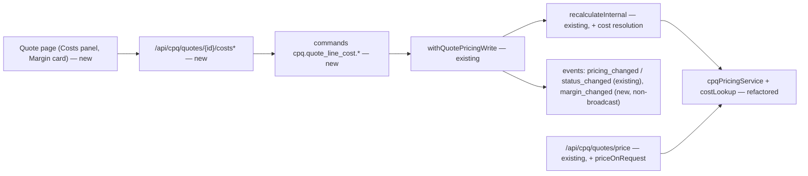
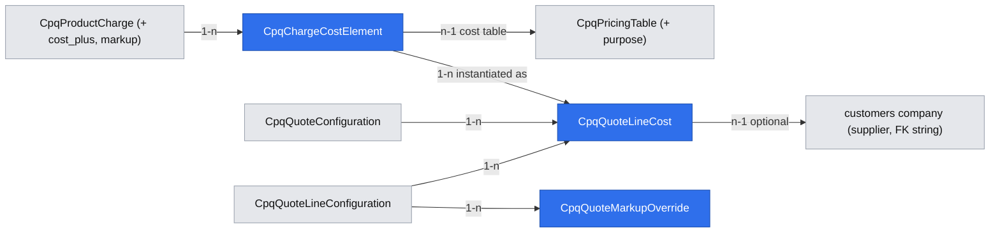

# CPQ cost-plus charges, cost catalog and quote margin (known costs)

Extends: .ai/specs/2026-11-10-cpq-manual-price-adjustments.md
Extends: specs/implementation/xd-186-pricing-tables.md
Extends: specs/implementation/xd-187-calculate-price-api.md
Extends: specs/implementation/xd-201-quoting.md

App Spec: `.ai/specs/2026-11-11-app-spec-cpq-cost-plus-pricing.md` is the source of truth (§1.3 glossary, §1.4 domain model, §7 Phase 1).
Brief: `.ai/specs/briefs/2026-11-11-cpq-cost-plus-quote-pricing-margin.md`.
Stories: US-1.1, 1.2, 1.3, 1.5, 1.6, 2.1, 2.2, 2.3, 2.5, 3.5, 4.1, 4.2, 4.3, 4.4, 0.1, 0.2.
Commit plan: `app-spec-notes/cost-plus-commits-WF.md` #1–#17, #21 (#17 moved here — see Resolved assumptions Q1).

## 📝 TLDR

Operators sell offers whose price is *supplier cost + markup*: third-party tails, hardware bought at supplier rate tables. Today CPQ only knows list prices (a fixed amount or a pricing-table lookup), so these prices are worked out in spreadsheets and typed in as overrides. Nobody can see margin.

**Proposed (future behavior):**
- A charge can use a new pricing method, `cost_plus`, and carry **cost elements** in the catalog.
- On a quote, every line gets **cost lines** for those elements. A cost-plus charge's list price is computed as markup(Σ price-basis costs).
- The existing waterfall (price rules → manual adjustments → offer) continues unchanged.
- Holders of a new `cpq.costs.view` permission see costs, markup and a computed margin. It is granted by default to `admin` and to `employee`, so reps see cost details read-only. Editing needs `cpq.costs.manage` (`admin`). Roles without `cpq.costs.view` (custom roles, the public calculator) see only cost status.
- Everything is behind the tenant feature toggle `cpq.cost_plus`, which is off by default.

## Resolved assumptions (autonomous defaults)

| # | Question | Applied default | Rationale | Confirm? |
|---|---|---|---|---|
| Q1 | Should the conversion guard (R7) ship here or in the order / subscription feature, as the brief says? | **Here** (commit #17). The order / subscription feature keeps the order's own cost entity (`CpqOrderLineCost`, copied at conversion), the stable-id subscription item costs (history in the existing `CpqSubscriptionChangeLog`), the UI and ARC safety. | Without the guard, this feature alone would let an indicative quote become an order and break I-6. Moving one small commit keeps both features independently deployable. The App Spec is amended (dated changelog). | reversible |
| Q2 | Command pattern and undo for cost writes | Commands `cpq.quote_line_cost.create / update / delete` and `cpq.quote_markup_override.set / clear`, **not undoable**. Audit snapshots carry ids, statuses, roles and `cost_key` only. | An undo payload must hold the previous amounts, and the action log is readable outside `cpq.costs.view` (App Spec I-4, architect checkpoint #1). Reversal is an ordinary edit. | reversible |
| Q3 | Where is the markup override stored? | New table `cpq_quote_markup_overrides`: one row per (line, charge code). | The line `configuration` / `charges` jsonb is read by every quote reader (I-4). A cost line is the wrong owner, because the markup belongs to the charge, not to one cost. | reversible |
| Q4 | Who may see `pricing_method = cost_plus` on a charge? | Everyone with the existing read feature. `markup_rule` / `markup_value` are stripped without `cpq.costs.view`. | The method alone reveals no cost. The markup combined with a visible list price would. | reversible |
| Q5 | Status transitions with `expectedRevision` | An optional `expectedRevision` in the status body. The quote page always sends it. API callers that omit it keep today's behavior. | App Spec R11: a rep must never send a price they have not seen. Optional keeps the contract additive. | reversible |
| Q6 | Behavior of a non-quote-currency cost before the FX feature | `value_status = none` + `CURRENCY_NO_RATE`; the line is not ready. | App Spec R3: never a silent 1:1 conversion. | reversible |
| Q7 | Registering cost entities in `ce.ts` | New cost entities are not registered. The existing registrations of `cpq_product_charge`, `cpq_pricing_table` and `cpq_pricing_table_entry` (`ce.ts:45-67`), which will hold markup and cost-table rows, are audited in step 17. Whatever data surface they expose (custom-entity APIs, query index, export) is covered by the leak sweep. If one exposes data, `markup_*` and `purpose = cost` rows are excluded there through the platform's interceptor / query-index exclusion. | Avoids opening new surfaces and closes the ones that already exist (I-4). Registration with `fields: []` may expose nothing, but the sweep decides that, not the assumption. | reversible |
| Q8 | Cost endpoints when the toggle is off | `404` for all cost endpoints. Exceptions: the usage endpoint (always available to `cpq.costs.view`) and future answer routes (`409 COST_PLUS_DISABLED`). | App Spec R14 and the common failure block. | reversible |

## 📝 Problem Statement

- **No cost in the domain.** No CPQ entity, service or `ResolvedCharge` field holds a cost or margin (`data/entities.ts`; `CpqInventoryAsset.purchasePrice` stores the *sale* NRC, `cpqOrderService.ts:703`).
- **Cost-plus prices are typed.** Reps use `price_override` manual adjustments (`data/price-adjustments.ts`) to enter spreadsheet results. The override cannot go above standard (sibling R3), so marking up a low catalog price is impossible without a fake catalog price.
- **No margin governance.** Approval workflows key on discount depth only (`cpq.quote.pricing_changed`, `events.ts:84-91`). A 20% discount on a 60%-margin product and on a 10%-margin tail look alike.
- **Evidence:** the App Spec primary goal (≥ 95% of won cost-plus quotes priced from cost) is 0% by construction today. The Puffin calculator already strips `cost` / `margin` / `vendor` metadata (`demo_puffin/lib/public-calculator/catalog-filter.ts:8-38`), which shows the data exists off-system and is treated as confidential.

## 📝 Prior spec drift

- `xd-186-pricing-tables.md` describes pricing tables as price-only. The code has no purpose flag (`entities.ts:385-426`). This is in sync; we add `purpose`.
- The `xd-187` calculate-price route is `POST /api/cpq/quotes/price` with feature `cpq.quotes.view` (`api/quotes/price/route.ts:13`). Public access happens only through the Puffin proxy (`demo_puffin/api/cloud-pricing-calculator/price/route.ts:185`).
- `api/product-charges`, `api/pricing-tables` and `api/pricing-table-entries` export no `openApi` (AGENTS.md: "Every API route MUST export `openApi`"). The routes this spec touches gain one.

## 📝 Proposed Solution

**Cost is an input, margin is an output** (App Spec §1.4.1).
- Cost lines are stored inputs, like manual adjustments.
- Margin is a pure function of stored `charges` + cost lines + markup overrides, computed on read and inside each write. It is never stored.
- The only engine change is a third list-price source: `cost_plus`, beside `fixed` and `table`.

```
standard charge:   fixed | table ─────────────────────┐
cost-plus charge:  markup( Σ price-basis known costs )┴─▶ list ─rules─▶ standard ─manual adj.─▶ offer
cost lines (price_basis + margin_only) ─────────────────────────────────────────────▶ cost ─▶ margin = offer − cost
```

1. **Catalog.**
   - `CpqProductCharge` gains `pricing_method = 'cost_plus'`, `markup_rule` and `markup_value`.
   - A new `CpqChargeCostElement` defines a charge's default costs:
     - `source`: `fixed` / `table` / `on_request` (`index` is added by the Phase 4 feature);
     - `role`: `price_basis` / `margin_only`;
     - `cost_model`: `flat` / `per_unit` / `tiered` / `volume`.
   - Cost tables are ordinary `CpqPricingTable` rows with `purpose = 'cost'`. Reading them requires `cpq.costs.view`.
2. **Engine.**
   - The table lookup is refactored out of `calculateFlat / PerUnit / Tiered / Volume` (`cpqPricingService.ts:324-467`), which today read `charge.priceColumnKey` / `quantityAttributeCode`. The new pure lookup takes `(table, columnKey, model, dimensions, quantity, currency)`.
   - Price charges and cost elements both call it.
   - For a cost-plus charge, `calculateCharge` receives the resolved price-basis costs and returns list = markup(C) (R2). If any price-basis cost is `none` → no price (`COST_PENDING`). If none applies → `NO_PRICE_BASIS_COST`.
3. **Quote cost lines.**
   - `recalculateInternal` instantiates one `catalog` cost line per applicable element (R1a), matched by `cost_key`.
   - It resets `on_request` values when an attribute that drives them changes (R1b, value part).
   - Unreconfigured Amend mirrors are skipped (R1c skip part).
   - Everything runs inside the existing `withQuotePricingWrite` boundary (`services/priceAdjustments/quotePricingWrite.ts:10-50`).
4. **Writes.**
   - Manual costs, value edits / confirmations and markup overrides go through commands and `withQuotePricingWrite`.
   - The cost lock reuses `ADJUSTMENT_MUTABLE_STATUSES` and the order-exists check (`services/priceAdjustments/adjustmentService.ts:233-238`), with the R11 exemptions.
   - A new cause `'cost'` is added to `QuotePricingCause`.
5. **Signals.**
   - New non-broadcast `cpq.quote.margin_changed`, emitted when `margin_hash` changes.
   - `cpq.quote.status_changed` gains `hasPendingCosts` / `hasEstimatedCosts`.
   - `pricing_changed` is unchanged: `charges` already carry the cost-plus list price and contain no cost.
6. **Guard.** Conversion is refused while any price-basis cost is not `confirmed` or is expired on the conversion date. Once an order exists, cost lines no longer affect price.

**Alternatives considered:**
- **Costs as Open Mercato catalog price kinds** (`CatalogPriceKind`): CPQ pricing never reads catalog prices (C6), and price kinds have no on-request / role / supplier semantics.
- **Costs inside `charges` jsonb:** these are returned to every quote reader and broadcast (`events.ts:84-105`).
- **Markup via manual adjustments:** blocked by the never-above-standard rule, and mixes negotiation with costing.
- **Stored margin table:** goes stale and adds a migration with no consumer (architect checkpoint #1).

**Research (market leaders):**
- **Salesforce CPQ** has a "Cost" pricing method: product cost × (1 + markup rate) or + markup amount. The quote line carries Unit Cost / Total Cost / gross profit fields, and discounts apply after the markup.
  - **Adopted:** markup turns cost into list price, discounts stay downstream, cost lives beside the line.
  - **Not adopted:** a separate cost price book (our elements with sources cover it).
- **Odoo `sale_margin`** has a purchase price per order line and margin / margin % per line and order, hidden behind a group permission.
  - **Adopted:** margin per line and quote, permission-gated.
  - **Added on top:** charge granularity, plus margin-only costs on standard-priced charges.
- **Oracle CPQ / Conga** support cost-plus with per-component cost roll-ups for bundles.
  - **Adopted:** bundle roll-up margin (R8).

## 📝 Delta

### Capability: cpq-cost-catalog

#### ADDED Requirement: Cost-plus charge
The system SHALL let a user with `cpq.products.manage` and `cpq.costs.view` set an NRC or MRC charge's pricing method to `cost_plus`, with a markup rule (`markup_percent`, `target_margin_percent`, `markup_absolute`) and a value, when the tenant toggle `cpq.cost_plus` is on. The charge must have at least one active price-basis cost element.

##### Scenario: Make a charge cost-plus
- WHEN a pricing admin saves charge `tail_mrc` with `pricing_method = cost_plus`, `markup_percent` 25 and one active `price_basis` cost element
- THEN the charge is saved, and the cost preview for a sample configuration shows cost 400 and list price 500

##### Scenario: No price-basis element
- WHEN the same charge is saved without an active price-basis element
- THEN the API returns `422 NO_PRICE_BASIS_ELEMENT` and nothing is stored

##### Scenario: Toggle off
- WHEN the tenant toggle is off and a charge is saved with `pricing_method = cost_plus`
- THEN the API returns `422 COST_PLUS_DISABLED`

#### ADDED Requirement: Charge cost elements
The system SHALL store a charge's default costs as cost elements, each with a code that is unique per charge and immutable, and a role, source, cost type and cost model, and SHALL reject combinations that App Spec §1.4.4 forbids.

##### Scenario: Price-basis on a fixed charge
- WHEN a `price_basis` element is added to a `fixed` charge
- THEN the API returns `422 PRICE_BASIS_REQUIRES_COST_PLUS`

##### Scenario: Wrong table purpose
- WHEN a `table` element references a pricing table with `purpose = price`
- THEN the API returns `422 WRONG_TABLE_PURPOSE`

##### Scenario: Last price-basis element
- WHEN the only active price-basis element of a cost-plus charge is deactivated or deleted
- THEN the API returns `422 NO_PRICE_BASIS_ELEMENT`

#### ADDED Requirement: Cost tables are confidential
The system SHALL hide pricing tables with `purpose = cost`, and their entries, from users without `cpq.costs.view` on every list, read and write route. The system SHALL refuse to change `purpose` on a table referenced by any charge or cost element.

##### Scenario: Rep lists pricing tables
- WHEN a user with `cpq.pricing.view` but not `cpq.costs.view` lists pricing tables or reads a cost table's entries by id
- THEN cost tables are absent from the list, and the entries route returns `404`

#### ADDED Requirement: Markup is confidential
The system SHALL omit `markup_rule` and `markup_value` from product-charge responses for users without `cpq.costs.view`.

##### Scenario: Catalog reader
- WHEN a user with `cpq.products.view` only reads a cost-plus charge
- THEN the response has `pricingMethod: 'cost_plus'` and no markup fields

### Capability: cpq-quote-pricing

#### MODIFIED Requirement: Price waterfall on every charge
The system SHALL expose on every resolved quote charge its list, standard and offer price and the ordered rule and manual adjustments between them. Charges saved before this change SHALL derive list and standard prices when read. A cost-plus charge whose list price cannot be computed (an unknown or missing price-basis cost) SHALL expose null list, standard and offer prices, a `pricingMethod: 'cost_plus'` marker and an error code instead.

##### Scenario: Quote without adjustments
- WHEN a quote has no manual adjustments
- THEN offer equals standard and `unitPrice`, `totalPrice`, line and quote totals equal the values produced before this change

##### Scenario: Unpriced cost-plus charge
- WHEN a cost-plus charge has a price-basis cost with `value_status = none`
- THEN its `listUnitPrice`, `standardUnitPrice` and `unitPrice` are null and its error is `COST_PENDING`

Frozen by: `packages/cpq/src/modules/cpq/services/__tests__/cpqPricingService.test.ts`

#### ADDED Requirement: Quote cost lines from catalog cost elements
The system SHALL keep exactly one non-deleted catalog cost line per applicable active cost element on every configured, non-mirror quote line, matched by cost key. On every saved recalculation it SHALL resolve `fixed` and `table` values and soft-delete cost lines whose element no longer applies.

##### Scenario: Add a costed product
- WHEN a rep adds a product whose `tail_mrc` charge has a `table` element and an `on_request` element with estimate 300
- THEN the line has two cost lines: one `confirmed` with the table value (origin `catalog`), and one `estimated` at 300

##### Scenario: Reconfigure a driving attribute
- WHEN the line's `bandwidth` (a dimension of the tail element) changes from 1G to 10G
- THEN the `on_request` cost line goes back to its catalog estimate (or `none`), and its previous value is kept in `note`

##### Scenario: Unreconfigured Amend mirror
- WHEN an Amend quote mirrors a subscription item and nothing on the line changes
- THEN no catalog cost lines are created on the mirror line

#### ADDED Requirement: Cost-plus list price
The system SHALL price a cost-plus charge at list total = markup(Σ known price-basis costs per instance, converted to the quote currency), rounded once to the currency precision. Price rules and manual adjustments SHALL then apply unchanged. A charge with an unknown price-basis cost, or with no applicable one, SHALL have no price, and its line SHALL NOT be ready.

##### Scenario: Markup percent
- WHEN price-basis costs are 300 and 100 per instance and the markup is `markup_percent` 25
- THEN `listTotalPrice` is 500.00, and with a 10% manual line discount the offer is 450.00

##### Scenario: Unknown cost
- WHEN one price-basis cost line has `value_status = none`
- THEN the charge has no price, the line error is `COST_PENDING`, and a `ready` quote becomes `incomplete`

##### Scenario: Foreign-currency cost before FX ships
- WHEN a price-basis cost is in USD on a EUR quote
- THEN the cost line is `none` with `CURRENCY_NO_RATE`, and the line is not ready

##### Scenario: Quote without costs
- WHEN a quote has no cost-plus charges and no cost lines
- THEN `charges`, `pricingSummary` and `snapshotHash` are byte-identical to the values produced before this change

#### ADDED Requirement: Manual costs, cost confirmation and markup override
The system SHALL let a user with `cpq.quotes.manage` and `cpq.costs.manage`:
- add, edit and delete `manual` cost lines;
- enter or confirm the value of any cost line;
- override or clear a cost-plus charge's markup on one quote line;

all subject to the cost lock.

##### Scenario: Enter a tail cost by hand
- WHEN a pricing manager sets the `on_request` tail cost line to 280 EUR, `confirmed`, with a supplier quote ref
- THEN the line prices from 280, and the cost line has `value_origin = manual`

##### Scenario: Margin-only custom cost after submission
- WHEN a pricing manager adds a `margin_only` NRC cost of 1500 to a line of a quote in `in_approval`
- THEN the cost line is created, the price is unchanged, and `margin_changed` is emitted with `approvalInvalidated: true`

##### Scenario: Price-basis change while locked
- WHEN a pricing manager changes a price-basis cost value, or a markup, on a quote in `with_customer`
- THEN the API returns `409 COST_LOCKED` and nothing changes

#### ADDED Requirement: Quote margin
The system SHALL compute margin for holders of `cpq.costs.view`:
- per charge, line, bundle roll-up and quote: NRC / MRC cost, offer, margin, margin %, markup %, contract margin over the deal-value horizon;
- cost coverage and the flags `hasPendingCosts`, `hasEstimatedCosts`, `hasExpiredCosts`;
- `margin_hash` over cost values, markups and offers (statuses excluded).

The system SHALL NOT store margin.

##### Scenario: Partial coverage
- WHEN two equal-value lines exist and only one has cost lines
- THEN cost coverage is 50%, and the uncovered line counts as cost 0

#### ADDED Requirement: Cost data is confidential
The system SHALL NOT expose cost values, suppliers, markups or margin through `charges`, `pricingSummary`, the quote, line, order and calculate-price responses, broadcast events, action-log snapshots, custom-entity registrations or search to users without `cpq.costs.view`.

##### Scenario: Leak sweep
- WHEN a user without `cpq.costs.view` reads every quote, order, line and calculate-price route, the action log and the broadcast events of a quote whose tail cost is 7777.77
- THEN no payload contains the value 7777.77, or a key named `markup*`, `cost*Amount` or `margin*`

#### ADDED Requirement: Costs follow quote copies and line removal
The system SHALL copy cost lines and markup overrides when a quote is cloned (new ids, remapped lines, catalog lines re-resolved on the clone's first recalculation). It SHALL soft-delete a line's cost lines and overrides when the line is removed.

##### Scenario: Clone
- WHEN a quote with a manual cost and a markup override is cloned
- THEN the clone prices identically and has its own cost line and override rows

### Capability: cpq-calculate-price

#### ADDED Requirement: Cost-plus charges in the calculate-price API
The system SHALL return a cost-plus charge's list price when all its applicable price-basis costs resolve without a quote. It SHALL mark the price `indicative: true` when any of them is an on-request estimate, and return `priceOnRequest: true` with no price otherwise or when the tenant toggle is off. It SHALL never return a cost or markup.

##### Scenario: On-request without estimate
- WHEN the Puffin calculator prices an offering whose cost-plus charge has an `on_request` element without an estimate
- THEN the charge has `priceOnRequest: true` and `unitPrice: null`, and the totals exclude it

### Capability: cpq-quote-lifecycle

#### MODIFIED Requirement: Quote to order conversion
The system SHALL refuse to convert a quote whose stored pricing contains an invalid manual adjustment, refuse it while any price-basis cost line is not `confirmed` or has `valid_until` before the conversion date (`422 COSTS_NOT_CONFIRMED`, listing the lines), keep today's `cancelled` / `rejected` refusal, and take the quote's pricing lock while converting. Once an order exists, cost lines SHALL NOT change the quote's prices.

##### Scenario: Estimated tail blocks conversion
- WHEN an accepted quote has an `estimated` price-basis cost
- THEN conversion returns `422 COSTS_NOT_CONFIRMED` naming the line, and no order is created

##### Scenario: Margin-only costs never block
- WHEN only a `margin_only` cost is unconfirmed
- THEN conversion succeeds

Frozen by: `packages/cpq/src/modules/cpq/services/__tests__/cpqOrderService.test.ts`

#### MODIFIED Requirement: Quote pricing and status events
The system SHALL emit `cpq.quote.pricing_changed` after a committed save that changes the quote's snapshot hash, and `cpq.quote.status_changed` after every committed status change (manual or automatic), each with the pricing snapshot. `cpq.quote.status_changed` SHALL also carry `hasPendingCosts` and `hasEstimatedCosts` (booleans), and neither event SHALL carry any cost, markup or margin value.

##### Scenario: No-op recalculation
- WHEN a saved recalculation produces the same snapshot hash
- THEN no `cpq.quote.pricing_changed` is emitted

##### Scenario: Automatic status change
- WHEN deleting the last invalid adjustment moves the quote from `incomplete` to `ready`
- THEN `cpq.quote.status_changed` is emitted with `cause: 'auto'`

##### Scenario: Status change with an indicative quote
- WHEN a quote with an estimated price-basis cost moves to `with_customer`
- THEN `status_changed` has `hasEstimatedCosts: true` and no cost value

Frozen by: `packages/cpq/src/modules/cpq/services/__tests__/quotePricingEvents.test.ts`

#### ADDED Requirement: Quote margin event
The system SHALL emit the non-broadcast event `cpq.quote.margin_changed` after commit, exactly once per write that changes the quote's `margin_hash`. The payload SHALL carry `marginHash`, `previousMarginHash`, `approvalInvalidated` (true when the status is outside `new` / `incomplete` / `ready` and no order exists), contract margin, margin %, coverage and the flags, and no per-line amounts. The quote-level margin in this payload is visible to whoever can view workflow definitions, instances and their stored context. The manual says so, and the leak sweep checks that this is the only place it appears outside `cpq.costs.view` routes.

##### Scenario: Confirmation without a value change
- WHEN an estimated cost is confirmed at the same value
- THEN `margin_hash` is unchanged and no `margin_changed` is emitted

#### ADDED Requirement: Status transition revision check
The system SHALL accept an optional `expectedRevision` on quote status transitions, and SHALL return `409 STALE_REVISION` without changing anything when it differs from the quote's `pricingRevision`.

##### Scenario: Price changed since the rep looked
- WHEN a rep sends `with_customer` with revision 7 and the quote is at revision 8
- THEN the API returns `409 STALE_REVISION`, and the status is unchanged

## 📝 Architecture

- **Module:** `@dainamite/cpq` only (`packages/cpq/src/modules/cpq/`). There are no imports from other `src/modules`, no ORM relations, and supplier ids are FK strings to `customers` companies. Billing and the connector are untouched (I-9).
- **Reused:**
  - `withQuotePricingWrite` (lock, revision, post-commit events);
  - `runCpqMutationGuards` (`api/_helpers/quoteMutationGuard.ts:13-37`, resource kinds `cpq.quote_line_cost`, `cpq.quote_markup_override`, `cpq.charge_cost_element`);
  - the command bus and the `adjustmentCommandRoute` helper shape;
  - `QuotingError` + `handleArcError`;
  - `featureTogglesService.getBoolConfig` (precedent `adjustmentService.ts:56-59`);
  - pricing-table entities and matching (`cpqPricingService.ts:43-61`);
  - `quoteAdjustmentLifecycle` (clone / remove) and `ADJUSTMENT_MUTABLE_STATUSES`.
- **New services:**
  - `services/costs/costLookup.ts`: the pure table lookup, shared with charges.
  - `services/costs/costResolution.ts`: R1 instantiation + value resolution per line.
  - `services/costs/costPlusPrice.ts`: R2.
  - `services/costs/quoteMargin.ts`: `computeQuoteMargin()`, `margin_hash`.
  - `services/costs/costService.ts`: list, write, lock, toggle, redaction helpers, usage.
- **Current consumers affected:**
  - Calculate-price and the Puffin proxy get new optional fields.
  - The quote page renders new panels.
  - Approval workflows on `status_changed` see two new booleans.
  - Sales line `unitPriceNet` keeps carrying the offer (`cpqQuotingService.ts:1078-1096`). An unpriced cost-plus charge contributes 0, exactly as a table miss does today (`totalPrice ?? 0`, `:1085-1087`). Its line is not ready, so the quote cannot reach `ready`. The quote page shows "Price on request" and the Indicative / Cost pending badges, so a sales document generated from such a quote is visibly incomplete. Syncing a provisional price was rejected: it would put an unpriced amount on a customer document.
- **Future work this design serves:** order / subscription costs, sourcing, FX, ARC and index features (App Spec §7). Sourcing fields (`sourcing_status`, `cost_request_id`, …) are created now as nullable columns. Only the sourcing feature reads them, which avoids a second migration of a hot table.



Takeaway: every cost write and every price effect passes through the existing aggregate boundary. Margin is derived on the read and write paths, never stored.

## 📝 Data Model

All tables are tenant-scoped, with standard columns (`id` uuid, `organization_id`, `tenant_id` indexed, `created_at`, `updated_at`, `deleted_at`). Migrations are generated with `yarn mercato db generate` in `packages/cpq/src/modules/cpq/migrations/` and are additive only.

**`cpq_product_charges` (existing) — new / changed columns**

| Column | Type | Rules |
|---|---|---|
| `pricing_method` | text, existing | gains value `cost_plus`; only `chargeType ∈ {nrc, mrc}`, `chargeModel ∈ {flat, per_unit}`; `per_unit` requires `quantity_attribute_code` |
| `markup_rule` | text null | `markup_percent` \| `target_margin_percent` \| `markup_absolute`; required for `cost_plus` |
| `markup_value` | numeric(18,4) null | ≥ 0; target margin < 100; absolute in the charge currency, per instance |

**`cpq_pricing_tables` (existing)**: `purpose` text not null default `'price'` (`price` \| `cost`). It is immutable while referenced.

**`cpq_charge_cost_elements` (new)** — the fields are exactly App Spec §1.4.4: `product_charge_id`, `code` (unique per charge among non-deleted rows, immutable), `name`, `role`, `cost_type`, `source` (`fixed` \| `table` \| `on_request` in this feature), `cost_model`, `amount`, `currency_code`, `cost_table_id`, `cost_column_key`, `estimate_amount`, `default_supplier_id`, `default_supplier_name`, `default_validity_days`, `requires_sourcing` (stored, no-op until the sourcing feature), `applicability_condition` jsonb, `sort_order`, `is_active`. The index columns (`cost_index_id`, `index_factor`, `index_offset`) are added by the index feature. Index: `(organization_id, tenant_id, product_charge_id)`.

**`cpq_quote_line_costs` (new)** — the fields are exactly App Spec §1.4.6. In this feature:
- `origin ∈ {catalog, manual}` (`carried` arrives with the ARC feature);
- `value_status ∈ {none, estimated, confirmed}`;
- `value_origin ∈ {catalog, manual}`;
- `instance_amount` numeric(18,4): the per-instance amount after the cost model, stored for display.

The sourcing columns (`sourcing_status` default `not_requested`, `cost_request_id`, `request_seq`, `requested_*`, `answered_*`, `decline_reason`, `proposed_amount`), `fx_rate`, `fx_rate_date`, `index_snapshot` and the `carried_from_*` columns are created as nullable and left unused until their features ship.

Indexes:
- `(organization_id, tenant_id, quote_configuration_id)`;
- `(organization_id, tenant_id, quote_line_id)`;
- a partial unique `(quote_line_id, cost_key) WHERE deleted_at IS NULL`.

**`cpq_quote_markup_overrides` (new)**

| Column | Type | Rules |
|---|---|---|
| `quote_configuration_id`, `quote_id`, `quote_line_id` | uuid (FK strings) | same quote |
| `charge_code` | text | must resolve to one cost-plus charge on the line |
| `markup_rule`, `markup_value` | as on the charge | |
| `note` | text ≤ 500, required | |
| `created_by_user_id`, `updated_by_user_id` | uuid | |

Partial unique `(quote_line_id, charge_code) WHERE deleted_at IS NULL`.

**Not changed:** `charges` jsonb keeps today's shape, with one additive field per cost-plus charge, `pricingMethod: 'cost_plus'`, and for unpriced charges `unitPrice` / `totalPrice` = null plus error `COST_PENDING` / `NO_PRICE_BASIS_COST`. `pricingSummary` is unchanged.

**Sensitive data:**
- Cost amounts, suppliers and markup are commercially confidential. They are not personal data.
- No encryption is needed beyond the platform defaults, but access is gated server-side by `cpq.costs.view`.
- The entities are not registered in `ce.ts` (Q7).
- Command logs carry ids / statuses only (Q2).



## 📝 API Contracts

Every route: `requireAuth`, `requireFeatures` (never `requireRoles`), an `openApi` export (`tag`, `pathParams`, `methods{summary, query/requestBody, responses, errors via cpqErrorDoc}`), Zod validation, errors as `{error, ...details}` via `handleArcError`, and `runCpqMutationGuards` on writes. When the toggle is off, every route below returns `404` except `cost-plus/usage`.

| Method + path | Features | Request | Response / errors |
|---|---|---|---|
| `GET /api/cpq/charge-cost-elements?productChargeId=&page=&pageSize≤100` | `cpq.products.view` + `cpq.costs.view` | — | `{items, total, page, pageSize, totalPages}` |
| `POST /api/cpq/charge-cost-elements` | `cpq.products.manage` + `cpq.pricing.manage` + `cpq.costs.view` | element body (§Data Model) | `201 {item}`; `422 PRICE_BASIS_REQUIRES_COST_PLUS`, `WRONG_TABLE_PURPOSE`, `DUPLICATE_CODE`, `COST_TYPE_MISMATCH`, `MODEL_REQUIRES_TABLE` |
| `PUT /api/cpq/charge-cost-elements` / `DELETE ?id=` | same | `{id, …}` (`code` immutable) | `200`; `422 NO_PRICE_BASIS_ELEMENT` |
| `GET /api/cpq/product-offerings` (existing; hand-maps charges, `api/product-offerings/route.ts:88-103, 163-175`, and `cpqProductService.getOffering`) | unchanged | — | charges gain `pricingMethod`; markup through the same redaction helper |
| `GET / POST / PUT /api/cpq/product-charges` (existing) | unchanged | + `markupRule`, `markupValue`, `pricingMethod: 'cost_plus'` | markup stripped without `cpq.costs.view`; `422 NO_PRICE_BASIS_ELEMENT` (on activation of a cost-plus charge), `COST_PLUS_DISABLED`; gains `openApi` |
| `GET … /api/cpq/pricing-tables`, `/pricing-table-entries` (existing) | unchanged + `cpq.costs.view` for `purpose = cost` rows (server-side filter / `404`) | + `purpose` | `422 PURPOSE_LOCKED`; gain `openApi` |
| `POST /api/cpq/cost-preview` | `cpq.pricing.view` + `cpq.costs.view` | `{offeringId \| productId, configuration, currencyCode?, quantity?}` | `{charges:[{chargeCode, pricingMethod, costs:[{costKey, name, role, source, valueStatus, unitAmount, instanceAmount, currencyCode, error?}], costTotal, markupRule, markupValue, listTotalPrice, error?}]}`; no persistence |
| `GET /api/cpq/quotes/{quoteId}/costs` | `cpq.quotes.view` | — | without `cpq.costs.view`: `{lines:[{quoteLineId, costs:[{id, costKey, name, role, valueStatus, expired, error?}]}], pricingRevision}`; with it: + values, currency, supplier, validity, markup overrides, `margin` (`computeQuoteMargin()` result incl. `marginHash`) |
| `POST /api/cpq/quotes/{quoteId}/costs` | `cpq.quotes.manage` + `cpq.costs.manage` | `{quoteLineId, chargeCode?, name, role, costType, source: 'fixed'\|'on_request', costModel: 'flat'\|'per_unit', unitAmount?, currencyCode?, valueStatus?, supplierId?, supplierName?, supplierQuoteRef?, validUntil?, supplierTermEnd?, supplierMinTermMonths?, note?, expectedRevision?}` | `201 {cost, margin, pricingRevision}`; `409 COST_LOCKED`, `STALE_REVISION`; `422 PRICE_BASIS_REQUIRES_COST_PLUS`, `CHARGE_NOT_FOUND`, `LINE_NOT_ELIGIBLE` (cancel / mirror lines) |
| `PATCH /api/cpq/quotes/{quoteId}/costs/{costId}` | same | partial of the above + `valueStatus`; a `note` is required when overwriting a `catalog` value | `200`; `409 COST_LOCKED` (price-basis value change while locked; exemptions R11), `422 NOTE_REQUIRED`, `VALIDITY_EVIDENCE_REQUIRED` |
| `DELETE /api/cpq/quotes/{quoteId}/costs/{costId}` | same | `?expectedRevision=` | `200`; `422 CATALOG_COST_NOT_DELETABLE` (catalog lines follow the catalog; set value instead) |
| `PUT /api/cpq/quotes/{quoteId}/markup-overrides` | same | `{quoteLineId, chargeCode, markupRule, markupValue, note, expectedRevision?}` | `200`; `409 COST_LOCKED`; `422 CHARGE_NOT_COST_PLUS` |
| `DELETE /api/cpq/quotes/{quoteId}/markup-overrides?quoteLineId=&chargeCode=` | same | | `200` |
| `POST /api/cpq/quotes/{quoteId}/status` (existing) | unchanged | + optional `expectedRevision` | `409 STALE_REVISION` |
| `POST /api/cpq/orders` convert (existing) | unchanged | — | + `422 COSTS_NOT_CONFIRMED {lines:[{quoteLineId, costKeys}]}` |
| `POST /api/cpq/quotes/price` (existing) | unchanged | — | per charge, additive: `pricingMethod`, `indicative?`, `priceOnRequest?`; totals exclude price-on-request charges |
| `GET /api/cpq/cost-plus/usage` | `cpq.costs.view` | — | `{enabled, costPlusCharges, openQuotes, openRequests: 0, liveSubscriptions: 0}` (the last two are filled by later features) |

**Events** (`events.ts`):
- `cpq.quote.margin_changed` (category `custom`, `clientBroadcast: false`, payload schema per Delta).
- `status_changed` payload gains `hasPendingCosts` / `hasEstimatedCosts`.
- `QuotePricingCause` gains `'cost'`.

**ACL** (`acl.ts`, `setup.ts`):
- `cpq.costs.view` (default `admin` + `employee`: reps see cost details read-only) and `cpq.costs.manage` (default `admin`) — App Spec Q-D1, user decision 2026-11-12.
- `seedCostPlusDefaults` upserts the global toggle `cpq.cost_plus` (`defaultValue: false`, `onConflictAction: 'ignore'`), following the `priceAdjustmentDefaults.ts` pattern.
- A CLI `seed-cost-plus` is added, mirroring `cli.ts:99-113`.

## 📝 UI/UX

- **Charge editor** (`backend/cpq/offerings/[id]`, `backend/cpq/specifications/[id]`):
  - The pricing method selector gains **Cost-plus**, shown only when the toggle is on.
  - Markup rule and value fields render for `cpq.costs.view` holders.
  - A **Cost elements** sub-table (`DataTable`, injection spot `data-table:cpq.charge_cost_elements`) with an add / edit dialog (`Cmd/Ctrl+Enter` / `Esc`). Fields switch by source.
  - A **Preview cost** button calls `cost-preview` with a sample configuration form.
  - Switching back from Cost-plus asks: "Deactivate N price-basis cost elements? Open unlocked quotes will re-price on their next save."
- **Pricing table detail:** a `purpose` selector, read-only once the table is referenced; a list filter by purpose.
- **Quote detail** (`backend/cpq/quotes/[id]/page.tsx`):
  - **All users:** per-line cost status badges (`Cost pending`, `Estimated`, `Expired cost`) beside `ChargeBreakdown`; an `Indicative` chip in the header when any price-basis cost is estimated; for unpriced cost-plus charges, "≈ {fallback}" or "Price on request".
  - **`cpq.costs.view` holders (reps by default, read-only without `cpq.costs.manage`):**
    - a **Costs** sub-panel per line (`_components/CostsPanel.tsx`, injection spot `data-table:cpq.quote_line_costs`) with name, role, source, status, value, currency, supplier, valid until, and actions **Add cost**, **Edit / Confirm**, **Override markup** (needs `cpq.costs.manage`);
    - a **Margin** card beside `PricingSummaryCard` showing contract margin, margin %, NRC / MRC margin, "based on X% coverage" and flags, with a bundle-parent roll-up row.
  - Locked state: tooltip "Costs that change the price are locked in status X — margin-only costs and confirmations remain possible."
  - The status change control sends `expectedRevision`. On `409` it shows "Prices changed since you opened the quote — reload".
- **Empty states:** as App Spec §3.5 (Costs sub-panel, Margin card, Cost elements).
- **Accessibility:** status badges carry text, not only colour. Every dialog is keyboard-operable.

Mockups: skipped. No browser provider or test-env descriptor is configured in this repo, so this is a text-only spec. The layout reuses existing CPQ panels.

## 📝 Edge Cases & Failure Scenarios

| Case | Behavior |
|---|---|
| Table miss / no entry in the quote currency | cost line `none` + `TABLE_NO_MATCH` / `CURRENCY_NO_RATE`; line not ready; badge with the reason |
| Cost-plus charge whose elements all fail applicability | `NO_PRICE_BASIS_COST`; line not ready |
| Element deactivated while open quotes use it | unlocked quotes drop the cost line on the next saved recalculation (price may change → `pricing_changed`); locked quotes keep stored lines and prices |
| Two pricing managers edit | `409 STALE_REVISION` (existing lock) |
| A recalculation runs while the quote is locked | cost values / `charges` unchanged (R4 for tables); only status / derived flags refresh |
| Toggle turned off with stored cost-plus quotes | prices stay readable; any re-pricing → `COST_PLUS_DISABLED` (line not ready); conversion still enforces R7; calculate-price → `priceOnRequest` |
| Toggle turned on for an existing tenant | no backfill; cost lines appear on each line's next saved recalculation |
| Clone of a quote with an expired cost | the clone shows Expired; conversion blocked until re-confirmed |
| Event dispatch fails after commit | swallowed as today (`services/priceAdjustments/quotePricingEvents.ts:69-94`); stored data is authoritative; project guards recompute the margin |
| `target_margin_percent` ≥ 100 / negative values | `422` at validation |
| Migration on a large `cpq_product_charges` | additive nullable columns + defaulted `purpose`; no backfill job |

## 📝 Risks & Impact Review

- **Pricing-engine regression (High impact, mitigated).** The lookup refactor touches every table-priced charge. Mitigation: a characterization step freezes current outputs over all demo offerings (golden test, I-8) before the refactor.
- **Confidentiality leaks (High impact).** Mitigations: a leak-sweep test with a sentinel value across every channel; redaction in one helper; entities kept out of `ce.ts`; non-undoable commands with redacted logs. Accepted trade-off: cost writes cannot be undone from the action log.
- **Public contracts:**
  - New optional calculate-price fields (additive, `xd-187` contract kept).
  - A new event and two boolean payload fields.
  - An optional status-route field.
  - A new conversion error code (conversion was already refusable).

  None is breaking. These are logged in `packages/cpq/MIGRATION.md` and the package changelog.
- **Schema:** additive. A down-migration drops only new tables and columns.
- **Rollback by toggle is not neutral.** Toggle off keeps all data and stored prices readable. But every re-pricing of a cost-plus charge returns `COST_PLUS_DISABLED`, so open cost-plus quotes become not ready on their next save until the toggle is back on, or until their charges are switched to `fixed` / `table`. This is intentional: re-pricing from cost without costs would be wrong. The manual tells admins to check `GET /api/cpq/cost-plus/usage` first.
- **Product direction calls (owner: product):** reps see cost details read-only (Q-D1, user decision 2026-11-12); indicative quotes may be sent (Q-D2). Both are decided in the App Spec and reversible by role grants and status configuration.

## 📋 Phasing

One feature, delivered as **three PRs**. Each keeps the app working and the toggle keeps the PRs independent. The App Spec §7 Phase 1 is split across this spec and the order / subscription costs spec.

- **PR 1 (no visible change):** Phase A, steps 5–6, step 15.
- **PR 2:** the rest of Phase B and Phase C.
- **PR 3:** Phases D and E.

The high-risk engine refactor is therefore reviewed alone.

1. **Phase A — Catalog foundations:** toggle, ACL, charge columns, table purpose, cost elements (API + validation).
2. **Phase B — Engine and quote cost lines:** lookup refactor (frozen first), cost resolution, cost-plus price, margin.
3. **Phase C — Quote APIs, writes and signals:** read / write routes, commands, lock, markup override, events, status revision, conversion guard.
4. **Phase D — UI:** charge editor, quote Costs panel, Margin card, dialogs.
5. **Phase E — Calculate-price, clone, toggle-off, seed, docs, archive.**

## 📋 Implementation Plan

Each step leaves the app working and is verified by the named tests (`yarn test`, jest config `jest.config.cjs`). After entity steps run `yarn mercato db generate`; after structural changes run `yarn generate`.

### Phase A — Catalog foundations
1. **Toggle and ACL.**
   - Add `cpq.costs.view` / `cpq.costs.manage` to `acl.ts` and the admin defaults in `setup.ts`.
   - Add `lib/costPlusDefaults.ts` (toggle `cpq.cost_plus`, default false), called from `seedDefaults`, plus CLI `seed-cost-plus`.
   - Add `costService.enabled(tenantId)`.
   - Tests: `lib/__tests__/costPlusDefaults.test.ts` (idempotent, never overwrites).
2. **Charge columns.**
   - Entity + migration for `markup_rule` / `markup_value` and `cost_plus` in the enums.
   - Extend V-CHG-1 (`refineChargePricingShape`) for the cost-plus shape. Until step 9 enables pricing, saving `pricing_method = cost_plus` is refused with `422 COST_PLUS_NOT_AVAILABLE`, so no unpriceable charge can exist.
   - A markup redaction helper used by `api/product-charges`, `api/product-offerings` and `cpqProductService.getOffering`; `openApi` on `api/product-charges`.
   - Tests: validators (cost-plus shape matrix), route redaction.
3. **Pricing table purpose.**
   - `purpose` column + migration.
   - Server-side filter / `404` on `pricing-tables` and `pricing-table-entries` for users without `cpq.costs.view`; `PURPOSE_LOCKED`; `openApi` on both.
   - Tests: route tests by feature set.
4. **Cost elements.**
   - Entity + migration + validators (§1.4.4 combination rules) + `api/charge-cost-elements` with `openApi` and guards.
   - The last-price-basis rule on element and charge writes (`NO_PRICE_BASIS_ELEMENT`, including when activating a cost-plus charge).
   - Tests: validator matrix and route tests.

### Phase B — Engine and quote cost lines
5. **Characterize before any change**, committed alone and green on unchanged code:
   - A golden test recording `charges` / `pricingSummary` / `snapshotHash` over the `demo_gix` / `demo_puffin` seed definitions (`services/__tests__/costPlusGolden.test.ts`). It is fixture-based, using the mock-EM pattern of `.ai/skills/unit-tests` with no database.
   - The current conversion behavior in `cpqOrderService.test.ts`.
   - The current event payloads in `quotePricingEvents.test.ts`.
   - The waterfall in `cpqPricingService.test.ts`.
6. **Refactor the lookup** into `services/costs/costLookup.ts` (`table, columnKey, model, dimensions, quantity, currency`). `calculateFlat / PerUnit / Tiered / Volume` delegate to it. The golden test stays byte-identical. Tests: `costLookup.test.ts`.
7. **Cost line entity + markup override entity** + migrations (all nullable sourcing / FX / index / carried columns, partial unique indexes). Not registered in `ce.ts`.
8. **Cost resolution** (`costResolution.ts`): R1a instantiation by `cost_key`, R1b value reset with note, R1c skip on unreconfigured Amend mirrors, `fixed` / `table` resolution, `on_request` estimate, `CURRENCY_NO_RATE`. Wired into `recalculateInternal` inside `withQuotePricingWrite`. Tests: `costResolution.test.ts`.
9. **Cost-plus price** (`costPlusPrice.ts`; lifts `COST_PLUS_NOT_AVAILABLE`): the R2 formulas, round once, `per_unit` unit derivation, `COST_PENDING`, `NO_PRICE_BASIS_COST`, the markup override applied. The line status integrates with the existing auto `new / incomplete / ready`. Tests: property test over rule × model, golden test unchanged.
10. **Margin** (`quoteMargin.ts`): `computeQuoteMargin()` per charge / line / roll-up / quote, coverage, flags, `margin_hash` (values only). Tests: `quoteMargin.test.ts` (coverage, roll-up, hash stability on status-only change).

### Phase C — Quote APIs, writes and signals
11. **Read API** `GET /quotes/{id}/costs` (two projections by feature) + `POST /cost-preview` + `GET /cost-plus/usage`. Tests: route tests incl. projection without `cpq.costs.view`.
12. **Write commands, part 1:** `cpq.quote_line_cost.create / update / delete` (non-undoable, redacted log), lock + R11 exemptions, note / evidence rules, guard resource kinds. Tests: `commands/__tests__/quote-line-costs.test.ts`, `costService.test.ts`.
13. **Write commands, part 2:** `cpq.quote_markup_override.set / clear`, `CHARGE_NOT_COST_PLUS`. Tests as above.
14. **Signals.** `withQuotePricingWrite` gains an optional `marginTracker` argument (`{ before(tx, quote), after(tx, quote) }`). Its `before` runs inside the transaction right after the lock and before `execute`. When the toggle is off or the quote has neither cost lines nor cost-plus charges (one indexed existence query), the tracker is skipped, so other tenants and quotes pay nothing. The resulting hashes drive:
    - `cpq.quote.margin_changed` (non-broadcast) emitted from `withQuotePricingWrite` when `margin_hash` changes;
    - `approvalInvalidated`;
    - the `status_changed` booleans;
    - the `'cost'` cause.

    The `quotePricingEvents.test.ts` characterization happens in step 5.
15. **Status revision:** optional `expectedRevision` in `cpqTransitionStatusSchema`, passed by the status route through `transitionStatus` (`cpqQuotingService.ts:863`) into `writeQuote` / `withQuotePricingWrite`; plus the status route `openApi`. Tests: route test (`409`).
16. **Conversion guard** (characterized in step 5): add `COSTS_NOT_CONFIRMED` and the post-conversion price freeze (recalculation never re-applies cost lines once an order exists).
17. **Confidentiality sweep:** `services/__tests__/costConfidentiality.test.ts` with sentinel 7777.77. It covers:
    - the quote / line / order / offering / charge / calculate-price responses;
    - broadcast event payloads and command logs;
    - the surfaces exposed by the existing `ce.ts` registrations of charges, pricing tables and entries (Q7). If one exposes data, add the exclusion there.

### Phase D — UI
18. **Charge editor:** cost-plus fields, Cost elements sub-table + dialog, Preview cost, switch-back confirmation. i18n keys in `translations`. Tests: component tests where the repo has them; Playwright smoke in Phase E.
19. **Quote page:** status badges, Indicative chip, Costs sub-panel (`CostsPanel.tsx`, `useQuoteCosts.tsx`), locked tooltip.
20. **Quote page:** Margin card, Add / Edit / Confirm cost and Override markup dialogs, `expectedRevision` on status changes.

### Phase E — Calculate-price, clone, toggle-off, seed, docs
21. **Calculate-price:** cost-plus resolution without a quote, `indicative`, `priceOnRequest`, totals exclusion, toggle-off. Puffin proxy check (no new fields leak). Tests: `api/quotes/price/__tests__/route.test.ts`.
22. **Clone and removal:** extend `cloneQuoteAdjustments` / `removeQuoteLineTree` (`services/priceAdjustments/quoteAdjustmentLifecycle.ts:9, 28`) for cost lines and overrides. Toggle-off behavior (`COST_PLUS_DISABLED` on re-pricing). Tests: `quoteCloneAdjustments.test.ts`, `quoteAdjustmentLifecycle.test.ts` extended.
23. **Demo seed + docs:**
    - `demo_gix`: cross-connect cost table, "IP Transit with partner tail" cost-plus charge (`on_request` with estimate + a table cost), demo quotes in the pending / estimated / confirmed / expired states, the margin-approval workflow recipe seeded **disabled**, demo users with `cpq.costs.*`.
    - `manuals/cpq-cost-plus-pricing.md` (incl. the approval recipe and the guard example).
    - `packages/cpq/MIGRATION.md` + changeset.
    - Playwright smoke: admin makes a charge cost-plus → rep quotes it → pricing manager confirms the cost → conversion succeeds.
24. **Archive the Delta** into `.ai/specs/capabilities/`:
    - new `cpq-cost-catalog.md`;
    - `cpq-quote-pricing.md`, `cpq-calculate-price.md`, `cpq-quote-lifecycle.md` updated.

### Acceptance (from App Spec §7 Phase 1)

| Kind | Criteria |
|---|---|
| Domain | I-8 golden (step 5); R2 property (step 9); I-1 / R1a uniqueness (step 8); I-5 / R11 (steps 12–13); I-4 sweep (step 17); R8 event (step 14); R14 toggle-off (step 22); R4 tables, locked quotes (step 8); R1b value part (step 8); I-6 / R7 (step 16) |
| Business | App Spec §7 Phase 1, the first four bullets. The activation / Renew bullets belong to the order / subscription costs spec. |
