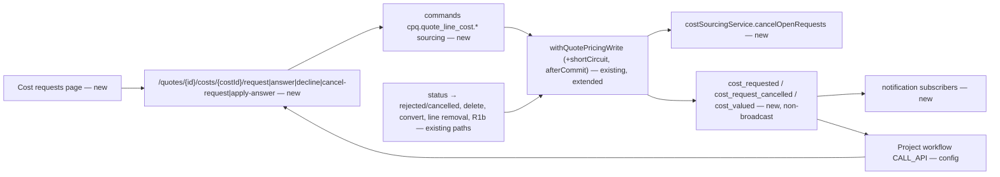
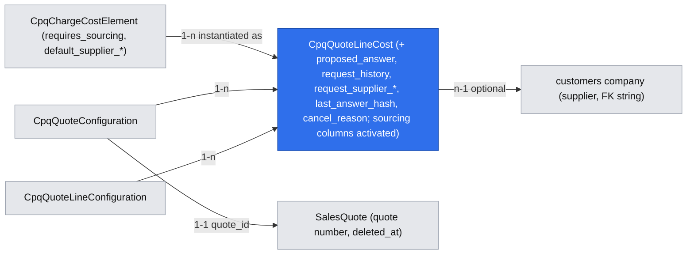

# CPQ supplier cost sourcing for on-request costs (third-party tails)

Extends: .ai/specs/2026-11-12-cpq-cost-plus-quote-pricing-margin.md
Extends: .ai/specs/2026-11-10-cpq-manual-price-adjustments.md
Extends: specs/implementation/xd-201-quoting.md
Extends: specs/implementation/xd-250-arc-spec.md

App Spec: `.ai/specs/2026-11-11-app-spec-cpq-cost-plus-pricing.md` is the source of truth (§1.3 value / sourcing status, cost request, overdue request; §1.4.6, §1.4.7 R1b request part, R7, R10a, R11, R14, R16; §1.4.8 I-13; §1.4.9 events + notifications; §3 WF3; §3.5 Cost requests page; §7 Phase 2).
Brief: `.ai/specs/briefs/2026-11-11-cpq-cost-plus-supplier-sourcing.md`.
Stories: US-3.1, US-3.2, US-3.3, US-3.4, US-3.7.
Commit plan: `app-spec-notes/cost-plus-commits-WF.md` #22, #22a, #23, #24, #25, #28 (Phase 2). FX (#26) is a separate spec.
Depends on: `.ai/specs/2026-11-12-cpq-cost-plus-quote-pricing-margin.md` (PR #87, not merged) — its `cpq_quote_line_costs` table (sourcing columns created nullable), `costService`, the cost commands, `withQuotePricingWrite` + `marginTracker`, the `'cost'` pricing cause, the redaction helper and the conversion guard. This spec ships only after that spec's PR 3.
Also depends on: `.ai/specs/2026-11-12-cpq-cost-plus-order-subscription-costs.md` (PR #88, App Spec Phase 1): its MODIFIED texts of "Quote cost lines from catalog cost elements" and "Quote to order conversion", which this spec's MODIFIED texts replace cumulatively. If Phase 1 has not shipped when this spec is implemented, those two requirements are rebased onto whatever is archived at that point.

## 📝 TLDR

A third-party tail cost is unknown until a carrier quotes it. After PR #87 a pricing manager types the value in by hand, with no record of who asked whom, when, or whether the answer still matches the configuration.

**Proposed (future behavior):**
- A cost line can carry one **cost request** at a time, identified by `cost_request_id` and `request_seq`. A request opens automatically on a **saved** recalculation for elements with `requires_sourcing`, or manually (**Request cost**).
- Requests are allowed on any cost line except those on a Cancel line or frozen-unpriceable ones, **including `carried` cost lines** (e.g. renegotiation-due costs on Renew mirrors, App Spec R13).
- Procurement (or a project workflow, through the API) **answers** with the current request id, or **declines**. A stale id gets `409 COST_REQUEST_SUPERSEDED`. A repeated answer with the same `supplier_quote_ref` and the same normalized payload (`last_answer_hash`) on the same cost line is a `200` no-op.
- Every event that makes a request meaningless (reconfiguration that resets the cost, line removal, element deactivation, re-request, a manual value, quote rejected / cancelled / deleted / converted) **cancels** the request in the same transaction.
- On a **locked** quote, an answer with the same value confirms it (lock-exempt). A different value is stored as a **proposal** (`proposed_amount`), conversion is refused with `422 COST_ANSWER_PENDING`, and the action **Reopen and apply supplier answer** moves the quote back to `ready` and applies it in one write.
- Three non-broadcast events (`cpq.quote.cost_requested`, `cost_request_cancelled`, `cost_valued`, no amounts), four notification types, a **Cost requests** page (`/backend/cpq/cost-requests`) with Answer / Decline dialogs and an Overdue filter, and a sourcing workflow recipe seeded **disabled** in `demo_gix`. CPQ never depends on a workflow existing.

## Resolved assumptions (autonomous defaults)

| # | Question | Applied default | Rationale | Confirm? |
|---|---|---|---|---|
| Q1 | Where is the request history (every `cost_request_id`) kept, given a request is "a state of a cost line, not an entity" (App Spec §3.5)? | A bounded jsonb column `request_history` on `cpq_quote_line_costs` (≤ 50 entries, oldest dropped): per closed request its id, seq, requested / closed timestamps and users, outcome, reason, supplier id and quote ref. **No amounts.** The current request lives in the existing columns. | No new entity, matches the App Spec; lead time per supplier is reportable from the closed entries plus the current columns. A table can be split out later without changing the API. | reversible |
| Q2 | Where does a locked-quote answer with a different value keep its full payload (currency, validity, supplier fields), since PR #87 only creates `proposed_amount`? | One additive nullable jsonb column `proposed_answer` beside `proposed_amount`. `proposed_amount` stays the queryable flag used by the conversion guard. | Writing the new validity / supplier fields onto a line that still holds the old value would misstate it. | reversible |
| Q3 | Decline on a **locked** quote: R10a says the value goes to `none`, R11 says a price-basis value never changes while locked. | Unlocked quote: R10a as written (value `none`, estimate moved into `note`). Locked quote: the amount is kept (price unchanged, I-5) and `value_status` is downgraded to `estimated`, so the conversion guard refuses (`COSTS_NOT_CONFIRMED`) until the quote is reopened and an alternative value entered (R10a). | Statuses are excluded from `margin_hash` and the pricing hash, so the downgrade changes no price; the sent quote cannot become an order on an undeliverable cost. | Confirmed by the product owner in PR review (2026-11-13). Note: resolves an App Spec R10a / R11 conflict. Reversible. |
| Q4 | Element deactivation: App Spec says requests cancel "in the same transaction as the cause". The cause is a catalog write that touches many quotes, each with its own aggregate lock. | The deactivation command commits, then cancels each open request on that element in **its own quote's** `withQuotePricingWrite` (reason `element_deactivated`), best effort with per-quote error logging. Backstops: R1a cancels on the quote's next saved recalculation, and the answer / decline API refuses a cost line whose element is inactive with `409 COST_REQUEST_SUPERSEDED` and **no write** (the refusal never cancels; cancellation stays with R1a and the post-commit per-quote write). | Locking every open quote inside a catalog transaction would serialize the catalog behind all quotes and risks deadlocks. The answer-side check keeps I-13 airtight. | Confirmed by the product owner in PR review (2026-11-13). Note: deviates from the App Spec "same transaction" wording for this one cause. Reversible. |
| Q5 | "Quote owner" for answered / declined notifications: neither `CpqQuoteConfiguration` nor `SalesQuote` has an owner column. | The request's `requested_by_user_id` (for auto-opened requests, the user whose saved recalculation opened it). No recipient → no notification. Routes that trigger saved recalculations pass the actor (`resolveAuditActor`). | No new owner concept; the requester is the person waiting for the answer. | reversible |
| Q6 | Which closures cancel requests with `quote_closed`? App Spec lists "rejected, cancelled, expired" and deletion. | `rejected`, `cancelled`, deletion through CPQ, **and conversion** (open margin-only requests on a converted quote). `expired` does not exist in CPQ (drift, below); `accepted` keeps requests open (an accepted indicative quote still needs its answer). Reopening a closed quote does not reopen requests; the rep re-requests. | Converted-quote answers already return `409 QUOTE_CONVERTED`; leaving requests open would keep dead work in the queue. | reversible |
| Q7 | Quote deleted through the **sales** module (not the CPQ route). | A persistent subscriber on `sales.quote.deleted` cancels open requests in a CPQ write (eventually consistent, reason `quote_closed`). The queue hides rows whose CPQ or sales quote is deleted; the answer API returns `409 QUOTE_CLOSED` for them. | CPQ cannot join the sales module's transaction; the stored state already hides them. `sales.quote.deleted` is declared (core `sales/events.ts:37`); its emission path and payload shape (`id`) are verified in step 10 — if it is not emitted, the queue filter and the `QUOTE_CLOSED` check alone cover the case. | reversible |
| Q8 | Manual cancel of a request (brief: "cancel API") — none of the App Spec reasons fit. | New reason value `cancelled_by_user` (additive) on `POST …/cancel-request`. | Lets procurement close a request that is no longer needed without a decline, which would clear the value. | reversible |
| Q9 | Is `supplier_quote_ref` required on an answer? Same ref with a different payload? | Required (1–100 chars). Each applied or proposed answer stores `last_answer_hash` = SHA-256 of the normalized answer payload (sorted keys, amounts as 4-dp strings, upper-case currency, ISO dates, trimmed strings, the `costRequestId` included). Check order: stale request id → `409 COST_REQUEST_SUPERSEDED`; then same ref + same hash → `200` no-op (no revision, no event); then same ref + different hash → `409 SUPPLIER_QUOTE_REF_CONFLICT`, nothing written. | It is the idempotency key (I-13); comparing a stored hash is exact and cheap, and silently ignoring a changed payload would hide a supplier correction. | reversible |
| Q10 | Where is the overdue threshold configured (tenant-configurable, default 5 working days)? | Numeric feature toggle `cpq.cost_requests.overdue_working_days` (default 5, per-tenant override), read with `featureTogglesService.getNumberConfig`; working days = Mon–Fri, no holiday calendar. | Same mechanism as `cpq.cost_plus` (C11); no settings entity. | reversible |
| Q11 | When does `cost_valued` fire? | On every write that changes a cost line's value or `value_status` through a sourcing action (answer, decline, apply), a PR #87 manual value write, or an R1b reset. **Not** on catalog `fixed` / `table` re-resolution during recalculation (covered by `pricing_changed` / `margin_changed`). | Keeps the event a sourcing signal and avoids one event per table cost per save. | reversible |
| Q12 | Auto-open predicate for `requires_sourcing`. | On a saved recalculation of an **unlocked**, non-mirror (or reconfigured mirror) line: element `requires_sourcing`, cost line `source = on_request`, `value_status ≠ confirmed`, and `sourcing_status = not_requested`, or the line was just reset by R1b in the same write. Never on previews, locked quotes, unreconfigured mirrors, or with the toggle off. | Gives "at most N requests for N sites" (US-3.1) and never re-opens a request a user cancelled, declined or answered. | reversible |
| Q13 | Feature set of the Cost requests page and list API. | List API: `cpq.quotes.view` + `cpq.costs.view` (reps read it by default, Q-D1). Page and Answer / Decline: `cpq.costs.view` + `cpq.costs.manage`, as App Spec §3.5. | App Spec navigation: procurement needs `cpq.costs.manage`. | reversible |
| Q14 | Which cost lines may be requested / answered? | Eligible unless the quote line is a Cancel line (`action = 'cancel'`) or the cost line is **frozen-unpriceable** (a price-basis cost line on a frozen ARC mirror whose charge cannot be re-priced from cost, e.g. the Phase 1–2 frozen cost-plus Renew mirrors). `carried` cost lines are explicitly eligible, including renegotiation-due costs on Renew mirrors (R13); a confirming answer clears the ARC spec's `renegotiation_due` flag. Auto-open (Q12) still never fires on mirrors. | App Spec R13 opens requests on renegotiation-due costs, and the ARC spec relies on this API. | reversible |
| Q15 | How is the answer currency validated? | ISO 4217 **format** only (`^[A-Z]{3}$`); no read of the `currencies` module. A missing rate for a non-quote currency is the FX spec's `CURRENCY_NO_RATE`. | Avoids a hard dependency on `currencies` in the answer path; App Spec §1.4.9 "currency known to `currencies`" is narrowed to format validation here. | reversible |
| Q16 | Who exactly receives "request opened"? | A shared helper `notifyCostManagers(scope, orgId, …)` (`lib/costNotifications.ts`, owned by this spec, reused by the index / expiry spec): candidates from `getRecipientUserIdsForFeature(db, tenantId, 'cpq.costs.manage')`, filtered by `rbacService.userHasAllFeatures(user, ['cpq.costs.view', 'cpq.costs.manage'], { tenantId, organizationId })`, then `createBatch`. | `createForFeature` checks a single feature; recipients must be able to see the cost they are asked to source, and only in the quote's organization. | reversible |

## 📝 Problem Statement

- **No request concept.** After PR #87 the `on_request` cost line holds only a value and statuses; `sourcing_status`, `cost_request_id`, `request_seq`, `requested_*`, `answered_*`, `decline_reason`, `proposed_amount` exist as unused nullable columns (PR #87 spec, Data Model). Nothing records who asked a carrier, when, or whether an answer still matches the configuration.
- **Late answers are unsafe.** A reconfiguration (bandwidth 1G → 10G) resets the tail value (R1b, value part, PR #87). An email answer quoting the 1G price can still be typed onto the 10G line. There is no correlation id to refuse it.
- **Closed quotes leave work behind.** Quote status transitions only set `cpqStatus` (`services/cpqQuotingService.ts:868-911`). The CPQ quote delete route soft-deletes rows directly, **outside** the aggregate lock, without mutation guards and without an `openApi` export (`api/quotes/[quoteId]/route.ts:63-109`). Any sourcing state would survive both.
- **No process hook.** CPQ events today are the subscription lifecycle and the two broadcast quote pricing signals (`events.ts:37-108`); CPQ has no `notifications.ts`. A project cannot start a procurement task or call a carrier API on a cost need.
- **Evidence it matters:** App Spec WF3 ROI — 0% of tail requests are recorded today; the target is 100% with timestamps and per-supplier median lead time from month 1.

## 📝 Prior spec drift

- App Spec US-3.7 / §1.4.9 name an `expired` terminal quote status. CPQ has none: `CPQ_STATUSES` (`services/types.ts:40-51`) and `TERMINAL_STATUSES = ['accepted','rejected','cancelled']` (`:55`); the sales module only emits `sales.quote.expiring` (core `sales/events.ts:38`), which changes no CPQ status. This spec cancels on `rejected` / `cancelled` / delete / conversion only (Q6). An expired-quote path would need its own status first.
- App Spec §1.4.10 / WF3 speak of the "quote owner". No owner column exists on `CpqQuoteConfiguration` (`data/entities.ts:631-720`) or `SalesQuote` (core `sales/data/entities.ts:835+`). Q5 resolves it.
- `TERMINAL_STATUSES` includes `accepted`, and quote deletion is refused in `accepted` (`api/quotes/[quoteId]/route.ts:83-86`), yet an accepted quote is the normal source of conversion (`cpqOrderService.ts:144-147` blocks only `cancelled` / `rejected`). "Terminal" in the App Spec means *closed*; this spec uses `{rejected, cancelled}` as closed.
- PR #87 spec (Data Model) lists the App Spec index `(organization_id, tenant_id, sourcing_status)` nowhere; this spec adds it (with `requested_at`).

## 📝 Proposed Solution

Sourcing is **state on the cost line plus an API**; the *process* (who calls the carrier, reminders, escalation) is a project workflow (Q-D5). All writes go through the PR #87 command bus and `withQuotePricingWrite`, so I-5 (lock + revision) holds for every sourcing change.

1. **Request** — opens on a saved recalculation (auto, Q12) or by `POST …/request`. Assigns a new `cost_request_id` (uuid), `request_seq + 1`, `requested_at/by`, optional target supplier. An open previous request is closed into `request_history` as `cancelled (re_requested)`. One cost line has one `cost_request_id` column, so "at most one open request per line" holds by construction.
2. **Answer** (`POST …/answer`, takes the lock itself, no `expectedRevision`):
   - check order (all refusals write nothing, via `shortCircuit`): `404` → `QUOTE_CLOSED` → `QUOTE_CONVERTED` → `COST_PLUS_DISABLED` → `LINE_NOT_ELIGIBLE` (Q14) → I-13 stale request id or inactive element → `COST_REQUEST_SUPERSEDED` (Q4) → same ref + same `last_answer_hash` → `200` no-op → same ref + different hash → `SUPPLIER_QUOTE_REF_CONFLICT` (Q9) → `REQUEST_NOT_OPEN` (declined / cancelled);
   - **unlocked** quote: apply value (`value_origin = supplier`, `valueStatus` `confirmed` or `estimated`), supplier fields, recalculate (price may change → `pricing_changed`); on a `carried` renegotiation-due cost (Renew mirror) a confirmed answer also clears the ARC spec's `renegotiation_due`;
   - **locked**, same amount + currency: confirm (lock-exempt, R11), supplier / validity updated;
   - **locked**, different: store `proposed_amount` + `proposed_answer`, `sourcing_status = answered`, price untouched.
3. **Decline** — `declined` + reason; value cleared (unlocked) or downgraded to `estimated` (locked, Q3).
4. **Cancel** — explicit (`cancelled_by_user`) or as a side effect in the same transaction as: R1b reset (`reconfigured`), line removal (`line_removed`), re-request (`re_requested`), manual value (`manual_value`), status → `rejected` / `cancelled`, CPQ delete, conversion (`quote_closed`). Element deactivation per Q4.
5. **Reopen and apply supplier answer** — one write: status → `ready` (if locked), apply `proposed_answer`, recalculate. Guards and `expectedRevision` as on a status change.
6. **Signals** — events emitted after commit from a per-write buffer; notifications from persistent subscribers on those events.

**Alternatives considered:**
- **CPQ-owned sourcing state machine with tasks, SLAs and escalation** — rejected (Q-D5): Workflows already provides `USER_TASK`, timers and `CALL_API`.
- **A `cpq_cost_requests` table** — rejected for now (Q1): App Spec defines a request as a cost-line state; the history jsonb gives the row expansion and lead-time data without a second aggregate member.
- **Answer by request id only (`POST /cost-requests/{id}/answer`)** — rejected: CPQ routes are quote-scoped (`api/quotes/[quoteId]/…`), and the quote id lets the route take the aggregate lock without a lookup outside it.
- **Competing bids per line** — out of scope (Q-D11).

**Research (market leaders):**
- **Salesforce Revenue Cloud / CPQ** has no native supplier-quote request; partners use Flows + approval processes and custom objects. *Adopted:* the process lives in the platform's flow engine (here Workflows), CPQ exposes data and events. *Not adopted:* a custom "supplier quote" object per bid.
- **Oracle CPQ** integrates external cost lookups at configuration time via integrations; asynchronous answers re-price on the next save. *Adopted:* answers re-price only through a saved write under the quote lock.
- **Odoo Purchase (RFQ)** models requests for quotation as documents with states (draft / sent / confirmed / cancelled) and supplier references. *Adopted:* the state vocabulary and the supplier reference as the business key. *Not adopted:* a full RFQ document — procurement execution is out of scope (App Spec §1.2).
- **Zuora / Chargebee** have no cost sourcing; they confirm that costs must stay out of billing (I-9), which this spec keeps.

## 📝 Delta

### Capability: cpq-cost-sourcing

#### ADDED Requirement: Cost requests on quote cost lines
The system SHALL let a user with `cpq.quotes.manage` open a cost request on any eligible cost line of a quote that is not closed and has no order — eligible meaning not on a Cancel line and not frozen-unpriceable; `catalog`, `manual` and `carried` cost lines are all eligible, including renegotiation-due costs on Renew mirrors — and SHALL return `422 LINE_NOT_ELIGIBLE` otherwise. It SHALL open one automatically on a saved recalculation of an unlocked line for every `on_request` cost line whose element has `requires_sourcing`, whose value is not confirmed and which was never requested (or was just reset by a reconfiguration). Each request SHALL get a new `cost_request_id` and `request_seq` = previous + 1, and a cost line SHALL have at most one open request.

##### Scenario: Auto-open on adding a tail
- WHEN a rep adds "IP Transit with partner tail" at a site and the quote is saved
- THEN the tail cost line has `sourcing_status = requested`, a `cost_request_id`, `request_seq = 1`, and the line shows "Cost requested"

##### Scenario: Preview opens nothing
- WHEN the configurator previews the same product without saving
- THEN no request exists and no `cost_requested` event is emitted

##### Scenario: Re-request
- WHEN a pricing manager requests the cost again on a line with open request seq 1
- THEN request seq 1 is closed as `cancelled (re_requested)` in the history, seq 2 is open with a new id, and exactly one `cost_request_cancelled` and one `cost_requested` are emitted

##### Scenario: Renegotiation-due carried cost on a Renew mirror
- WHEN a Renew quote carries a tail cost whose supplier term ends before the new term end (`value_status = estimated`, `renegotiation_due = true` per the ARC spec), the rep requests the cost and procurement answers it `confirmed` with the current request id
- THEN the carried cost line is `confirmed` with `value_origin = supplier`, `renegotiation_due` is cleared, and conversion is no longer blocked by it

##### Scenario: Cancel line
- WHEN a rep requests a cost on a line marked for removal (`action = 'cancel'`)
- THEN the API returns `422 LINE_NOT_ELIGIBLE` and nothing is written

#### ADDED Requirement: Supplier answers are correlated and idempotent
The system SHALL apply a supplier answer only when it quotes the cost line's current open `cost_request_id`, and SHALL otherwise return `409 COST_REQUEST_SUPERSEDED` with no change; this check runs before the idempotency check. A repeated answer with the same `supplier_quote_ref` whose normalized payload hash equals the stored `last_answer_hash` SHALL return `200` without changing the revision or emitting events; the same reference with a different hash SHALL return `409 SUPPLIER_QUOTE_REF_CONFLICT`.

##### Scenario: Stale answer after reconfiguration
- WHEN bandwidth changes from 1G to 10G (request seq 1 cancelled, seq 2 opened) and the carrier answers seq 1
- THEN the API returns `409 COST_REQUEST_SUPERSEDED` and the cost line is unchanged

##### Scenario: Workflow retry
- WHEN a workflow posts the same answer (ref `CARR-889`) twice
- THEN the second call returns `200` with `outcome: 'noop'`, `pricingRevision` is unchanged, and no event is emitted the second time

##### Scenario: Clone accepts its own answer
- WHEN a quote is cloned and the clone's cost line is requested and answered with ref `CARR-889`, already used on the source quote
- THEN the clone's answer is applied as new

##### Scenario: Deactivated element
- WHEN the tail element is deactivated and the carrier answers the still-open request
- THEN the API returns `409 COST_REQUEST_SUPERSEDED` and nothing is written; the request is cancelled `(element_deactivated)` by the post-commit per-quote write or the quote's next saved recalculation (R1a)

##### Scenario: Same reference, changed payload
- WHEN a second answer quotes the current request id and ref `CARR-889` but amount 295 instead of 280
- THEN the API returns `409 SUPPLIER_QUOTE_REF_CONFLICT` and nothing is written

#### ADDED Requirement: Answers on unlocked and locked quotes
The system SHALL apply an answer on an unlocked quote as the cost line's value (`value_origin = supplier`, status `confirmed` or `estimated` as answered) and re-price. On a locked quote it SHALL confirm an answer with the same amount and currency without changing the price, and SHALL store an answer with a different value only as a proposal, leaving the price unchanged.

##### Scenario: Unlocked answer prices the line
- WHEN procurement answers 280 EUR, confirmed, on a `ready` quote
- THEN the cost line is `confirmed` at 280 with origin `supplier`, the line re-prices, `answered_at − requested_at` is recorded, and the requester is notified

##### Scenario: Same value on a sent quote
- WHEN the quote is `with_customer` with an estimated tail of 276 and the carrier answers 276 EUR
- THEN the cost line becomes `confirmed`, `charges` and `snapshotHash` are unchanged, and conversion is no longer blocked by that line

##### Scenario: Different value on a sent quote
- WHEN the same quote receives 310 EUR
- THEN `proposed_amount = 310`, the value stays 276 `estimated`, `charges` are unchanged, the line shows "Supplier answered with a different cost", and the requester gets the "answer pending" notification

#### ADDED Requirement: Reopen and apply supplier answer
The system SHALL let a user with `cpq.quotes.manage` and `cpq.costs.manage` apply a pending proposal in one write that moves a locked quote back to `ready`, applies the proposed value under the same `cost_request_id` (`value_origin = supplier`), clears the proposal and re-prices. It SHALL require the quote's current `expectedRevision` and SHALL run the quote mutation guards.

##### Scenario: Apply
- WHEN the pricing manager applies the 310 proposal with the current revision
- THEN the quote is `ready` (or `incomplete` if another line is not ready), the cost line is 310 `confirmed`, `pricing_changed` and `status_changed (manual)` are emitted, and the earlier customer acceptance must be repeated

#### ADDED Requirement: Declined requests
The system SHALL let a user with `cpq.costs.manage` decline an open request with a reason (1–500 characters). On an unlocked quote the value SHALL become `none` with any estimate moved into the note; on a locked quote the amount SHALL be kept and its status set to `estimated`. A request that is not open SHALL NOT be declined.

##### Scenario: No coverage
- WHEN procurement declines with "No coverage at site" on a `ready` quote whose tail was estimated at 300
- THEN `sourcing_status = declined`, `value_status = none`, the note holds "estimate 300 discarded: declined", the line is not ready, and the requester gets "Cost declined"

##### Scenario: Decline an answered request
- WHEN procurement declines a request that is already `answered`
- THEN the API returns `409 REQUEST_NOT_OPEN`

#### ADDED Requirement: Requests are cancelled with their cause
The system SHALL cancel an open request, in the same transaction as the cause, when the cost line is reset by a reconfiguration (`reconfigured`), the line is removed (`line_removed`), the cost is re-requested (`re_requested`), a manual value is entered (`manual_value`), a user cancels it (`cancelled_by_user`), or the quote is rejected, cancelled, deleted through CPQ or converted (`quote_closed`). A later answer SHALL return `409 COST_REQUEST_SUPERSEDED`, `409 QUOTE_CLOSED` or `409 QUOTE_CONVERTED` with no write.

##### Scenario: Rep rejects the quote
- WHEN a quote with three open requests moves to `rejected`
- THEN all three are `cancelled (quote_closed)` in the same commit, three `cost_request_cancelled` events follow, and the Cost requests page no longer lists them

##### Scenario: Late answer on a closed quote
- WHEN the workflow answers one of those requests afterwards
- THEN the API returns `409 QUOTE_CLOSED` and nothing is written

#### ADDED Requirement: Sourcing events carry no amounts
The system SHALL emit, after commit and never to browsers, `cpq.quote.cost_requested` once per opened request, `cpq.quote.cost_request_cancelled` once per cancelled request with its reason, and `cpq.quote.cost_valued` once per sourcing-driven value or value-status change with `leadTimeHours` for answers and declines. None of them SHALL carry a cost amount, currency amount, markup or margin.

##### Scenario: Leak check
- WHEN a tail is answered at 7777.77
- THEN no payload of the three events contains 7777.77, and all three are declared `clientBroadcast: false`

#### ADDED Requirement: Answer API while cost-plus is disabled
The system SHALL return `409 COST_PLUS_DISABLED` (retryable) from the answer and decline routes when the tenant toggle `cpq.cost_plus` is off, and `404` from every other sourcing route. Cancellation on quote close SHALL run regardless of the toggle.

##### Scenario: Workflow answers while disabled
- WHEN the toggle is off and a workflow answers a valid open request
- THEN the API returns `409 COST_PLUS_DISABLED`, nothing is written, and the same call succeeds after the toggle is turned back on

#### ADDED Requirement: Cost requests queue
The system SHALL list cost requests across quotes for users with `cpq.quotes.view` and `cpq.costs.view`, filtered by sourcing status (default `requested`), cancel reason (requests closed by conversion appear under `cancelled` + `quote_closed`), supplier, quote and overdue (open longer than the tenant threshold, default 5 working days), excluding cost lines of deleted quotes, sorted oldest first, paginated (page size ≤ 100).

##### Scenario: Overdue filter
- WHEN a request opened on Monday is listed with `overdue=true` on the following Tuesday (6 working days later) and another opened on Friday of the same week
- THEN only the Monday request is returned

#### ADDED Requirement: Sourcing notifications
The system SHALL notify users holding both `cpq.costs.view` and `cpq.costs.manage` in the quote's organization when a request opens, and SHALL notify the user who opened the request when it is answered, answered with a different value on a locked quote, or declined. The answered notification SHALL carry the resulting `valueStatus` and say whether the line is now priced, still lacks an exchange rate, or is still not ready. Notifications SHALL carry the quote number and cost name and no amount.

##### Scenario: Request opened
- WHEN a tail request opens on quote Q-123
- THEN every user of that organization with `cpq.costs.view` and `cpq.costs.manage` receives "Cost requested on quote Q-123 — Last-mile tail", linking to the Cost requests page filtered on that quote, and a user with only `cpq.costs.manage` receives nothing

##### Scenario: Answered but rate missing
- WHEN a USD answer lands on a EUR quote and no exchange rate exists
- THEN the requester receives "Cost answered on quote Q-123 — exchange rate missing, line not priced yet" with `valueStatus` in the notification data

### Capability: cpq-quote-pricing

#### MODIFIED Requirement: Quote cost lines from catalog cost elements
The system SHALL keep exactly one non-deleted catalog cost line per applicable active cost element, matched by cost key, on every configured quote line that is either not an ARC mirror line or an ARC mirror line (Amend or Renew) that has been reconfigured. Unreconfigured mirror lines, including frozen cost-plus Renew mirrors, SHALL never get catalog cost lines (App Spec R1c). On every saved recalculation it SHALL resolve `fixed` and `table` values and soft-delete cost lines whose element no longer applies, cancelling any open request on them (`element_deactivated` when the element is inactive, otherwise `reconfigured`). A reconfiguration that changes an attribute driving an `on_request` line SHALL reset its value to the catalog estimate (or `none`), keep the previous value in `note`, cancel any open request (`reconfigured`) and, for `requires_sourcing` elements, open a new one.

##### Scenario: Add a costed product
- WHEN a rep adds a product whose `tail_mrc` charge has a `table` element and an `on_request` element with estimate 300
- THEN the line has two cost lines: one `confirmed` with the table value (origin `catalog`), and one `estimated` at 300

##### Scenario: Reconfigure a driving attribute
- WHEN the line's `bandwidth` (a dimension of the tail element) changes from 1G to 10G while request seq 1 is open
- THEN the `on_request` cost line goes back to its catalog estimate (or `none`), its previous value is kept in `note`, seq 1 is `cancelled (reconfigured)` and exactly one `cost_request_cancelled` is emitted, and seq 2 opens when the element has `requires_sourcing`

##### Scenario: Unreconfigured Amend mirror
- WHEN an Amend quote mirrors a subscription item and nothing on the line changes
- THEN no catalog cost lines are created on the mirror line and no request opens

Frozen by: `packages/cpq/src/modules/cpq/services/costs/__tests__/costResolution.test.ts` (created by PR #87 step 8)

Note: this replaces the order / subscription costs spec's MODIFIED text of the same requirement (App Spec Phase 1, which itself replaced PR #87's). It keeps that spec's mirror-line eligibility and adds only the request-cancellation and reset clauses.

#### MODIFIED Requirement: Manual costs, cost confirmation and markup override
The system SHALL let a user with `cpq.quotes.manage` and `cpq.costs.manage`:
- add, edit and delete `manual` cost lines;
- enter or confirm the value of any cost line;
- override or clear a cost-plus charge's markup on one quote line;

all subject to the cost lock. Entering a value (amount or value status) on a cost line with an open request SHALL cancel that request (`manual_value`) and clear any pending proposal in the same write; after a decline the alternative supplier's value SHALL be entered on the same cost line (R10a).

##### Scenario: Enter a tail cost by hand
- WHEN a pricing manager sets the `on_request` tail cost line to 280 EUR, `confirmed`, with a supplier quote ref
- THEN the line prices from 280, and the cost line has `value_origin = manual`

##### Scenario: Manual value while a request is open
- WHEN a pricing manager enters 290 EUR on a tail whose request seq 2 is open
- THEN seq 2 is `cancelled (manual_value)`, a later answer to seq 2 returns `409 COST_REQUEST_SUPERSEDED`

##### Scenario: Margin-only custom cost after submission
- WHEN a pricing manager adds a `margin_only` NRC cost of 1500 to a line of a quote in `in_approval`
- THEN the cost line is created, the price is unchanged, and `margin_changed` is emitted with `approvalInvalidated: true`

##### Scenario: Price-basis change while locked
- WHEN a pricing manager changes a price-basis cost value, or a markup, on a quote in `with_customer`
- THEN the API returns `409 COST_LOCKED` and nothing changes

Frozen by: `packages/cpq/src/modules/cpq/commands/__tests__/quote-line-costs.test.ts`

#### MODIFIED Requirement: Costs follow quote copies and line removal
The system SHALL copy cost lines and markup overrides when a quote is cloned (new ids, remapped lines, catalog lines re-resolved on the clone's first recalculation, supplier answers kept with their validity, open requests and proposals **not** copied: `sourcing_status = not_requested`, empty request id and history). It SHALL soft-delete a line's cost lines and overrides when the line is removed, cancelling their open requests (`line_removed`) in the same write.

##### Scenario: Clone
- WHEN a quote with a manual cost, a markup override and an open tail request is cloned
- THEN the clone prices identically, has its own cost line and override rows, and its tail cost line is `not_requested`

##### Scenario: Line removal
- WHEN a line with an open tail request is removed
- THEN the cost line is soft-deleted and the request is `cancelled (line_removed)` in the same commit

Frozen by: `packages/cpq/src/modules/cpq/services/__tests__/quoteAdjustmentLifecycle.test.ts`

### Capability: cpq-quote-lifecycle

#### MODIFIED Requirement: Quote to order conversion
The system SHALL refuse to convert a quote whose stored pricing contains an invalid manual adjustment, refuse it while any price-basis cost line is not `confirmed` or has `valid_until` before the conversion date (`422 COSTS_NOT_CONFIRMED`, listing the lines), refuse it while any price-basis cost line has an unapplied supplier proposal (`422 COST_ANSWER_PENDING`, listing the lines), keep today's `cancelled` / `rejected` refusal, and take the quote's pricing lock while converting. A successful conversion SHALL copy every non-deleted quote cost line to exactly one order line cost and cancel every open cost request of the quote (`quote_closed`), both in the same transaction. Once an order exists, cost lines SHALL NOT change the quote's prices.

##### Scenario: Estimated tail blocks conversion
- WHEN an accepted quote has an `estimated` price-basis cost
- THEN conversion returns `422 COSTS_NOT_CONFIRMED` naming the line, and no order or order line cost is created

##### Scenario: Pending supplier answer blocks conversion
- WHEN an accepted quote has a confirmed tail of 276 and an unapplied proposal of 310
- THEN conversion returns `422 COST_ANSWER_PENDING` naming the line, and no order or order line cost is created

##### Scenario: Margin-only costs never block
- WHEN only a `margin_only` cost is unconfirmed and its request is open
- THEN conversion succeeds, that cost is copied with its `value_status`, and the request is `cancelled (quote_closed)`

Frozen by: `packages/cpq/src/modules/cpq/services/__tests__/cpqOrderService.test.ts`

Note: this replaces the order / subscription costs spec's MODIFIED text of the same requirement (App Spec Phase 1). It keeps that spec's copy-to-order-line-cost sentence and adds only the `COST_ANSWER_PENDING` refusal and the request cancellation.

#### ADDED Requirement: Quote deletion
No capability file records quote deletion yet, so it is added here; today's behavior is still pinned by a characterization test before it changes (step 1).

The system SHALL refuse to delete a quote in `accepted`, `rejected` or `cancelled`, and otherwise SHALL soft-delete the quote, its lines and the linked sales quote and lines under the quote's pricing lock, after the quote mutation guards pass, cancelling every open cost request (`quote_closed`) in the same transaction.

##### Scenario: Delete a draft with an open request
- WHEN a rep deletes a `ready` quote with one open tail request
- THEN the quote and lines are soft-deleted, the request is `cancelled (quote_closed)` in the same commit, and a later answer returns `409 QUOTE_CLOSED`

##### Scenario: Guard blocks deletion
- WHEN a project mutation guard rejects `cpq.quote` delete
- THEN the route returns the guard's response and nothing is deleted

Characterization test (written first, then updated to these scenarios): `packages/cpq/src/modules/cpq/api/quotes/[quoteId]/__tests__/route.delete.test.ts`

## 📝 Architecture

- **Module:** `@dainamite/cpq` only. Supplier ids are FK strings to `customers` companies; notifications go through the core notifications service (`@open-mercato/core/modules/notifications/lib/notificationService`, `notificationBuilder`) — the same import style CPQ already uses for `@open-mercato/core/modules/sales/data/entities` (`api/quotes/[quoteId]/route.ts:7`). No imports from other `src/modules`. Billing and the connector are untouched (I-9).
- **Reused:**
  - `withQuotePricingWrite` (`services/priceAdjustments/quotePricingWrite.ts:10-50`) for every sourcing write, with PR #87's `marginTracker` and pricing cause `'cost'`;
  - PR #87 `costService` (toggle, lock check `ADJUSTMENT_MUTABLE_STATUSES` + order-exists, `services/priceAdjustments/adjustmentService.ts:18, 233-238`), the redaction helper and the non-undoable command pattern with redacted logs (PR #87 Q2);
  - `runCpqMutationGuards` (`api/_helpers/quoteMutationGuard.ts:23-38`) on every write route;
  - `handleArcError`, `cpqErrorDoc`, `cpqQuoteIdPathParams` (`api/_helpers/quoteRouteOpenApi.ts`);
  - `featureTogglesService.getBoolConfig` / `getNumberConfig` (core `feature_toggles/lib/feature-flag-check.ts:218-226`);
  - `removeQuoteLineTree` / `cloneQuoteAdjustments` (`services/priceAdjustments/quoteAdjustmentLifecycle.ts:9, 28`) as extended by PR #87;
  - the notification-subscriber pattern of core `catalog/subscribers/low-stock-notification.ts:9-55` (type definition + builder + service), with recipients resolved by `getRecipientUserIdsForFeature` (core `notifications/lib/notificationRecipients.ts:78`) and filtered per organization with `rbacService.userHasAllFeatures`, the same check `createForFeature` runs for one feature (core `notifications/lib/notificationService.ts:423-500`).
- **New:**
  - `services/costs/costSourcing.ts` — pure decisions: auto-open predicate (Q12), answer classification (`noop | superseded | applied | confirmed_unchanged | proposed`), decline effect (Q3), history append (Q1, cap 50), working-day age (Q10).
  - `services/costs/costSourcingService.ts` — `request`, `answer`, `decline`, `cancelRequest`, `applyAnswer`, `cancelOpenRequests(tx, quote, reason, filter?)` (the single cancellation helper every cause calls), `listRequests`.
  - `lib/costNotifications.ts` — `notifyCostManagers(scope, orgId, typeDef, variables, link)`: the one org-filtered fan-out (Q16) for cost notifications; owned here and reused by the index / expiry spec's `cpq.cost.expiring`.
  - `services/costs/sourcingEventBuffer.ts` — collects `[eventId, payload]` during the transaction; flushed after commit.
  - `commands/quote-line-cost-sourcing.ts` — `cpq.quote_line_cost.request / answer / decline / cancel_request / apply_answer`, non-undoable, logs with ids, statuses, `requestSeq`, reasons only.
  - `notifications.ts` + `subscribers/cost-request-notifications.ts` + `subscribers/sales-quote-deleted-cancel-requests.ts`.
- **Change to `withQuotePricingWrite` (internal, additive):** the trailing optional parameters become an options object `{ expectedRevision?, validate?, events?, marginTracker?, shortCircuit?, afterCommit? }` with the positional form kept as an overload. `shortCircuit(tx, quote)` runs after the lock and **before** the revision bump; a non-undefined result returns immediately and commits nothing (used for the idempotent answer and for refusals that must not bump the revision). `afterCommit` flushes the sourcing buffer after `emitQuoteWriteEvents`, with the same log-and-swallow rule (`quotePricingEvents.ts:69-94`).
- **Cancellation call sites** (all already inside one quote transaction):
  - `recalculateInternal` via PR #87 `costResolution` (R1a soft-delete, R1b reset) — `cpqQuotingService.ts:937+`;
  - `removeQuoteItemInTransaction` → `removeQuoteLineTree` — `cpqQuotingService.ts:542-584`;
  - `transitionStatusInTransaction` when the target is `rejected` / `cancelled` — `cpqQuotingService.ts:868-911`;
  - conversion `convertFromConfig` inside `convertQuoteToOrder`'s locked write — `cpqOrderService.ts:136-138, 142-147`;
  - quote delete — moved from the route body (`api/quotes/[quoteId]/route.ts:63-109`) into `cpqQuotingService.deleteQuote` under `writeQuote`;
  - PR #87 manual value write; re-request; explicit cancel.
- **Actor threading:** the item add / update / remove / restore, recalculate and clone routes pass `resolveAuditActor(ctx.auth)` (as `status/route.ts:35` does) into the service and `QuoteWriteEvents.actorUserId`, so auto-opened requests record `requested_by_user_id` (Q5).
- **Current consumers affected:**
  - Quote page (PR #87 Costs panel) gains sourcing badges and actions.
  - `GET /quotes/{id}/costs` gains sourcing fields in both projections (status-only fields for `cpq.quotes.view`).
  - `GET /cost-plus/usage` fills `openRequests`.
  - The quote DELETE route gains mutation guards (projects with a `cpq.quote` delete guard start seeing deletes) and an `openApi` export.
  - Approval workflows on `margin_changed` see re-emissions after answers (already in PR #87 semantics).

Takeaway: every sourcing state change, whether user-, workflow- or side-effect-driven, passes the same quote lock, so correlation (I-13) and cancellation are decided against committed state, never against a race.

## 📝 Data Model

Migrations are generated with `yarn mercato db generate` into `packages/cpq/src/modules/cpq/migrations/`; additive only.

**`cpq_quote_line_costs` (PR #87) — columns activated** (created nullable by PR #87; semantics fixed here):

| Column | Type | Rules |
|---|---|---|
| `sourcing_status` | text, default `not_requested` | `not_requested` \| `requested` \| `answered` \| `declined` \| `cancelled` |
| `cost_request_id` | uuid null | set on open; kept after close (the last request); a new request replaces it |
| `request_seq` | integer null | 1 on first request, +1 on each new one; never decreases |
| `requested_at`, `requested_by_user_id` | timestamptz, uuid null | system-set on open |
| `answered_at`, `answered_by_user_id` | timestamptz, uuid null | set on answer or decline (decline counts as an answer for lead time) |
| `decline_reason` | text ≤ 500 null | required on decline |
| `proposed_amount` | numeric(18,4) null | set only by a different-value answer on a locked quote; cleared by apply, re-request, manual value, cancel |

**`cpq_quote_line_costs` — new columns (this spec):**

| Column | Type | Rules |
|---|---|---|
| `proposed_answer` | jsonb null | `{ unitAmount, currencyCode, valueStatus, supplierId, supplierName, supplierQuoteRef, validUntil, supplierTermEnd, supplierMinTermMonths, note }`; present iff `proposed_amount` is not null (Q2) |
| `request_history` | jsonb not null default `[]` | closed requests, newest last, ≤ 50: `{ costRequestId, requestSeq, requestedAt, requestedByUserId, closedAt, closedByUserId, outcome: 'answered'\|'declined'\|'cancelled', reason?, supplierId?, supplierQuoteRef?, declineReason? }` — **no amounts** (Q1) |
| `request_supplier_id`, `request_supplier_name` | uuid / text null | the supplier the open request targets (defaults from the element's `default_supplier_*`); distinct from the answered `supplier_*` |
| `last_answer_hash` | text (64 hex) null | SHA-256 of the normalized last applied or proposed answer incl. `costRequestId` (Q9); compared with the incoming answer's hash for idempotency; cleared by re-request, manual value and cancel |
| `cancel_reason` | text null | reason of the last cancellation while `sourcing_status = cancelled` (the §1.4.9 values + `cancelled_by_user`); cleared when a new request opens; lets the queue filter on it |

**Indexes (new):** `(organization_id, tenant_id, sourcing_status, requested_at)` for the queue; a non-unique index on `cost_request_id`. "At most one open request per cost line" needs no constraint: a cost line has a single `cost_request_id`.

**State rules:** `requested` ⇒ `cost_request_id`, `requested_at` set; `answered` / `declined` ⇒ `answered_at` set; `declined` ⇒ `decline_reason`; `proposed_amount` ⇒ `sourcing_status = answered`. Enforced in `costSourcing.ts` and covered by tests; not DB checks (the columns are PR #87's and stay nullable).

**Toggles (seeded in `lib/costPlusDefaults.ts`, PR #87 pattern):** `cpq.cost_requests.overdue_working_days` (number, default 5, `onConflictAction: 'ignore'`).

**Sensitive data:** `proposed_answer` holds a cost amount; it is in a cost-owned table and returned only through the `cpq.costs.view` projection. `request_history` and events hold ids, statuses, timestamps, supplier id and quote ref only. Cost tables stay out of `ce.ts` and search (PR #87 Q7). Supplier quote refs are business identifiers, not personal data.

(`CpqQuoteLineCost` is drawn as changed: PR #87 creates it; this spec adds columns.)

## 📝 API Contracts

Every route: `requireAuth`, `requireFeatures` (never `requireRoles`), `openApi` (`tag: 'CPQ Quotes'`, `pathParams`, request / response schemas, errors via `cpqErrorDoc`), Zod validation, errors `{ error, ...details }` via `handleArcError`, `runCpqMutationGuards` on writes (resource kind `cpq.quote_line_cost`, operation `custom`, `mutationPayload.action` = the route's action; `apply-answer` and DELETE use `cpq.quote`). Toggle off → `404`, except answer / decline (`409 COST_PLUS_DISABLED`). Common write errors: `404` quote / cost line, `409 QUOTE_CLOSED` (status `rejected` / `cancelled`, or CPQ or sales quote deleted), `409 QUOTE_CONVERTED` (an order exists), `422 LINE_NOT_ELIGIBLE` (Cancel line or frozen-unpriceable cost line, Q14; `carried` lines are eligible).

**Error body:** every error is `{ error: <CODE>, ...details }` (the `handleArcError` shape). `409 QUOTE_CONVERTED` MAY carry `orderId` and `orderLineCostId`: both are **reserved for the ARC / re-confirmation feature** (Q-D13) and are omitted in this phase unless the order id is cheaply known (it is: the order-exists check loads `CpqOrderConfiguration`, so `orderId` is returned now; `orderLineCostId` stays absent until that feature ships). Clients MUST tolerate both being absent.

| Method + path | Features | Request | Response / errors |
|---|---|---|---|
| `POST /api/cpq/quotes/{quoteId}/costs/{costId}/request` | `cpq.quotes.manage` | `{ supplierId?, supplierName?, note? (≤500), expectedRevision? }` | `200 { costId, sourcingStatus, costRequestId, requestSeq, pricingRevision }`; `409 STALE_REVISION`; `422 LINE_NOT_ELIGIBLE` |
| `POST /api/cpq/quotes/{quoteId}/costs/{costId}/answer` | `cpq.costs.view` + `cpq.costs.manage` | `{ costRequestId, unitAmount ≥ 0, currencyCode (ISO 4217 format `^[A-Z]{3}$` only, Q15), valueStatus: 'confirmed'\|'estimated' = 'confirmed', supplierQuoteRef (1–100), supplierId?, supplierName?, validUntil? (≥ today), supplierTermEnd?, supplierMinTermMonths? (int ≥ 0), note? }` — **no `expectedRevision`** (takes the lock itself, R11) | `200 { outcome: 'applied'\|'confirmed_unchanged'\|'proposed'\|'noop', cost (cost projection, incl. resolved `valueStatus` / `errorCode`), lineReady, pricingRevision }`; in check order (Proposed Solution §2): `409 QUOTE_CLOSED`, `QUOTE_CONVERTED { orderId?, orderLineCostId? }`, `COST_PLUS_DISABLED`, `422 LINE_NOT_ELIGIBLE`, `409 COST_REQUEST_SUPERSEDED`, (`200 noop`), `409 SUPPLIER_QUOTE_REF_CONFLICT`, `409 REQUEST_NOT_OPEN`; `422` validation (`VALID_UNTIL_IN_PAST`, invalid currency format). A missing exchange rate is not an error here: the line resolves to `CURRENCY_NO_RATE` per the FX spec |
| `POST /api/cpq/quotes/{quoteId}/costs/{costId}/decline` | `cpq.costs.view` + `cpq.costs.manage` | `{ costRequestId, reason (1–500) }` | `200 { outcome: 'declined', cost, pricingRevision }`; `409 COST_REQUEST_SUPERSEDED`, `REQUEST_NOT_OPEN`, `QUOTE_CLOSED`, `QUOTE_CONVERTED`, `COST_PLUS_DISABLED` |
| `POST /api/cpq/quotes/{quoteId}/costs/{costId}/cancel-request` | `cpq.quotes.manage` | `{ costRequestId, note?, expectedRevision? }` | `200 { costId, sourcingStatus: 'cancelled', pricingRevision }`; `409 COST_REQUEST_SUPERSEDED`, `REQUEST_NOT_OPEN` |
| `POST /api/cpq/quotes/{quoteId}/costs/{costId}/apply-answer` | `cpq.quotes.manage` + `cpq.costs.manage` | `{ expectedRevision }` (required) | `200` quote result (as the status route) + `cost`; `409 STALE_REVISION`, `NO_PENDING_ANSWER`, `QUOTE_CLOSED`, `QUOTE_CONVERTED`; guard response |
| `GET /api/cpq/cost-requests?status=requested\|answered\|declined\|cancelled\|all&cancelReason=&supplierId=&quoteId=&overdue=true&page=&pageSize≤100` | `cpq.quotes.view` + `cpq.costs.view` | — | `{ items: [{ costId, quoteId, quoteConfigurationId, quoteNumber, customerName, quoteLineId, productName, offeringId, costKey, costName, chargeCode, role, origin, keyAttributes, sourcingStatus, cancelReason, costRequestId, requestSeq, requestedAt, ageWorkingDays, overdue, requestSupplierId, requestSupplierName, valueStatus, hasAnswerPending, cpqStatus, orderId }], total, page, pageSize, totalPages, overdueThresholdWorkingDays }` — no amounts in the list. Requests closed by conversion are surfaced with `status=cancelled&cancelReason=quote_closed` (rows carry `orderId`); deleted quotes are excluded |
| `GET /api/cpq/cost-requests/{costId}` | same | — | row expansion: `{ …item, lineConfiguration (attributes named by the element), note, requestHistory, current: { valueStatus, valueOrigin, unitAmount, currencyCode, supplierId, supplierName, supplierQuoteRef, validUntil }, proposedAnswer }` |
| `GET /api/cpq/quotes/{quoteId}/costs` (PR #87) | unchanged | — | **additive**: status projection gains `sourcingStatus`, `requestSeq`, `requestedAt`, `hasAnswerPending`; cost projection also gains `costRequestId`, `answeredAt`, `declineReason`, `proposedAnswer`, `requestSupplier*` |
| `PATCH /api/cpq/quotes/{quoteId}/costs/{costId}` (PR #87) | unchanged | unchanged | side effect: cancels the open request when amount or value status changes (`manual_value`) |
| `POST /api/cpq/quotes/{quoteId}/status` (existing) | unchanged | unchanged | side effect on `rejected` / `cancelled`: cancels open requests |
| `DELETE /api/cpq/quotes/{quoteId}` (existing) | unchanged (`cpq.quotes.manage`) | — | **now** under the pricing lock with `runCpqMutationGuards` (`cpq.quote`, `delete`) and an `openApi` export; cancels open requests; `409` on `accepted` / `rejected` / `cancelled` unchanged |
| `POST /api/cpq/orders` convert (PR #87 guard) | unchanged | — | + `422 COST_ANSWER_PENDING { lines: [{ quoteLineId, costKeys }] }`; cancels open requests on success |
| `GET /api/cpq/cost-plus/usage` (PR #87) | unchanged | — | `openRequests` now counted |

`costId` is the cost line id. The answer route accepts API-key auth like every CPQ route; a workflow `CALL_API` authenticates with a one-time key carrying the triggering user's roles, else the definition author's (core `workflows/lib/activity-executor.ts:1609` `executeCallApi`, `:1828` `resolveCallApiRoleIds`), so that user needs `cpq.costs.view` + `cpq.costs.manage`.

**Events** (`events.ts`, category `custom`, entity `quote`, `clientBroadcast: false`, with `payloadSchema` for the workflow trigger UI):

| Event | When (after commit) | Payload (+ `tenantId`, `organizationId`, `occurredAt`) |
|---|---|---|
| `cpq.quote.cost_requested` | a request opens (auto or manual) | `quoteId`, `quoteConfigurationId`, `quoteLineId`, `costLineId`, `costRequestId`, `requestSeq`, `costKey`, `costName`, `chargeCode`, `productId`, `offeringId`, `attributes` (line configuration values of the attributes named by the element's applicability condition and table dimensions), `supplierId` (request target), `requestedByUserId`, `auto` |
| `cpq.quote.cost_request_cancelled` | per cancelled request | ids above, `costRequestId`, `requestSeq`, `reason` (`reconfigured` \| `line_removed` \| `element_deactivated` \| `re_requested` \| `manual_value` \| `quote_closed` \| `cancelled_by_user`) |
| `cpq.quote.cost_valued` | per sourcing-driven value / value-status change (Q11) | ids, `costRequestId?`, `valueStatus` (resolved after the write's recalculation), `previousValueStatus`, `sourcingStatus`, `valueChanged`, `answerPending`, `errorCode?` (e.g. `CURRENCY_NO_RATE`), `lineReady`, `leadTimeHours?`, `requestedByUserId?`, `cause` (`answer` \| `decline` \| `apply_answer` \| `manual_value` \| `reset`) — **no amount** |

`supplierId` is an id, not a cost; the manual notes that event payloads are visible to whoever can read workflow instances (as PR #87 does for `margin_changed`).

**Notifications** (`notifications.ts`, type ids frozen once shipped; `channels: ['in_app', 'email']`, i18n keys in CPQ `i18n/*.json` incl. `notifications.categories.cpq`):

| Type | Trigger (persistent subscriber) | Recipients | Link |
|---|---|---|---|
| `cpq.cost_request.opened` | `cost_requested` | `notifyCostManagers(scope, organizationId, …)`: users with `cpq.costs.view` **and** `cpq.costs.manage` in the quote's organization (Q16) | `/backend/cpq/cost-requests?quoteId={quoteId}` |
| `cpq.cost_request.answered` | `cost_valued` with `cause = answer`, `answerPending = false` | `requestedByUserId` | `/backend/cpq/quotes/{quoteId}` |
| `cpq.cost_request.answer_pending` | `cost_valued` with `answerPending = true` | `requestedByUserId` | same |
| `cpq.cost_request.declined` | `cost_valued` with `cause = decline` | `requestedByUserId` | same |

Variables: quote number (from `SalesQuote.quoteNumber`), cost name, product name. No amount. Subscriber failures are logged and swallowed (core pattern).

`cpq.cost_request.answered` carries `valueStatus` (and `errorCode`, `lineReady`) in the notification `data` map, and the subscriber picks the body key from the event: `…answered.body.confirmed` ("Cost confirmed on quote Q-123 — line priced"), `…answered.body.estimated` ("Budgetary cost on quote Q-123 — quote stays indicative"), `…answered.body.rateMissing` ("Cost answered on quote Q-123 — exchange rate missing, line not priced yet", when `errorCode = CURRENCY_NO_RATE`), `…answered.body.notReady` ("Cost answered on quote Q-123 — line still not ready", any other `lineReady = false`).

## 📝 UI/UX

- **Cost requests page** `backend/cpq/cost-requests/page.tsx` + `page.meta.ts`: `requireFeatures: ['cpq.costs.view', 'cpq.costs.manage']`, `pageTitleKey: 'cpq.costRequests.title'`, `pageGroup: 'CPQ'`, `pageGroupKey: 'customers~sales~cpq.nav.group'` (same key as every CPQ page, e.g. `backend/cpq/quotes/page.meta.ts`), `pageOrder: 4` (after Quotes 1, Orders 2, Subscriptions 3), icon `ClipboardList` from `lucide-react` (import, not `React.createElement` of an SVG), breadcrumb.
  - `DataTable` with `page`, `pageSize` (25, ≤ 100), `totalCount`, `onPageChange`; injection spot `data-table:cpq.cost_requests`.
  - Columns: quote no. (link), customer, product, cost name, key attributes, requested at, age (working days; red "Overdue" chip past the threshold), request supplier, sourcing status, value status, "Answer pending" chip.
  - Filters: status (default Open = `requested`), cancel reason (shown when status = Cancelled; the preset **Closed by conversion** = `cancelled` + `quote_closed` with an order link lists requests of converted quotes), supplier, **Overdue** toggle (threshold shown: "older than 5 working days"), quote.
  - Row expansion (lazy `GET /cost-requests/{costId}`): line configuration attributes, current value and supplier, note (previous values), request history (seq, requested → closed, outcome, reason, ref), proposed answer if any.
  - Row actions (open requests): **Answer**, **Decline**; on any row: **Open quote**.
  - Empty state: "No open cost requests. Requests appear here when a quote needs a supplier price." + link to Quotes.
  - No detail page: a cost request is a state of a cost line; the line's home is the quote detail (App Spec §3.5, architect #1).
- **Answer dialog:** amount, currency (default the request's estimate currency, else the quote currency), value status (Confirmed / Budgetary estimate), supplier (customers company lookup + name), supplier quote reference (required), valid until (default today + element `default_validity_days`), supplier term end, minimum term months, note. Shows the request id and seq read-only. On a locked quote it shows "This quote is locked in status X. A different value will be recorded as a proposal; the price changes only after **Reopen and apply supplier answer**."
- **Decline dialog:** reason (required, ≤ 500), with a hint on locked quotes ("The estimate stays on the sent quote but conversion is blocked until an alternative value is entered").
- **Quote detail Costs panel (PR #87) additions:**
  - All users (`cpq.quotes.view`): badges "Cost requested", "Overdue", "Declined — no supplier", "Supplier answered with a different cost"; the line's cost status reflects sourcing.
  - `cpq.quotes.manage`: **Request cost** / **Re-request** / **Cancel request** on an eligible cost line, including `carried` costs on ARC mirrors (renegotiation due on Renew); not rendered on Cancel lines or frozen-unpriceable cost lines.
  - `cpq.costs.manage`: **Answer**, **Decline** (same dialogs), and **Reopen and apply supplier answer** (one action name everywhere) with a confirmation: "The quote returns to Ready and must be re-sent and re-accepted. New cost: 310.00 EUR (was 276.00 EUR)." When the proposal is in another currency than the current value, both are shown with their own currency codes ("New cost: 330.00 USD (was 276.00 EUR) — converted at the quote's rate on apply").
  - **Reps (default `cpq.costs.view`, no `cpq.costs.manage`):** see sourcing status, request history and supplier answers read-only; Answer / Decline / Apply are not rendered; Request cost is rendered (it needs only `cpq.quotes.manage`). A custom role without `cpq.costs.view` sees status badges only (server-side projection).
- Every dialog: `Cmd/Ctrl+Enter` submits, `Esc` cancels; `409 COST_REQUEST_SUPERSEDED` → "This request was replaced — open the current one" (refreshes the row); `409 STALE_REVISION` → "Quote changed, reload"; `409 QUOTE_CLOSED` → the row is removed with a toast; `409 QUOTE_CONVERTED` → when the body carries `orderId`, the dialog stays open and shows a **Re-confirm on order** link to `/backend/cpq/orders/{orderId}` (the re-confirmation itself ships with the ARC / Q-D13 feature) instead of a toast; without `orderId`, the row is removed with a toast.
- Accessibility: status chips carry text; overdue is not colour-only.

Mockups: skipped — no browser provider configured (text-only spec).

## 📝 Edge Cases & Failure Scenarios

| Case | Behavior |
|---|---|
| Rep changes bandwidth twice while procurement works seq 1 | seq 1 and seq 2 cancelled, seq 3 open; only an answer to seq 3 applies (I-13) |
| Bulk add of 20 sites | at most 20 open requests; repeated saves never duplicate (Q12, single column) |
| Workflow `CALL_API` times out after CPQ committed | retry gets `200 noop` (same ref + payload) |
| Workflow answers a request cancelled by `manual_value` | `409 COST_REQUEST_SUPERSEDED`; the instance fails visibly in Workflows |
| Answer in a non-quote currency (before the FX feature) | stored and answered; the cost line resolves to `none` + `CURRENCY_NO_RATE` (PR #87 Q6), line not ready |
| Answer `valid_until` in the past / unknown currency | `422`, nothing written |
| Answer on a quote reopened to `ready` manually with a pending proposal | the proposal stays; conversion `422 COST_ANSWER_PENDING`; the user applies it or re-requests |
| Concurrent answer and status transition | serialized by the aggregate lock; the transition carries `expectedRevision`, so a price-changing answer in between yields `409 STALE_REVISION` (R11) |
| Concurrent answer and conversion | serialized; whichever commits second sees the other's state (`QUOTE_CONVERTED` or the guard) |
| Quote deleted via the sales module | subscriber cancels requests later; meanwhile hidden from the queue and answers get `QUOTE_CLOSED` (Q7) |
| Element deactivated with 40 open requests | 40 per-quote cancellation writes after the catalog commit; failures logged, backstopped by R1a and the answer check (Q4) |
| Notification / event dispatch fails | logged and swallowed; stored request state is authoritative and listed in the queue; re-request re-fires the workflow |
| No workflow configured | requests sit in the queue (WF3 edge 4) |
| Toggle off with open requests | queue and request routes `404`; answers `409 COST_PLUS_DISABLED` (retryable); closing quotes still cancels requests; usage endpoint lists them |
| History cap exceeded (> 50 requests on one line) | oldest entries dropped; current request unaffected |
| `requested_by_user_id` deactivated / null | no requester notification; `cpq.costs.manage` holders still see the queue |

## 📝 Risks & Impact Review

- **Contracts (all additive, none breaking):**
  - five new routes, two list routes; additive fields on PR #87's costs read API and usage endpoint;
  - new error codes `COST_REQUEST_SUPERSEDED`, `REQUEST_NOT_OPEN`, `SUPPLIER_QUOTE_REF_CONFLICT`, `QUOTE_CLOSED`, `QUOTE_CONVERTED`, `LINE_NOT_ELIGIBLE`, `NO_PENDING_ANSWER`, `COST_ANSWER_PENDING` (conversion was already refusable), all as `{ error, ...details }`; `orderId` / `orderLineCostId` on `QUOTE_CONVERTED` are reserved optional fields for the ARC feature;
  - three events and four notification type ids (frozen once shipped);
  - quote DELETE now runs mutation guards and the lock: a project that registered a `cpq.quote` guard which does not expect `operation: 'delete'` may start blocking deletes. Flagged in `packages/cpq/MIGRATION.md` and the changeset.
  - `withQuotePricingWrite` signature: internal, positional form kept.
- **Schema:** three nullable / defaulted columns and two indexes; down-migration drops only them. PR #87's sourcing columns keep their names.
- **Rollback limits:** turning the toggle off stops new requests and answers (retryable) but keeps all state; there is no "un-cancel" — a cancelled request is re-requested. A proposal is never auto-applied; reverting this feature leaves `proposed_*` data unread and the PR #87 conversion guard no longer checks it (an operator must re-confirm by hand).
- **Toggle-off behavior:** as R14 — guards and close-cancellation keep running; answer routes answer `409` so no external answer is lost silently.
- **Confidentiality sweep extension (I-4):** PR #87's `costConfidentiality.test.ts` (sentinel 7777.77) is extended to: the three new events, the four notification payloads, sourcing command logs, `request_history`, the status projection of `GET /costs`, the `cost-requests` list (no amounts even for holders), and responses of `request` / `cancel-request` to a caller without `cpq.costs.view`.
- **Product direction calls:** Q3 (decline on locked quotes) and Q4 (element-deactivation cancellation outside the catalog transaction) need product / architect confirmation; both are reversible in code without schema change.
- **Docs-only (U2):** see the recipe step — verified: step types (`USER_TASK`, `IF_ELSE`, `AUTOMATED`, …) and trigger `filterConditions` / `contextMapping` (core `workflows/data/validators.ts:78-91, 776-800, 1635-1650`), `userTaskConfigSchema` with `formSchema` / `assignedToRoles` (`:243-301`), `CALL_API` `endpoint` / `method` / `body` with `{{context.*}}` interpolation and one-time API-key auth (`lib/activity-executor.ts`), definitions with an `enabled` flag (`data/entities.ts:280-313`). **Not verified:** how `USER_TASK` form output keys become context for the next step, the `IF_ELSE` condition syntax, and the supported seeding entry point for definitions; the recipe is therefore validated by a manual Playwright run, not by unit tests.

## 📋 Phasing

One feature, **two PRs**; both keep the app working and are gated by `cpq.cost_plus`.

- **PR A — backend (commits #22, #22a, #23, #25):** Phases A–C. Usable through the API and the PR #87 quote panel (status only).
- **PR B — UI and demo (commits #24, #28):** Phases D–E.

1. **Phase A — Characterize and foundations.**
2. **Phase B — Request lifecycle, answers, cancellation (#22, #22a).**
3. **Phase C — Events and notifications (#23, #25).**
4. **Phase D — Cost requests page and quote panel actions (#24).**
5. **Phase E — Workflow recipe, demo data, manual, archive (#28).**

## 📋 Implementation Plan

Each step leaves the app working and is verified by the named tests (`yarn test`, `jest.config.cjs`; mock-EM pattern from `.ai/skills/unit-tests/SKILL.md`, including the hidden `findOne` of `getBaseCurrencyCode`). After entity steps run `yarn mercato db generate`; after structural steps (`notifications.ts`, new pages, subscribers) run `yarn generate`.

### Phase A — Characterize and foundations
1. **Characterize, committed alone and green on unchanged code** (after PR #87 is merged). The baseline is the version of each PR #87 test file on `main` at PR #87's merge commit (record the SHA in the PR description; the diff of each file against that SHA is the reviewable behavior change): `services/__tests__/costResolution.test.ts`, `commands/__tests__/quote-line-costs.test.ts`, `services/__tests__/quoteAdjustmentLifecycle.test.ts`, `services/__tests__/quoteCloneAdjustments.test.ts`, `services/__tests__/cpqOrderService.test.ts`, `services/__tests__/costConfidentiality.test.ts`, `lib/__tests__/costPlusDefaults.test.ts`.
   - `api/quotes/[quoteId]/__tests__/route.delete.test.ts` — today's delete: `409` on `accepted` / `rejected` / `cancelled`, soft-deletes config, lines, sales quote and lines, `{ ok: true }`.
   - Extend PR #87's `services/costs/__tests__/costResolution.test.ts` (R1b reset keeps note; R1a soft-delete), `commands/__tests__/quote-line-costs.test.ts` (manual value write), `services/__tests__/quoteAdjustmentLifecycle.test.ts` + `quoteCloneAdjustments.test.ts` (cost lines on removal / clone), `services/__tests__/cpqOrderService.test.ts` (PR #87 conversion guard) with assertions on the current sourcing columns staying untouched.
2. **`withQuotePricingWrite` options object** with `shortCircuit` and `afterCommit` (positional overload kept). Tests: `quotePricingWrite.test.ts` — short-circuit commits nothing and keeps the revision; `afterCommit` runs only after commit and swallows errors.
3. **Entity + migration:** `proposed_answer`, `request_history`, `request_supplier_*`, `last_answer_hash`, `cancel_reason`, queue index, `cost_request_id` index (`yarn mercato db generate`). Toggle `cpq.cost_requests.overdue_working_days` in `lib/costPlusDefaults.ts`. Tests: `lib/__tests__/costPlusDefaults.test.ts` extended.
4. **Pure rules** `services/costs/costSourcing.ts`: eligibility (Q14: Cancel line, frozen-unpriceable, `carried` allowed), auto-open predicate, answer normalization + `last_answer_hash`, answer classification in the defined check order, decline effect (locked / unlocked), history append + cap, working-day age. Tests: `services/costs/__tests__/costSourcing.test.ts` (table-driven; hash stable under key order / number formatting, changes with `costRequestId`).

### Phase B — Request lifecycle, answers, cancellation (#22, #22a)
5. **`costSourcingService` + commands `request` / `cancel_request` + routes** (`request`, `cancel-request`) with `openApi`, guards, toggle `404`, actor threading in item / recalculate / clone routes. Tests: `costSourcingService.test.ts`, `api/__tests__/costSourcingRoutes.test.ts` (features, guard call, toggle, projection without `cpq.costs.view`).
6. **Auto-open + R1b / R1a cancellation** in PR #87 `costResolution` (saved recalculation only, unlocked, Q12). Update the step-1 characterization in `costResolution.test.ts` to the MODIFIED scenarios.
7. **Answer + decline** commands and routes: refusals and the no-op via `shortCircuit` (no write, no revision), check order as Proposed Solution §2 (stale id or inactive element → `COST_REQUEST_SUPERSEDED` before the hash comparison), ISO 4217 format validation only, unlocked apply, `carried` renegotiation-due confirm clears `renegotiation_due` (guarded: the column exists only once the ARC spec ships; until then the branch is a no-op), locked same-value confirm, locked proposal (#22a), decline Q3, `QUOTE_CONVERTED` with `orderId`. Tests: `commands/__tests__/quote-line-cost-sourcing.test.ts` (I-13 matrix incl. stale id + same ref → `409` not `200`, retry no-op without revision bump, ref conflict, inactive element writes nothing, Cancel line `422`, carried line accepted, locked / unlocked, toggle-off `409`).
8. **Apply answer** route (#22a): `expectedRevision`, guard `cpq.quote`, status → `ready` + apply in one write, `status_changed (manual)`. Tests: route + service.
9. **Cancellation on close** via `cancelOpenRequests`: `transitionStatusInTransaction` (`rejected` / `cancelled`), PR #87 manual value write (`manual_value`, clears proposal), `removeQuoteLineTree` (`line_removed`), clone resets sourcing (R16), conversion (`quote_closed` + `COST_ANSWER_PENDING` in the PR #87 guard), quote DELETE moved to `cpqQuotingService.deleteQuote` under `writeQuote` with guards and `openApi`. Update the step-1 characterization tests to the MODIFIED scenarios (`route.delete.test.ts`, `quote-line-costs.test.ts`, `quoteAdjustmentLifecycle.test.ts`, `quoteCloneAdjustments.test.ts`, `cpqOrderService.test.ts`); add `cpqQuotingService.test.ts` cases for status-driven cancellation.
10. **Element deactivation fan-out** (Q4) in the PR #87 cost-element write path + `subscribers/sales-quote-deleted-cancel-requests.ts` (Q7, persistent). Tests: service test with two quotes (one failing write logged, the other cancelled); subscriber test.
11. **Queue read API** `GET /cost-requests` and `/cost-requests/{costId}` (working-day overdue, deleted-quote exclusion, page size ≤ 100) + usage `openRequests`. Tests: route tests incl. overdue boundary and feature matrix.

### Phase C — Events and notifications (#23, #25)
12. **Events** in `events.ts` with `payloadSchema`, `clientBroadcast: false`; `sourcingEventBuffer` filled by the service and flushed by `afterCommit`. Tests: `services/__tests__/costSourcingEvents.test.ts` — exactly once per request / cancellation / value change, none on rollback, none on no-op, no amount keys.
13. **Notifications:** `notifications.ts` (four types), i18n keys (incl. the four `answered` body variants), `lib/costNotifications.ts` `notifyCostManagers(scope, orgId, …)` (shared with the index / expiry spec), `subscribers/cost-request-notifications.ts` (persistent; requester notifications with `valueStatus` in `data`). Tests: `lib/__tests__/costNotifications.test.ts` (a user with `cpq.costs.manage` but not `cpq.costs.view`, or in another organization, is excluded) and subscriber tests with a mocked `notificationService` (body variant by `valueStatus` / `errorCode` / `lineReady`, missing requester, no amounts).
14. **Confidentiality sweep extension** in `costConfidentiality.test.ts` (sentinel 7777.77 across the new events, notifications, command logs, history, list and status projections).

### Phase D — UI (#24)
15. **Cost requests page** (`backend/cpq/cost-requests/page.tsx`, `page.meta.ts`, `_components/AnswerCostDialog.tsx`, `DeclineCostDialog.tsx`, row expansion), empty state, i18n. `yarn generate`.
16. **Quote Costs panel additions:** badges, Request / Re-request / Cancel request, Answer / Decline (shared dialogs), **Reopen and apply supplier answer** with confirmation and `expectedRevision`; rep read-only rendering. Component tests where the repo has them.

### Phase E — Recipe, demo, docs, archive (#28)
17. **Demo seed** (`src/modules/demo_gix/seeds/`, new `cost-sourcing-examples.ts` called from the existing seed index): the "IP Transit with partner tail" element gets `requires_sourcing: true` and default supplier; demo quotes with one tail `requested` (overdue: `requested_at` 8 working days ago), one `declined` ("No coverage at site"), one `answered` with a pending proposal on a `with_customer` quote. Tests: `seeds/__tests__/cost-sourcing-examples.test.ts` (idempotent, states as listed).
18. **Workflow recipe seeded disabled** (`enabled: false`), definition `cpq_cost_sourcing`: trigger `cpq.quote.cost_requested` with `filterConditions [{ field: 'costKey', operator: 'eq', value: 'partner_tail' }]` and `contextMapping` (`quoteId`, `costLineId`, `costRequestId`, `attributes`); `USER_TASK` "Obtain carrier quote" (`assignedToRoles: ['admin']`, form: outcome answer / decline, amount, currency, supplier quote ref, valid until, reason); `IF_ELSE` on outcome; two `AUTOMATED` `CALL_API` steps posting to `/api/cpq/quotes/{{context.quoteId}}/costs/{{context.costLineId}}/answer` or `/decline` with `costRequestId: {{context.costRequestId}}`. Docs-only parts (form-output mapping, `IF_ELSE` syntax, seeding entry point) are verified against the installed `@open-mercato/core` while implementing; if the seeding entry point is not public, the recipe ships as JSON in the manual instead and the step says so in the PR. Test: seed test asserts the definition exists, disabled, idempotent.
19. **Manual + migration notes:** `manuals/cpq-cost-plus-pricing.md` section "Supplier cost sourcing" (lifecycle, API for integrations, idempotency and check order, `409` handling incl. `orderId` on `QUOTE_CONVERTED`, overdue toggle, recipe, payload visibility in Workflows, closing the workflow task on `cost_request_cancelled`, and that reps can read `GET /api/cpq/cost-requests` (default `cpq.costs.view`) while the Cost requests page needs `cpq.costs.manage`); `packages/cpq/MIGRATION.md` + changeset (DELETE guard note). Playwright (`.ai/skills/integration-tests`): add the demo tail → request appears in the queue → answer → line ready; stale answer `409`; enabled recipe creates a task and answers through the API.
20. **Archive the Delta** into `.ai/specs/capabilities/`: new `cpq-cost-sourcing.md`; update `cpq-quote-pricing.md` and `cpq-quote-lifecycle.md` (after PR #87's archive step has created / updated them).

### Acceptance (App Spec §7 Phase 2, sourcing part)

| Kind | Criterion | Steps |
|---|---|---|
| Domain | I-13: stale id `409`, repeated ref `200` no-op without revision bump or event, re-request cancels and increments `request_seq`, at most one open request | 4, 5, 7 |
| Domain | R11: locked same-value answer confirmed lock-exempt; different value only `proposedAmount`, `charges` unchanged, conversion `422 COST_ANSWER_PENDING` | 7, 8, 9 |
| Domain | R1b request part: one `cost_request_cancelled (reconfigured)` in the same transaction | 6, 12 |
| Domain | Events: `cost_requested` once per request, `cost_valued` with no amount and `leadTimeHours`, none broadcast | 12, 14 |
| Domain | Converted quotes: `409 QUOTE_CONVERTED`, nothing written | 7 |
| Domain | US-3.7: terminal status or deletion cancels in the same transaction; later answer `409 QUOTE_CLOSED` | 9 |
| Domain | R3 / R4 FX | out of scope — FX spec (#26) |
| Business | Demo tail opens a request; procurement notified; answering with the current id makes the line ready and notifies the rep | 6, 7, 13, 17, 19 |
| Business | Stale answer `409`; repeated ref no-op | 7, 19 |
| Business | Different answer on a sent quote shows **Reopen and apply supplier answer** and blocks conversion | 8, 9, 16 |
| Business | The demo recipe, once enabled, creates a procurement task and answers through the API | 18, 19 |
| Business | USD cost on a EUR quote | out of scope — FX spec |
