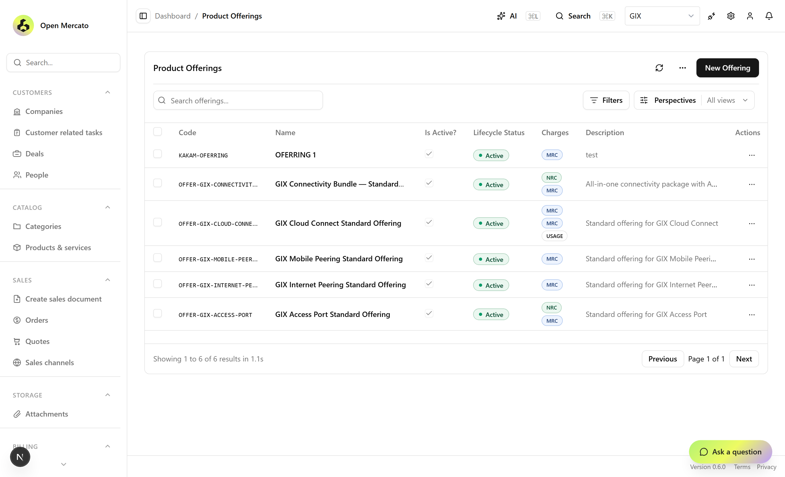
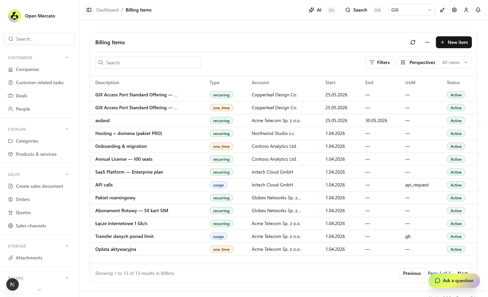
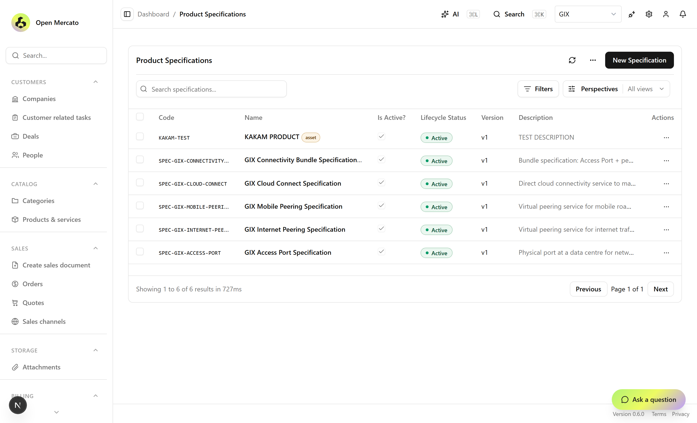
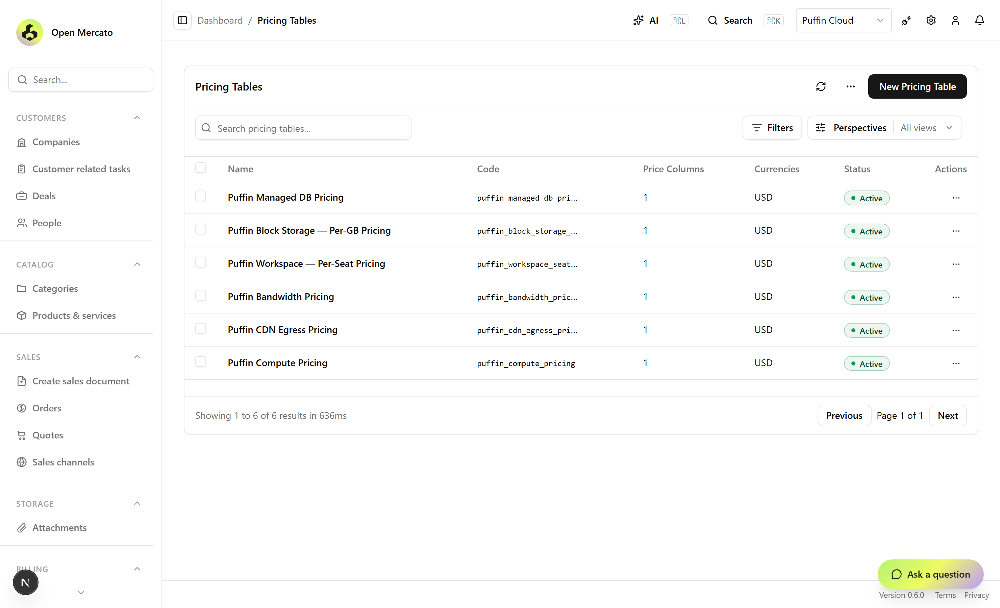
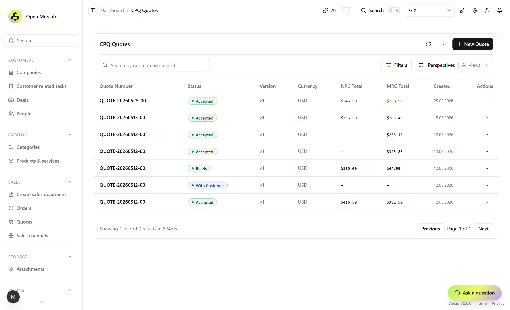
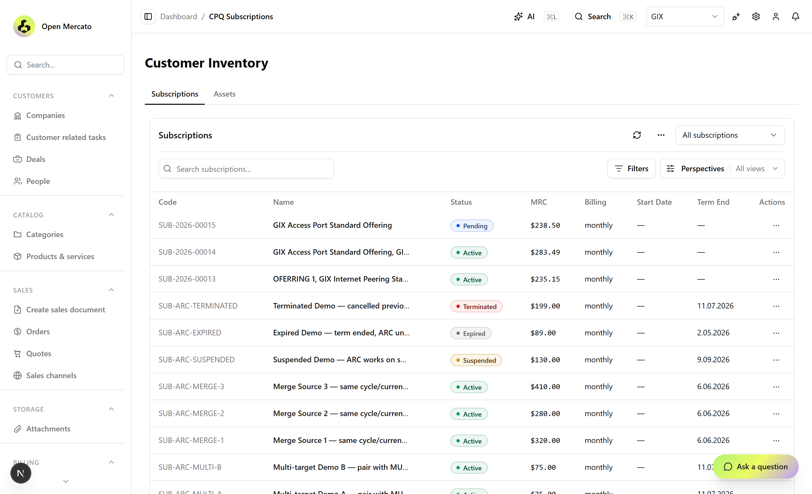
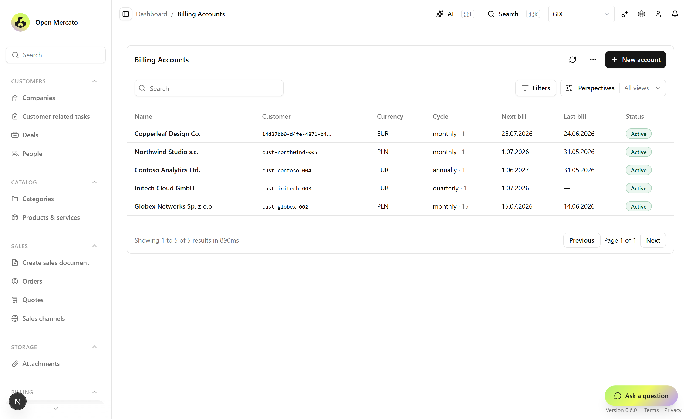
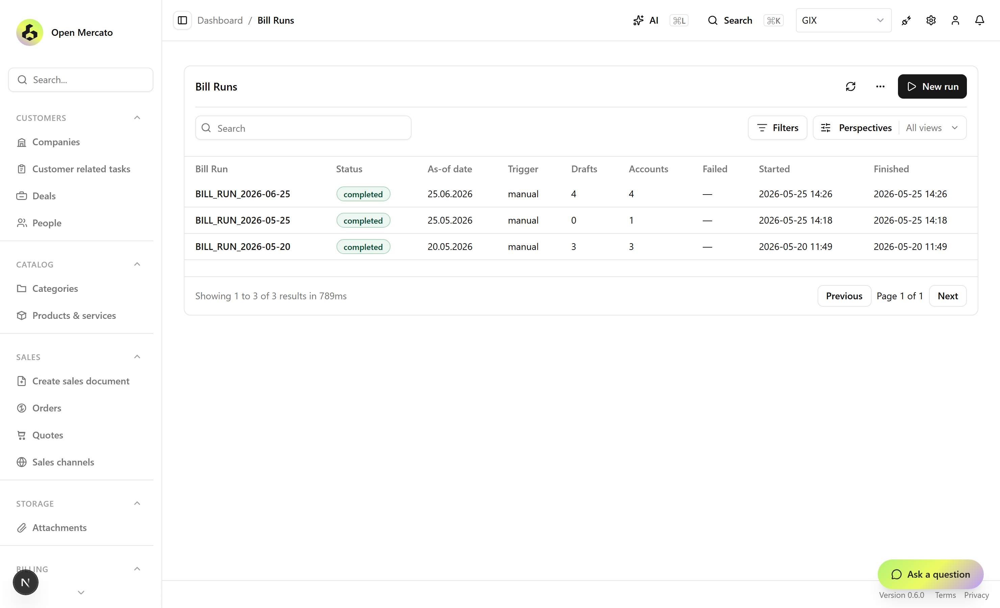
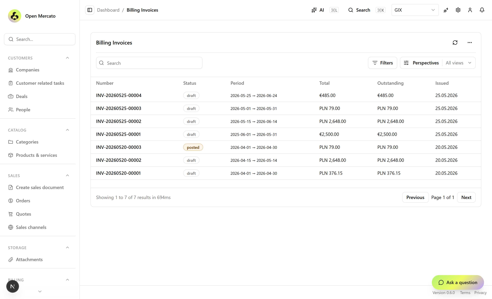

# Dainamite

Dainamite is an open-source **revenue management** framework for subscription businesses.

Start with a proven open-source foundation and build revenue management that fits your business. 
For you to own, with no per-seat tax.

- Website: [dainamite.com](https://dainamite.com)
- Powered by [Open Mercato](https://www.npmjs.com/org/open-mercato)

---

## Key Features

1. **Product catalog** - Products, SKUs, attributes and lifecycle, modelled the way your business actually thinks about its offering.

2. **CPQ - Configure-Price-Quote** - Configure complex offers, model real pricing, automate approvals, without acrobatic feats to fit a vendor’s data model.

3. **Order management** - Capture, fulfil, amend, without losing the audit trail or stitching three systems together.

4. **Subscription management** - Lifecycle, renewals, amendments and ARR tracking, for any commercial model your business can dream up.

5. **Billing** - Invoices, dunning, usage-based charges and revenue recognition, built into the same data model, not bolted onto it.

---

## How to start?

Follow [setup guide](https://dainamite.com/demo#how-to-start)

### Prerequisites

- Node ≥ 24 — enforced by the preinstall hook and `engines` field
- Yarn 4.17 — via Corepack (`corepack enable`; the version is pinned in `packageManager`)
- Docker — for Postgres, Redis, Meilisearch

### Setup

1. Bootstrap Open Mercato app and install dainamite packages

```bash
npx create-mercato-app your-revenue-mgmt-app
cd your-revenue-mgmt-app

docker compose up -d
cp .env.example .env

yarn add @dainamite/cpq @dainamite/billing @dainamite/cpq-billing-connector
```

2. EDIT `src.modules.ts` and register dainamite modules

```ts
export const enabledModules: ModuleEntry[] = [
  //{ id: 'attachments', from: '@open-mercato/core' },
  //{ id: 'catalog', from: '@open-mercato/core' },
  //{ id: 'sales', from: '@open-mercato/core' },

  // … core modules (incl. queue + events for billing). Make sure catalog, sales & attachment modules are enabled  …
  { id: 'cpq', from: '@dainamite/cpq' },
  { id: 'billing', from: '@dainamite/billing' },
  // MUST be after cpq + billing — its subscribers resolve both services.
  { id: 'cpq_billing_connector', from: '@dainamite/cpq-billing-connector' },
]
```

3. Finalize setup

```bash
yarn generate
yarn db:migrate
yarn initialize
yarn dev
```

4. The app will run locally on localhost:3000

---

## What is Open Mercato

[Open Mercato](https://www.openmercato.com/) is an open-source framework for CRM/ERP development following AI-assisted engineering approach. Open Mercato is built using Next.JS and can be deployed anywhere you want (Public/Private Cloud, On-Premise).

Dainamite leverages Open Mercato core modules and extends them with additional, domain specific packages: CPQ & Billing.

---

## Local development & contribution to Dainamite Core

You can run this monorepo locally & contribute to Dainamite Core. Fork repository and follow setup guide

### Prerequisites

- Node ≥ 24 — enforced by the preinstall hook and `engines` field
- Yarn 4.17 — via Corepack (`corepack enable`; the version is pinned in `packageManager`)
- Docker — for Postgres, Redis, Meilisearch

### Setup

```bash
docker compose up -d        # start Postgres / Redis / Meilisearch
yarn install                # install workspace deps
yarn build:packages         # build the @dainamite/* packages → packages/*/dist
yarn setup                  # generate + migrate DB + seed demo data, then starts the dev server
```

`yarn setup` (or `yarn setup --reinstall` to wipe and re-seed) ends by
starting the dev server on http://localhost:3000. Afterwards, `yarn dev` is all
you need to start it again.

`yarn build:packages` must run before `yarn setup`: generation and
initialisation resolve the `@dainamite/*` modules from their `dist/`. Without
it, the module registry and OpenAPI generation can't resolve the CPQ entities.

The seed provisions demo tenants (Acme, GIX, Puffin Cloud) with full CPQ
catalogs so you can explore quoting, pricing, inventory, and — once Billing is
wired — the Bill Run flow end-to-end. Default admin logins are printed in the
`yarn setup` banner.

`yarn build` is **not** part of local development. It produces a production
Next.js build (what the Dockerfile runs), and its type-check step needs a large
heap; the script sets `--max-old-space-size=8192` itself.

When you change package source under `packages/<pkg>/src`, rebuild that
package so the running app picks up the new `dist/`:

```bash
yarn workspace @dainamite/<pkg> build
```

---

## How is this Repository structured?

`dainamite-core` is the **Dainamite product monorepo** *and* the first
reference application built on it. It plays two roles at once:

1. **A publishable package workspace** under [`packages/`](packages/) — the
   `@dainamite/*` product modules that any Open Mercato app can install from
   npm.
2. **A runnable demo app** that consumes those packages exactly the way a
   customer app would, with seeded demo tenants (GIX network services, Puffin
   Cloud) to showcase the flows.

The relationship to Open Mercato follows a three-layer model:

| Layer | What | Where it lives |
|-------|------|----------------|
| **L1** | Open Mercato core framework (modules, DI, events, UI, ORM glue) | `@open-mercato/*` on npm — a peer dependency |
| **L2** | Dainamite product modules (CPQ, Billing, connector) | `@dainamite/*`, published from [`packages/`](packages/) |
| **L3** | Customer applications | `dainamite-core` is the first; new customer repos `yarn add` the L2 packages |

---

## The `@dainamite/*` packages

| Package | Version | Status | What it adds |
|---------|---------|--------|--------------|
| [`@dainamite/cpq`](packages/cpq) | `0.2.x` | ✅ Published (public npm) | Configure-Price-Quote engine |
| [`@dainamite/billing`](packages/billing) | `0.17.x` | 🔜 Publishing soon | Recurring-billing engine (Bill Runs → draft invoices) |
| [`@dainamite/cpq-billing-connector`](packages/cpq-billing-connector) | `0.1.x` | 🔜 Publishing soon | Event bridge: CPQ subscription lifecycle → Billing |

All three are **Open Mercato modules**: self-contained folders that the
framework auto-discovers by filename convention (`index.ts` metadata, `di.ts`,
`acl.ts`, `setup.ts`, `data/entities.ts`, `api/`, `backend/`, `subscribers/`,
`workers/`, `events.ts`). You enable them by listing them in your app's
`src/modules.ts`; the framework wires DI, routes, migrations, ACL, and the
admin UI automatically.

### `@dainamite/cpq` — Configure, Price, Quote

The core selling engine.



- **Products** — product specifications, sellable offerings, configurable
  attributes (design-time vs run-time), and bundled offerings with slots.
- **Pricing** — multi-charge pricing tables, tiered/volume pricing, and
  composable price rules (`discount_percent`, `discount_absolute`,
  `surcharge_*`, `price_override`).
- **Quoting** — guided quote wizards, a configurator, and a calculate-price
  API.
- **Customer inventory** — subscriptions, subscription items, and assets that
  survive after a quote is converted to an order.
- **ARC** — Amend / Renew / Cancel flows against live subscriptions.
- **Orders** — quote → order → activation pipeline.

#### Feature matrix

| Area | Capabilities |
|------|--------------|
| **Products** | Product specifications; sellable offerings (discrete & single-offering); product/offering lifecycle status |
| **Attributes** | Design-time vs run-time attributes; select / text / number types; defaults, help text, required flags; reference attributes with filtered options; attribute dependencies (`dependsOn` — filter options / apply constraints) |
| **Bundles** | Bundled offerings with slots (min/max per slot) and components; bundle-tree resolution |
| **Relationships** | Cross-offering relationships & constraints; relationship validation on quote lines |
| **Pricing** | Multi-charge model (recurring `MRC` / one-time `NRC` / `usage`); pricing tables (single & multi-dimensional); tiered / volume (range) pricing |
| **Price rules** | `discount_percent`, `discount_absolute`, `surcharge_percent`, `surcharge_absolute`, `price_override`; priority-ordered, conditionally applicable |
| **Pricing I/O** | XLSX import / export of pricing tables; calculate-price API (`/api/cpq/quotes/price`) |
| **Quoting** | Quotes & line items; guided multi-step wizards + configurator; clone & recalculate; quote status state machine |
| **Customer inventory** | Subscriptions & subscription items; assets + asset status; expiring-soon / renewal-watch picker; per-subscription change log |
| **ARC** | Amend / Renew / Cancel live subscriptions via quote; merge-renewal (supersede sources); proration + audited change log |
| **Orders** | Quote → order conversion; order activation (provisions inventory, emits lifecycle events); order status state machine |

CPQ piggybacks on Open Mercato `sales` for quote/order **headers** — it never
mutates `sales_*` rows directly; it goes through the sales service or emits
domain events.

**Required Open Mercato modules** (declared in `metadata.requires`, the app
will fail to bootstrap without them):
`auth`, `directory`, `catalog`, `sales`, `customers`, `dictionaries`.

### `@dainamite/billing` — Recurring billing

A lightweight billing engine that does **not** replace your accounting system
— it prepares billing data and hands draft invoices to a human for approval.



- Collects **Billing Items** to charge (`one_time`, `recurring`, `usage`).
- Runs a scheduled **Bill Run** (a background worker) that calculates totals
  and produces **draft invoices in Open Mercato `sales`**.
- Usage rating for metered items; idempotent, tenant-locked runs.
- Full admin UI: Billing Accounts, Items, Bill Runs, and Invoices (with a
  human-approval "post" step before an invoice leaves draft).

#### Feature matrix

| Area | Capabilities |
|------|--------------|
| **Accounts** | Billing Accounts per customer; account-scoped billing windows |
| **Items** | Billing Items typed `one_time` / `recurring` / `usage`, each with a bill start/end window |
| **Bill Runs** | Scheduled (worker) and on-demand runs; **dry-run** preview; idempotent & tenant-locked; stale-run reaping worker |
| **Usage** | Usage ingestion API; usage rating at run time for metered items |
| **Invoices** | Draft invoices written into `@open-mercato/core/sales`; draft edits; human-approval **post** step (guarded ACL action) |
| **Admin UI** | List + detail pages for Accounts, Items, Bill Runs, Invoices under `/backend/billing/*` |
| **ACL** | `billing.{account,item,invoice,run,usage}.*` — incl. `run.dry_run` / `run.trigger`, `invoice.edit_draft` / `invoice.post`, `usage.ingest` |

**Required Open Mercato modules**: `sales`, plus `@open-mercato/queue` for the
Bill Run worker and `@open-mercato/events` for lifecycle events.

### `@dainamite/cpq-billing-connector` — the glue

A pre-built integration so you don't write the CPQ↔Billing wiring yourself. It
subscribes to six CPQ lifecycle events on the Open Mercato **event bus** and
translates each into Billing API calls:

| CPQ event | Connector action |
|-----------|------------------|
| `cpq.subscription.activated` | Create Billing Account if missing; create Billing Items per charge (one-time + recurring split) |
| `cpq.subscription.amended` | Add Items for new lines; post proration for the partial cycle; end-date removed items |
| `cpq.subscription.renewed` | Extend `bill_end_date`; add Items for new lines |
| `cpq.subscription.cancelled` | Set `bill_end_date` on all Items for the subscription |
| `cpq.subscription.merged` | Re-point Items from source subscriptions to the merged one |
| `cpq.subscription.superseded` | Set `bill_end_date` on all Items for the superseded subscription |

It depends on both `@dainamite/cpq` and `@dainamite/billing` (as peers) and
**must be registered after both** so their services are available when its
subscribers fire.

---

## Screenshots

Captured from the seeded demo app (GIX network-services and Puffin Cloud
tenants).

### CPQ

| Specifications | Pricing tables |
|---|---|
|  |  |

| Quotes | Customer inventory (subscriptions) |
|---|---|
|  |  |

### Billing

| Accounts | Bill Runs |
|---|---|
|  |  |

| Draft invoices |
|---|
|  |

> Regenerate these with `node scripts/capture-readme-screenshots.mjs` against a
> running dev server (`yarn dev`) and a seeded DB.

---

## License

The `@dainamite/*` packages are released under the **MIT** license. See each
package's `package.json` and `LICENSE`.
